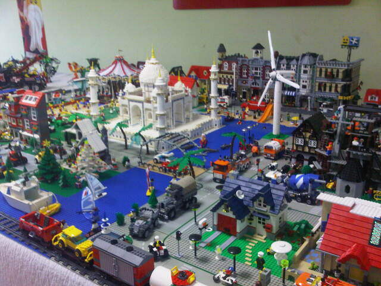
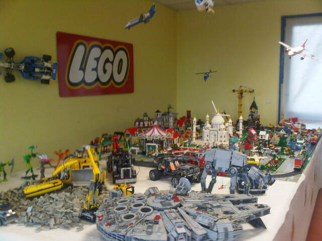

Bonjour, je m’appelle Gwen, je suis nouveau chez vous, mais je cherchais à franchir le pas depuis quelques temps. Je vais tâcher de me présenter en quelques lignes, et de vous définir pourquoi les LEGO m’accompagnent depuis toujours.

J’ai 35 ans, et pour autant que je m’en souvienne, je n’ai pas passé plus de 10 jours sans jouer à ces chères briques. A partir de 5 - 10 ans, j’avais toujours un sac de LEGO pour mes vacances, idem pour mes études en internat, j’en ai actuellement au bureau. Je pense sincèrement qu’en dehors du coté ludique et éducatif, les LEGO m’ont permis de m’évader dans un monde où non seulement tout est possible, mais surtout tout se modifie, se détruit ou se conserve, suivant vos humeurs, et vos envies. Combien de fois ai-je trouvé quiétude auprès des briques après une contrariété, ou un chagrin.

Les LEGO offrent cette magie de réunir des gens qui ont gardé cette part de gamin en eux, qui font qu’ils peuvent  
continuer à jouer avec fierté. Il est courant pour nous AFOL d’être traité de gamin, alors qu’un collectionneur de petit train passe pour un passionné.

Je suis assez fier d’avoir donné le virus à mon fils de 9 ans et à ma fille d’1 an, et j’espère qu’ils seront autant passionnés que moi pour les LEGO ou un autre jouet, cette part de nous que l’on déterre pour se donner la banane de temps en temps.

Voila, que dire de plus, à part que j’ai un site, si vous voulez jetez un oeil : [gwelego.com](https://www.freelug.org/gwelego.com)

Pour finir, merci de m’accueillir parmi vous, où je vous avoue, je me sens moins seul.

_Gwen_
