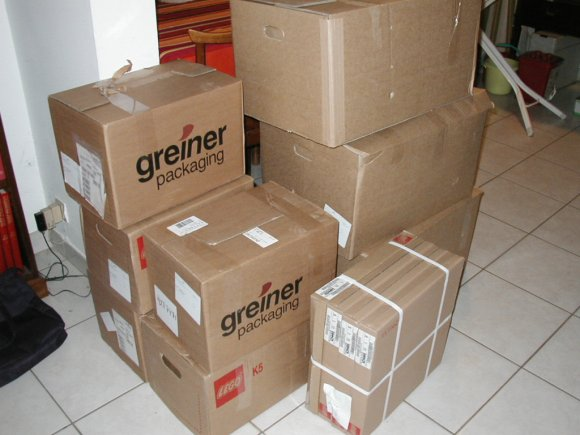
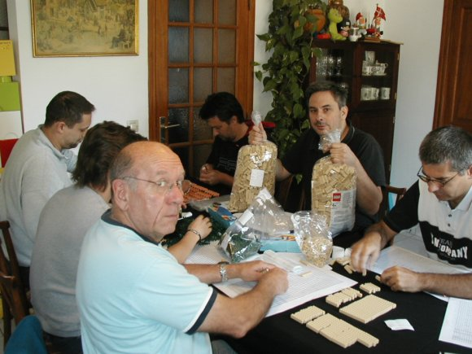
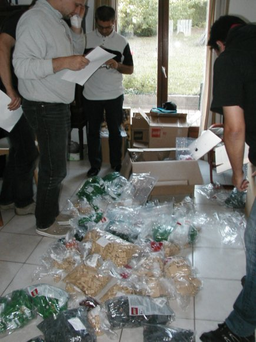
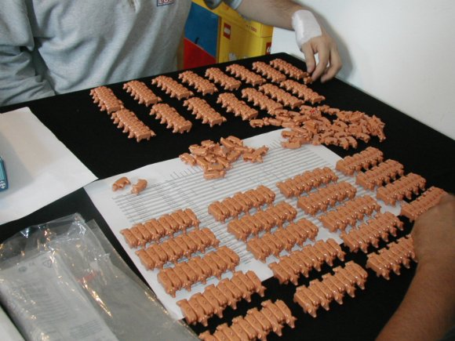

Le LUGBULK est une opération de vente de briques en grosse quantité par LEGO à destination des LUGs, groupes de passionnés LEGO répondant à certains critères de sélection. FreeLUG y participe pour la seconde fois.

Suite au succès de la [première commande](/articles/lugbulk-de-fevrier-2010/), nous avons remis ça. La commande, passée fin juin, a été reçue mi-septembre.

Cette fois-ci, les 31 participants ont jeté leur dévolu majoritairement sur les plaques de base, qui sont à un prix défiant toute concurrence.

Nous avions 3 gros cartons de briques, et 5 cartons exclusivement de plaques de base.

**115 kilos de LEGO à trier**

Nous nous sommes retrouvés à sept un samedi après-midi pour le tri.

Il nous fallu plus de quatre heures pour trier toutes les briques, et surtout les recompter, car _a contrario_ de la première commande, celle-ci contenait un certain nombre d’erreurs sur les quantités :(

Une fois toutes les briques mises en sachet, il restait à les répartir selon les commandes de chacun.

La journée s’est achevée autour d’une table dans un restaurant.

Les commandes seront remises pour la quasi totalité en main propre dans les deux mois qui viennent lors de nos différentes expositions, l’avantage d’un réseau national actif ! D’ici là, nous aurons probablement reçu de la part de LEGO les briques manquantes...

**Tout est bon dans le cochon**

Sauf le compte :)

## Le mot de Gilles

Le tri même bien organisé c’est long ;-), mais toujours un plaisir de le faire car on n’arrive à raconter pas mal de bêtises et on a toujours des choses à dire...

Même si je n’ai pas participé au premier tri, le deuxième d’après ce que j’ai compris était plus compliqué. Mais à mon avis moins que le prochain, succès oblige.

Heureusement que tout le monde n’a pas commandé 500 briques 1x1... Les plaques de base, cela se compte beaucoup plus rapidement.

J’attends quand même le suivant avec impatience.

Retour à la maison à 01h30 du matin, restaurant oblige.

Merci aux parents d’Erik pour l’accueil, et le stockage du bulk et du reste.

[Quelques photos supplémentaires](http://photos.freelug.org/main.php/v/FreeLUG/Promotions_speciales/lugbulk2010_06/)
