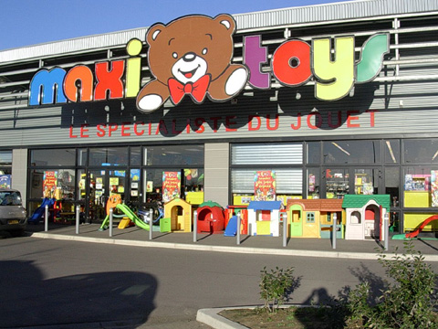
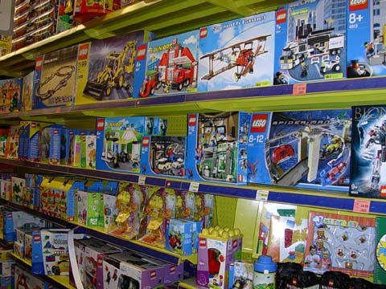
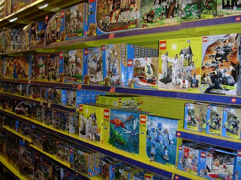
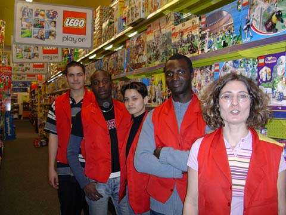

Le magasin Maxi Toys de Brétigny fait partie de cette chaine Belge de grandes surfaces dédiées au jouet et qui comporte, à ce jour, environ une centaine de points de vente en France. Pour en savoir plus cliquez ici -> : [Maxi Toys](http://www.maxitoys.com/).

## Infos pratiques

Le magasin Maxi Toys de Brétigny est situé dans la zone d’activité de Maison Neuve dans l’essonne à 30mn au sud de Paris.

**Vue générale du magasin**

Pour y accéder :  
**–** Il faut prendre la Francillienne (N104) et sortir entre Evry et Montlhéry à la sortie indiquée _ZI de Brétigny_.  
**–** Prendre ensuite la D19 en direction d’Arpajon, passer devant le Centre d’Essais en Vol.  
**–** En arrivant au rond point où se trouve le centre commercial Auchan, il faut touner à droite.  
**–** Passer devant le centre commercial et continuer tout droit après le rond point.  
**–** Passer entre les restaurants Quick et Mc Donalds et au deuxième rond point, prendre la rue la plus à gauche.  
**–** L’entrée du parking se situe sur la droite après quelques dizaines de mètres.

Le magasin est ouvert tous les jours :  
**–** Les Lundi, Mardi, Jeudi et Vendredi de 10h à 12h30 et de 14h à 19h.  
**–** Les Mercredi et Samedi, sans interruption de 10h à 19h.  
**–** Le Dimanche de 14h à 19h.

Merci de vous référer au site officiel de [Maxi Toys](http://www.maxitoys.com/) pour prendre connaissance des coordonnées officielles (téléphone et fax) de ce point de vente.

Adresse postale :  
**–** Maxi Toys - ZAC Maison Neuve - 91220 BRETIGNY S/ORGE

## Le rayon des jeux LEGO®

Le rayon des jeux LEGO® comporte une bonne partie de la gamme. Les approvisionnements s’effectuent en fonction des mises à disposition des produits en Belgique. Ceci offre comme particularité intéressante de pouvoir bénéficier, parfois, de la sortie des nouveautés, en avance par rapport aux autres chaines de distribution françaises.

**Le rayon (vue 1)**

A signaler que ce point de vente offre également quelques opportunités en modèles exclusifs, comme le Sopwith Camel, quelques modèles de la gamme "My own train" et la Forteresse du Faucon noir.

**Le rayon (vue 2)**

## L’équipe commerciale

L’équipe commerciale dirigée par Valérie est une équipe jeune et sympathique qui nous a vite affublé du surnom de "Messieurs LEGO®" lorsque nous avons commencé à nous faire connaître.

Certains semblent porter en bonne estime les produits de la concurrence, mais nous savons leur rappeler que seule la qualité nous intéresse ! Si, si, il n’y a pas à discuter, les FreeLUGiens sont animés par une passion exclusive.

**L’équipe commerciale**

L’équipe de gauche à droite : Nicolas, Judicaël, Magalie, William et Valérie.

## Les dispositions particulières

L’équipe réserve aux adhérents munis de leur carte en cours de validité, des conditions préférentielles (-10% sur les jeux LEGO®) et offre également à l’ensemble des clients la possibilité de pouvoir commander les produits dans les stocks disponibles des autres magasins de la chaîne.

N’hésitez pas à parcourir les différents rayons. Le statut "enseigne Belge" du magasin, réserve quelques surprises sur des produits parfois peu présents en France.

Pour nos membres de province, il n’est malheureusement pas prévu de faire de la vente par correspondance. Profitez de nos rencontres lors des expos pour passer commandes auprès des Parisiens, ou prenez contact avec votre revendeur préféré pour lui demander s’il est prêt lui aussi à devenir Partenaire de FreeLUG.
