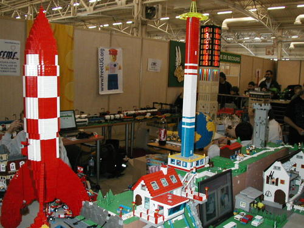
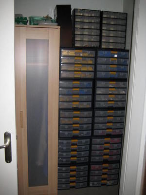
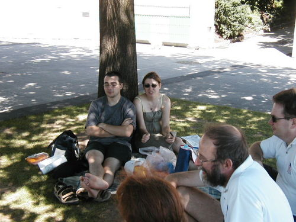

Moi et mes LEGO.

Tout a commencé il y a environ 3 ou 4 ans au salon de maquette et du modèle réduit. A cette époque je faisais du modélisme thermique radiocommandé (pour les connaisseurs, du TT1/8 en loisir).

Au salon, il y avait le stand FreeLUG avec la fusée de Tintin, la terre et autres choses - enfin bref, des LEGO partout. C’est là que je suis retombé en enfance, je suis venu deux jours de suite au salon pour voir les LEGO et autre modélisme.

Quelques jours plus tard, je vais chez mes parents pour un repas en famille et pendant le repas je demande si on a encore mes LEGO à la maison ? Réponse : "possible" - mais on ne sait pas où ils sont rangés. Dans la semaine qui suit, je passe une journée pour les retrouver et après une demi-journée de recherches, je les trouve ainsi que ceux de mon frère - je les prends tous.

De retour à Paris, comme ma "collection" était petite, je n’ai pas eu de problèmes, même si à l’époque je n’avais qu’un studio de 32m² en location. La plupart de mes LEGO sont de l’époque 1988 à 1994, j’ai donc un peu de tout : Fabuland, City, espace, Technic - le dernier set LEGO que j’ai eu était [la grue Technic rouge](http://www.bricklink.com/catalogItem.asp?S=8854-1).

Après avoir nettoyé et trié mes pièces LEGO, je décide de remonter des modèles. Et c’est là que commence le parcours : sur quelques sets, je m’aperçois que j’ai perdu des pièces ou quelles sont trop abimées.

Comme à l’époque je ne savais pas encore que Bricklink existait, je faisais mes achats de pièces sur Ebay, le plus souvent par lots de 10kg, à des prix variant entre 8 et 14 euros le kilo. J’achetais aussi des sets que je n’avais pas eu dans ma jeunesse (set de 150 à 300 euros).

A force d’acheter des LEGO, je devais stocker et trier toujours plus. Parfois je remontais les sets inclus dans les lots de pièces. Au bout d’un an et demi, j’avais une belle collection de LEGO m’obligeant à trier avec plusieurs systèmes de stockage. A chaque fois, le même problème se présentait : soit trop petit, soit trop grand. ([Voir photo stockage](http://photos.freelug.org/main.php/v/Tof92/Stockage/)).

L’année suivante de la découverte de FreeLUG, je me suis enfin inscrit sur la liste d’information de l’association. Je suis repassé au salon l’année suivante pour aller directement voir le stand FreeLUG, toujours avec des yeux d’enfants (ceux qu’on a quand on ouvre une boîte LEGO).

Puis un jour, sur la liste générale, tombe une invitation pour un pique-nique dans le parc André Citroën à Paris. C’est à cette occasion que je fais la connaissance de Qdm (Didier) avec sa famille, de Brickerik (Erik), de Gyclore (Manu) avec sa famille, de Philo avec sa femme et d’un autre fan de LEGO. Tous avaient amené une création (sauf moi) que j’ai pu apprécier, dont [la fourmi, la fusée et le ventilateur](http://photos.freelug.org/main.php/v/FreeLUG/Evennements/PiqueNique2007/).

Ce fut ma première sortie LEGO et une première rencontre avec des fans de LEGO. Dans le mois qui suivait cette rencontre, je m’inscrit comme adhérent à l’association et un jour je reçois ma convocation pour l’AG. Entre temps, je discute sur le tchat avec des fans de la France voire même de l’étranger (MrDJ était encore au Canada mais il était en préparation de cartons).

Pour l’AG, je suis venu avec Brice alias bricegrue et ma copine. Le premier soir j’avais un mal de tête avec tous ces résumés de fonctionnement de l’AG mais au moins on nous explique le fonctionnement et comment ça marche.

Et pour ce premier jour, je rencontre d’autres fans venus de la France (PZ, Pierrelego, Tribolego, SixStudS, LeGnome, Frogleap etc.).

Je vois de beaux LEGO, le train de Nicolas, le réseau de DCC de Philippe, le garage de trains d’un autre Nicolas, l’ouvrier avec le marteau piqueur automatique (vive le RCX), la mini pelleteuse, la cimenterie, enfin plein de constructions personnelles.

Pour cette première, j’en avais plein dans la tête. Je n’ai pas trop parlé, je suis resté à l’écoute des professionnels du LEGO (les cours de nouveautés et les explications de fonctionnement des nouveautés PFS comme les leds etc., et du DCC mais ça, c’était le deuxième jour).

Ce qui était bien, c’est aussi le matin du dimanche au magasin Pic-Wic, le moment d’achats LEGO tous en commun. Voir 30 personnes qui sont devant le rayon LEGO et qui ne savent pas quoi trop acheter. Pour ma part, j’ai pris un LEGO mais je ne sais plus le set.

Entre temps j’ai déménagé pour acheter un F2, un 42m², mais je n’avais pas pensé à mes LEGO lors de cet achat de mon appartement donc je manque toujours de place mais je suis sur un projet de mezzanine.

Il a y eu le [week-end dans le Gard](/articles/resume-du-week-end-dans-le-gard-des-6-et-7-septembre-2008/) où notre ami PZ a su nous accueillir comme il le fallait avec humour, divertissements et autres rigolades.

C’est là que j’ai rencontré Mr 1001brick notre serviteur LEGO. En quelques mots, sympathique, blagueur, serviable, donne de bons conseils et très bon prof pour le cours de préparation d’une commande et la remise en main propre.

Pour ma copine et moi, nous avons passé un bon week-end.  
Peut être qu’on pourrait faire ça avec la REF avec une région différente : à chaque fois, visiter du pays et monuments (Dit PZ, tu fais le pont du Gard pour l’AG 2009 ?).

Pour la partie stockage, je stockais dans le séjour, la chambre et la cuisine et puis un jour ma copine est venue avec ses meubles donc il a fallu trouver une solution.  
Location d’un box 5m² à 10km aller-retour à 150 euros par mois pendant 3 mois et entre temps j’ai trouvé un box dans ma résidence à 90 euros pour 12m² dans le sous-sol, le temps de trouver une autre solution (en cours de recherche) à cause de la poussière et des gaz d’échappement.

Dans ma résidence, j’ai une cave d’environ 3m² qui va me servir de pièces de stockage de pièces LEGO.

Sinon le sondage, pour vous donner une idée de mes achats.  
J’achète aussi bien du neuf, les nouveautés, les promos (+ de 3000 euros à l’été 2008 en promo), des occasions (brocante et Ebay). Ebay c’est pour des modèles bien spécifiques (réf) ou des lots à de bons prix (chose rare), et les brocantes pour des LEGO à de bons prix en général. Mon budget pour les brocantes peut aller à plus de 100 euros mais pour l’instant j’en fais moins de 5 en 1 an.

Mais je pense arrêter les brocantes et achats sur Ebay et me concentrer sur les promos des LEGO (comme les 21 barils de 1800 pièces XXL à 9,90 le baril).

Et peut être refaire ma collection d’enfance en LEGO neufs (pour les pièces qui ne seront pas neuves ça sera de l’usé) et me lancer dans les constructions de mocs qui me plaisent comme la [locomotive d’Alain](/articles/moc-locomotive-cc-6500-rc-3eme-et-derniere-partie/).

Je vous dit à bientôt pour l’AG ou autres manifestations et "légotez" bien et "moc’ez" encore, il y a des bons "moc’oeur".
