9 participants ont relevé le challenge de la mosaïque mais 7 seulement seront jugés car les 2 autres participations étaient hors règlement. Il est temps de découvrir ces jolis tableaux. N’hésitez pas à prendre du recul... beaucoup de recul pour admirer ces minis mosaïques.

Vous pouvez retrouver le [règlement de ce concours ici](https://www.freelug.org/spip.php?article3107).

Tout d’abord, nous tenons à remercier les 9 participants qui nous ont proposé de très belles réalisations.

Les participations sont présentées dans l’ordre de réception.

**01 - Caty et Pierre (Ecrou Papillon) - Egaliseur : affichage du spectre**

[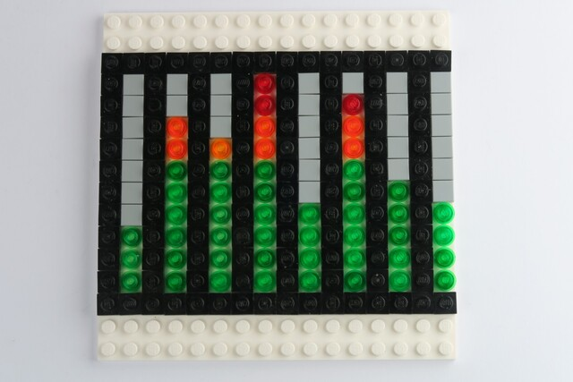](https://www.freelug.org/IMG/jpg/cp-01_grand_-2.jpg)

[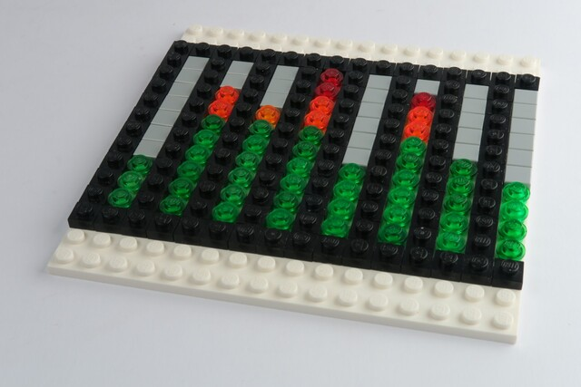](https://www.freelug.org/IMG/jpg/cp-02_grand_-2.jpg)

* * *

**02 - Laurent C. - David Bowie - Aladdin Sane**

[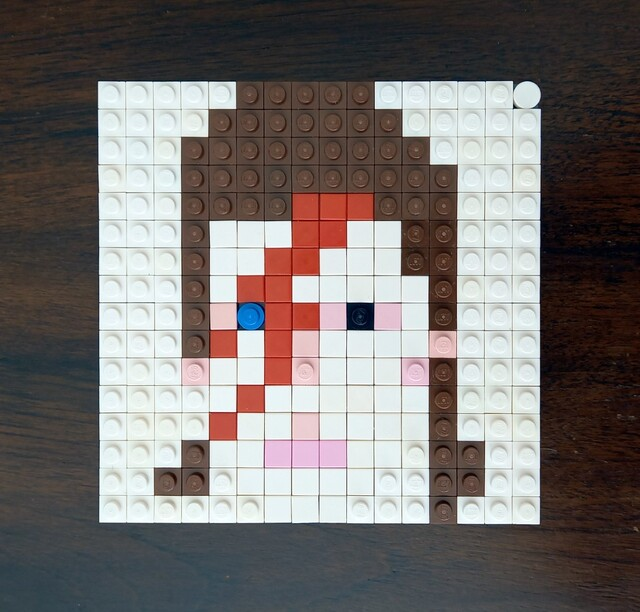](https://www.freelug.org/IMG/jpg/lc-01_grand_.jpg)

[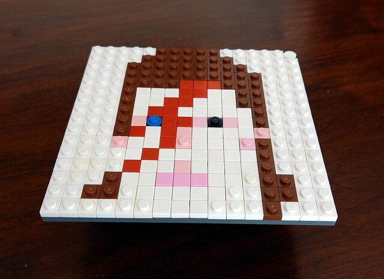](https://www.freelug.org/IMG/jpg/lc-02_grand_.jpg)

* * *

**03 - Xavier D. - Tête de Guitare a accorder les yeux dans les yeux**

[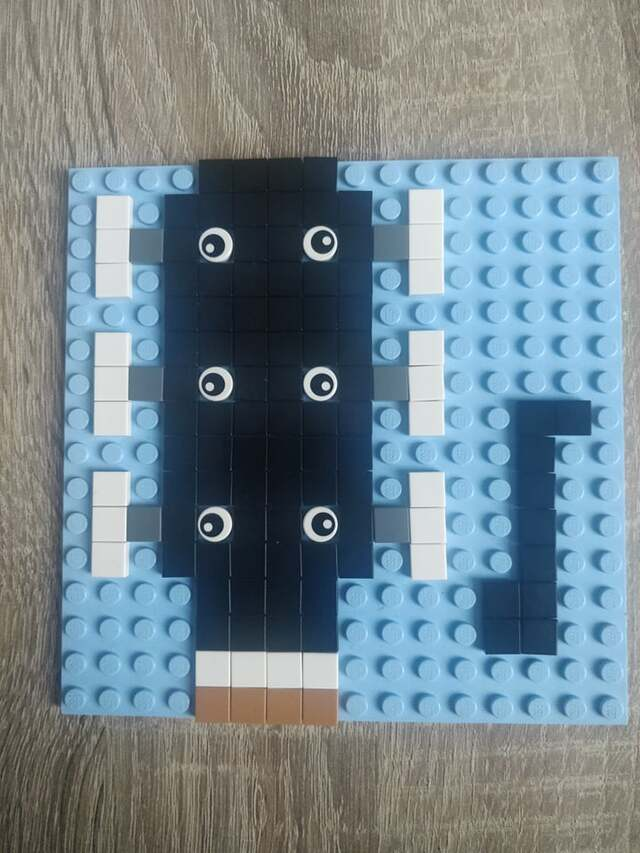](https://www.freelug.org/IMG/jpg/xd-01-3.jpg)

[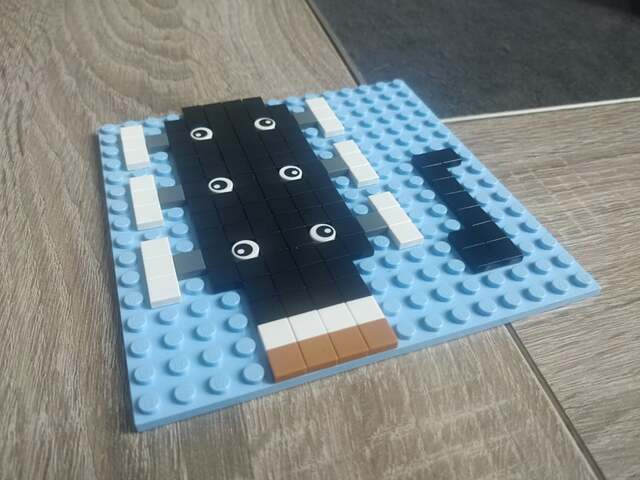](https://www.freelug.org/IMG/jpg/xd-02-2.jpg)

* * *

**04 - Christophe M - Hommage a Nirvana !**

[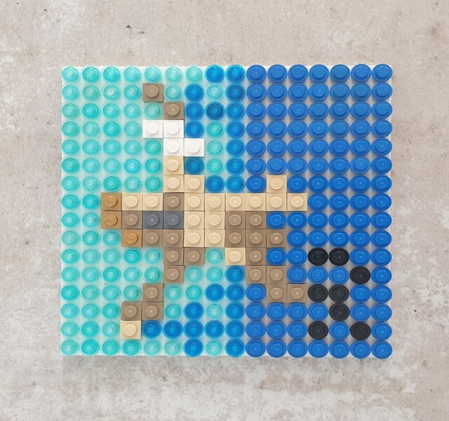](https://www.freelug.org/IMG/jpg/cm-01_grand_.jpg)

[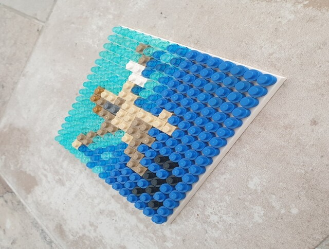](https://www.freelug.org/IMG/jpg/cm-02_grand_.jpg)

* * *

**05 - Landry G - Quatre, trois, deux, un, je joue avec mes briques**

[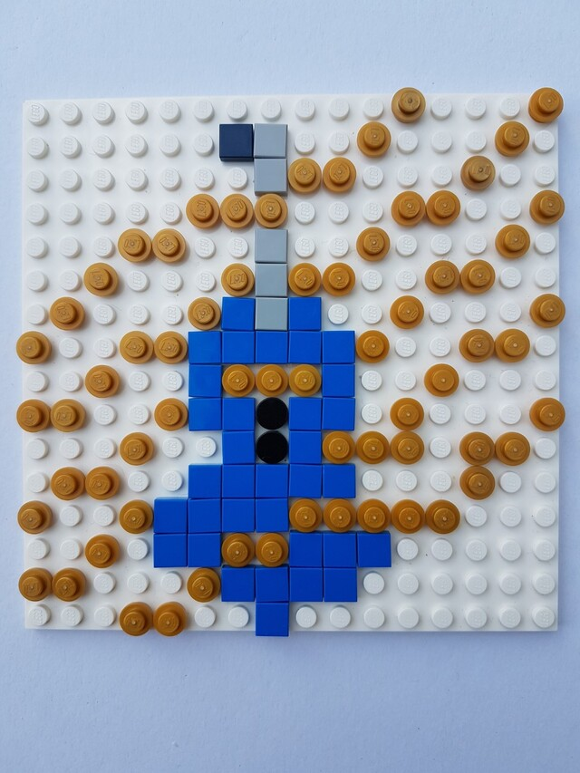](https://www.freelug.org/IMG/jpg/lg-01_grand_.jpg)

[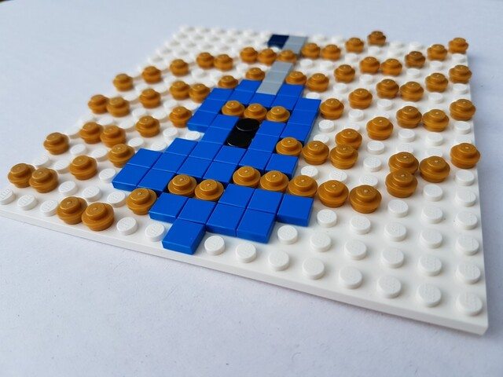](https://www.freelug.org/IMG/jpg/lg-02_grand_.jpg)

* * *

**06 - Amine R. - Surfons sur les notes de musique**

[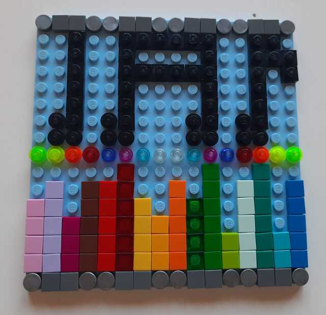](https://www.freelug.org/IMG/jpg/ar-01-3.jpg)

[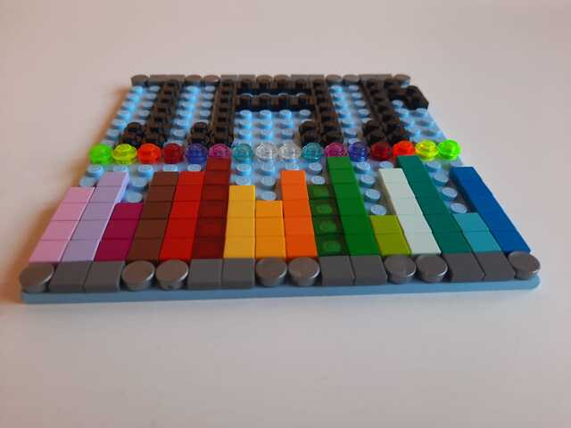](https://www.freelug.org/IMG/jpg/ar-02-2.jpg)

* * *

**07 - Coralie G. - 21 Juin**

[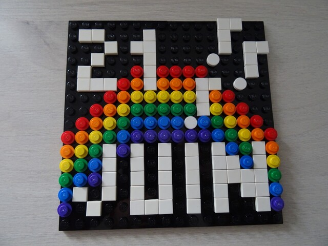](https://www.freelug.org/IMG/jpg/cg-01_grand_-3.jpg)

[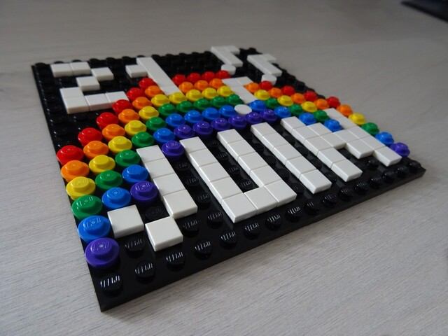](https://www.freelug.org/IMG/jpg/cg-02_grand_-2.jpg)

* * *

Et juste parce qu’ils ont pris le temps de participer, même si cela ne rentre pas dans le règlement du concours, rien n’empêche d’admirer les propositions de :

**Charles F. - Lecteur MP4 Friends**

[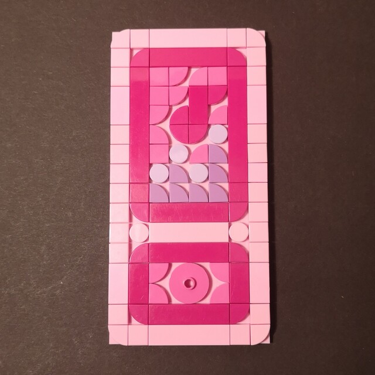](https://www.freelug.org/IMG/jpg/cf-01.jpg)

[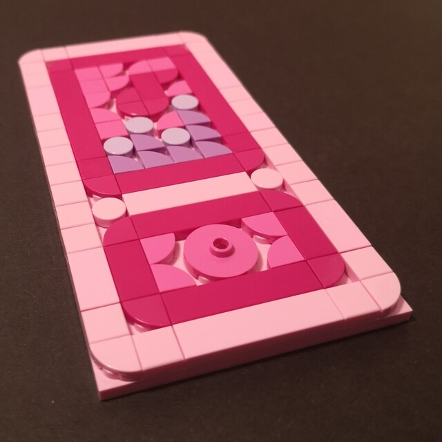](https://www.freelug.org/IMG/jpg/cf-02.jpg)

* * *

**Camille V. - Pink Floyd - Dark Side of the Moon**

[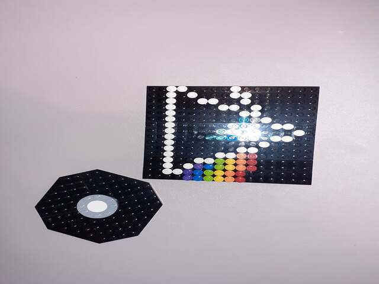](https://www.freelug.org/IMG/jpg/cv-01.jpg)

[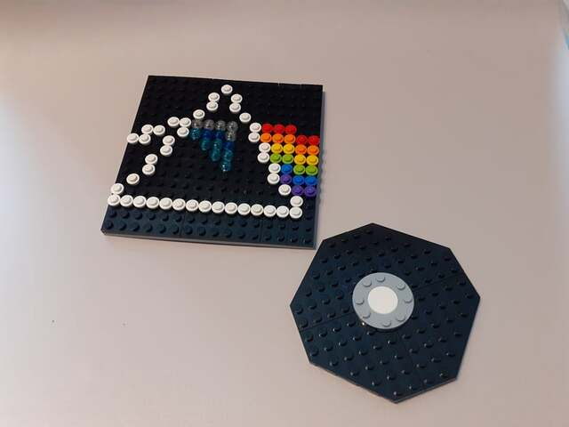](https://www.freelug.org/IMG/jpg/cv-02.jpg)

* * *

Les heureux gagnants de ce concours, (car une fois n’est pas coutume, nous avons 2 exæquo) sont **02 - Laurent C. - David Bowie - Aladdin Sane** et **07 - Coralie G. - 21 Juin** qui remportent chacun un set LEGO **Ref 41914 - Dots Creative Picture Frames**

Classement :  
1\. Laurent C. - Coralie G. (3 pts)  
2\. Xavier D. - Amine R. (2 pts)  
3\. Christophe M. (1 pt)  
4\. Caty et Pierre (Ecrou Papillon) - Landry G. (0 pt)

Composition du jury :  
**–** Mathieu W. (GFC)  
**–** Pierre C. (Tribolego) (GFC)  
**–** Jérôme V.  
**–** Duy Hai D.  
**–** Gaultier O-G.  
**–** Nicolas W.  
**–** Christophe (Timivox)  
**–** Ève-Elise J.  
**–** Maxime D.  
**–** Stéphane P.  
**–** Cyriac F.

* * *

**Merci à toutes et tous et à bientôt pour un nouveau concours !**
