Six participants ont chassé le lapin de Pâques, il est temps de découvrir leurs créations toutes plus extraordinaires les unes que les autres.

Vous pouvez retrouver le [règlement de ce concours ici](https://www.freelug.org/spip.php?article3092).

Tout d’abord, nous tenons à remercier les 6 participants qui nous ont proposé de très belles réalisations.

Les participations sont présentées dans l’ordre de réception.

**01 - Xavier D. - Pasquinou, la Fashion Victime**

Une fois par an Pasquinou ou Pâquinou en écriture moderne (oui c’est le petit nom de notre cher Lapin de Pâques et oui les accents circonflexes remplacent souvent les "s" disparu avec le temps... mais revenons à notre histoire) Pasquinou est content ! C’est pâques, il a le plaisir de décorer et de planquer des œufs dans les jardins.  
Mais ce qui le rend vraiment heureux de chez heureux ! C’est de pouvoir remplir sa superbe collection de Sac à Main pour faire la distribution !!!

[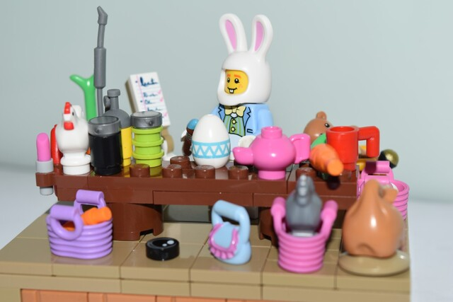](https://www.freelug.org/IMG/jpg/xd-01_grand_-3.jpg)

[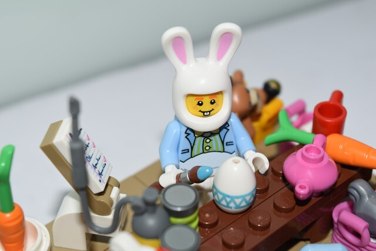](https://www.freelug.org/IMG/jpg/xd-02_grand_-2.jpg)

[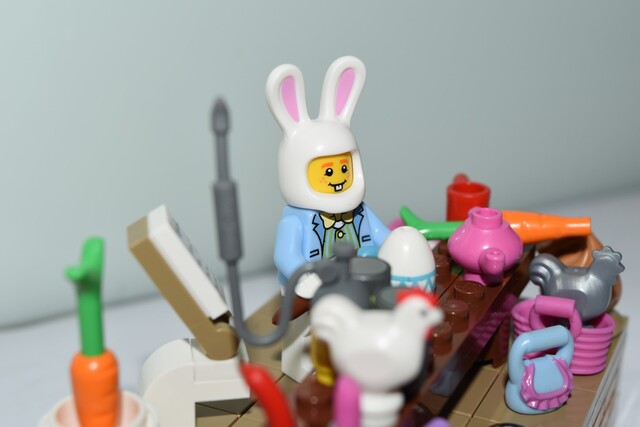](https://www.freelug.org/IMG/jpg/xd-03_grand_-2.jpg)

[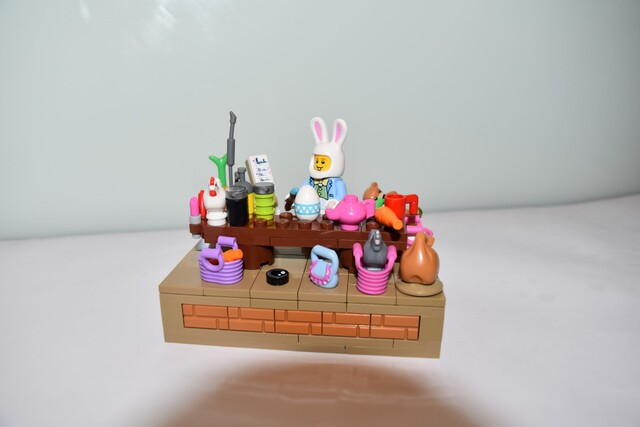](https://www.freelug.org/IMG/jpg/xd-04_grand_.jpg)

[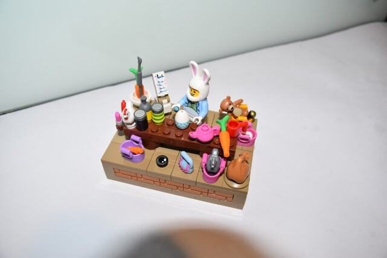](https://www.freelug.org/IMG/jpg/xd-05_grand_.jpg)

* * *

**02 - Sylvain J. - Les lapins farceurs de Pâques**

Un détective du dimanche est à la recherche d’œufs en ce week-end de Pâques. Malheureusement pour lui, il est tombé sans le savoir sur un secteur contrôlé par deux lapins farceurs qui l’observent et le surveillent…  
Les deux compères ont été les plus rapides et ont déjà récupéré tous les œufs qu’ils ont remplacés par de minuscules œufs difficiles à trouver, et de toute façon non comestibles…  
Leur espièglerie ne s’arrête pas là puisqu’ils ont également disposé un gros œuf pile au-dessus des plus petits et qui menace de tomber sur le pauvre détective !  
Un dimanche de Pâques à oublier pour notre Sherlock Holmes des bois !

[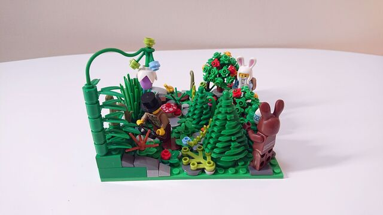](https://www.freelug.org/IMG/jpg/sj-01.jpg)

[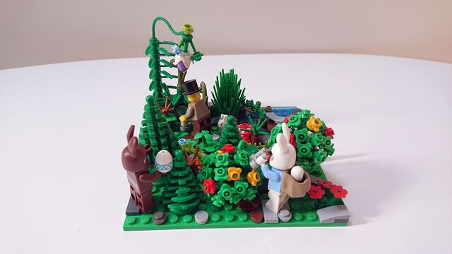](https://www.freelug.org/IMG/jpg/sj-02.jpg)

[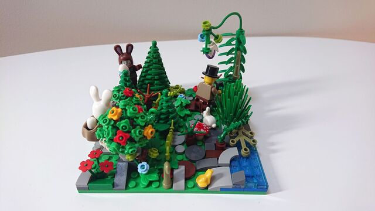](https://www.freelug.org/IMG/jpg/sj-03.jpg)

[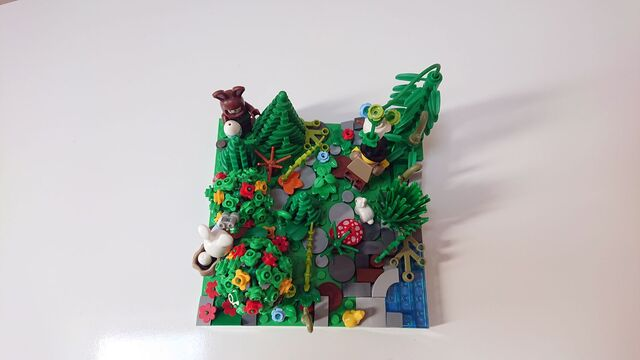](https://www.freelug.org/IMG/jpg/sj-04.jpg)

[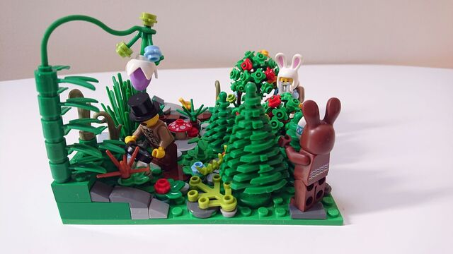](https://www.freelug.org/IMG/jpg/sj-05.jpg)

* * *

**03 - Wilfried R. - Easterland : la fête foraine du Lapin de Pâques.**

Viens faire le plein d’œufs en chocolat et célébrer le printemps dans le parc d’attraction du plus magique des lapins."

[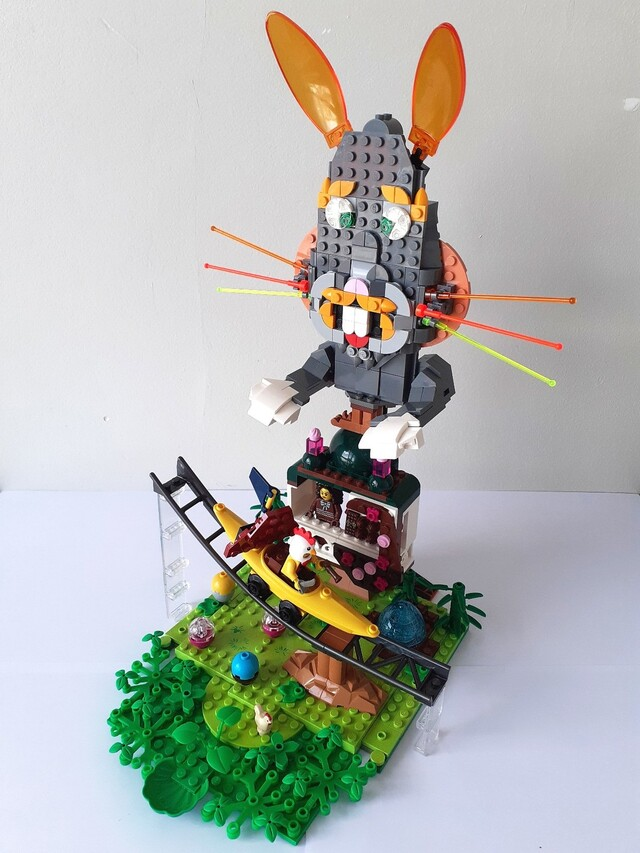](https://www.freelug.org/IMG/jpg/wr-01.jpg)

[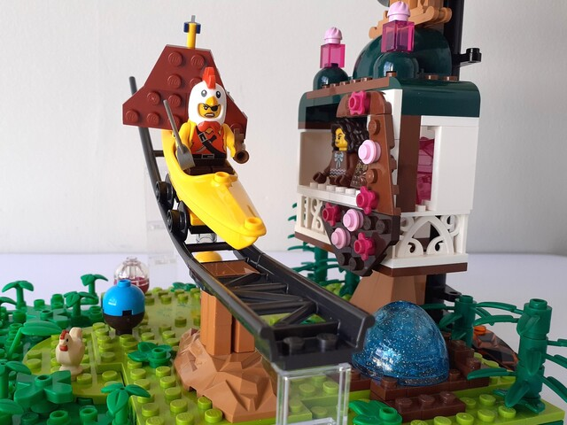](https://www.freelug.org/IMG/jpg/wr-02.jpg)

[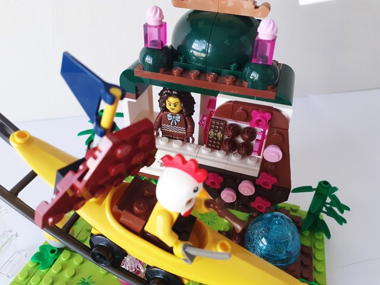](https://www.freelug.org/IMG/jpg/wr-03.jpg)

[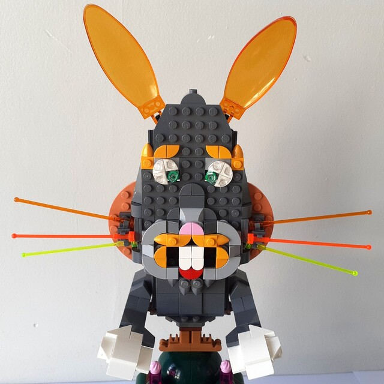](https://www.freelug.org/IMG/jpg/wr-04.jpg)

[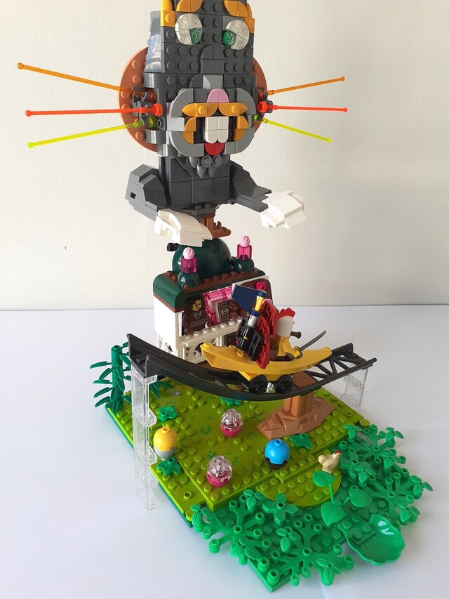](https://www.freelug.org/IMG/jpg/wr-05.jpg)

* * *

**04 - Caty et Pierre (Ecrou Papillon) - le Moai à oreilles de lapin**

Pâques + Oreilles de lapin = Île de Pâques + Oreilles de lapin = Moai de l’île de Pâques + Oreilles de lapin = le Moai à oreilles de lapin  
Ce Moai est célèbre car la légende raconte que les peuples premiers lui faisaient des offrandes de carottes. En retour, une fois par an, ils pouvaient trouver au pied de la statue des œufs en chocolat.

[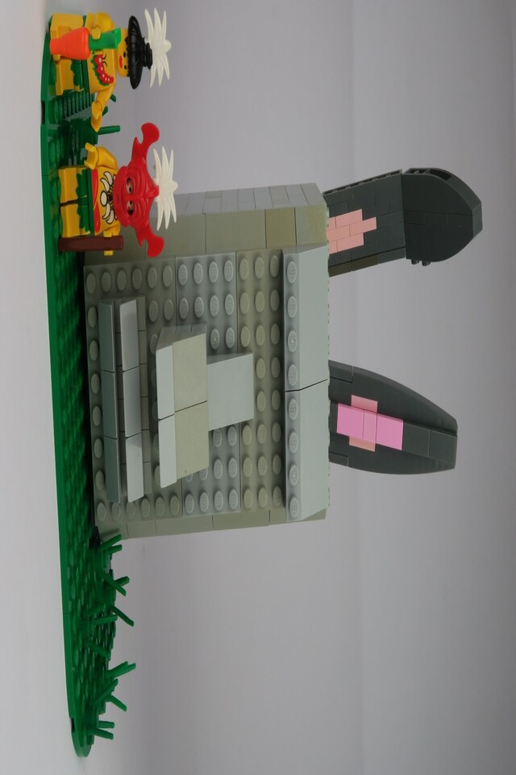](https://www.freelug.org/IMG/jpg/cp-01_grand_.jpg)

[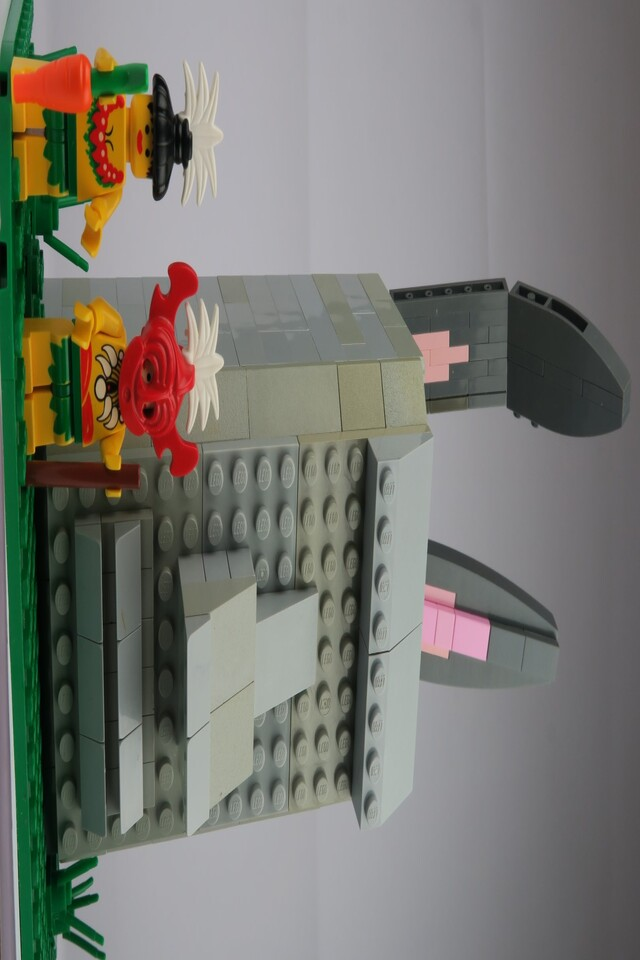](https://www.freelug.org/IMG/jpg/cp-02_grand_.jpg)

[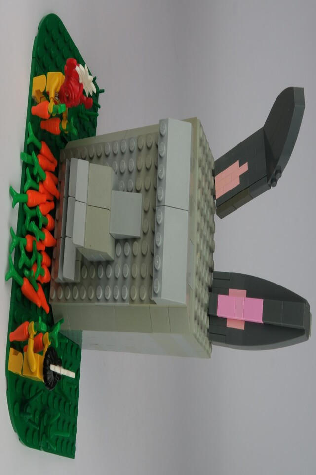](https://www.freelug.org/IMG/jpg/cp-03_grand_.jpg)

* * *

**05 - Charles F. - Le Lapin Malin**

Ce lapin a des aspects parfaits en façade, se nourrissant de carottes et d’eau fraiche et faisant commerce de fruits et légumes, il sait néanmoins protéger sa trépidante vie privé. Car, vu sur cour, il est malin ce lapin, c’est un pirate... Il cultive des œufs de Pâques sous serre et les décore dans son arrière cuisine, elle même protégée par une porte solide et sécurisée.

[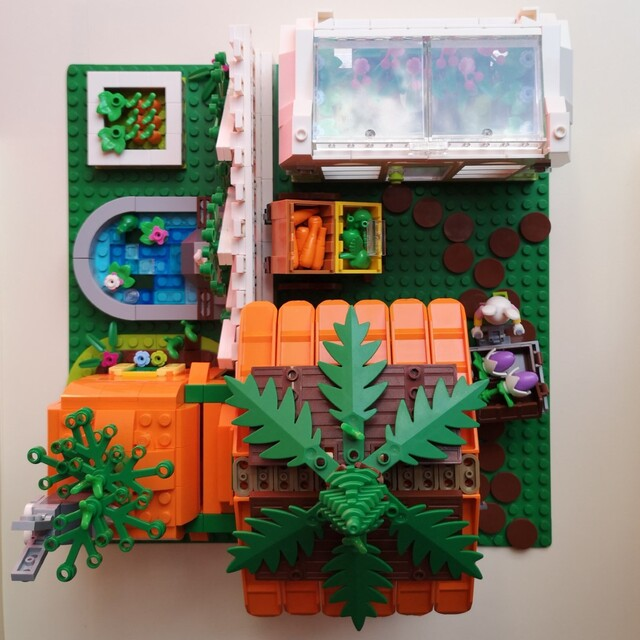](https://www.freelug.org/IMG/jpg/cf-01_grand_-5.jpg)

[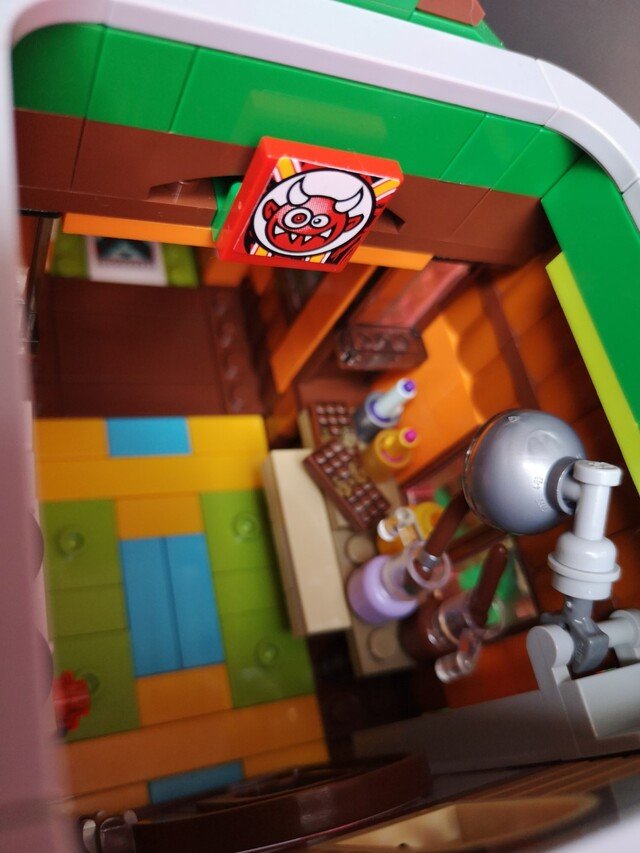](https://www.freelug.org/IMG/jpg/cf-02_grand_-4.jpg)

[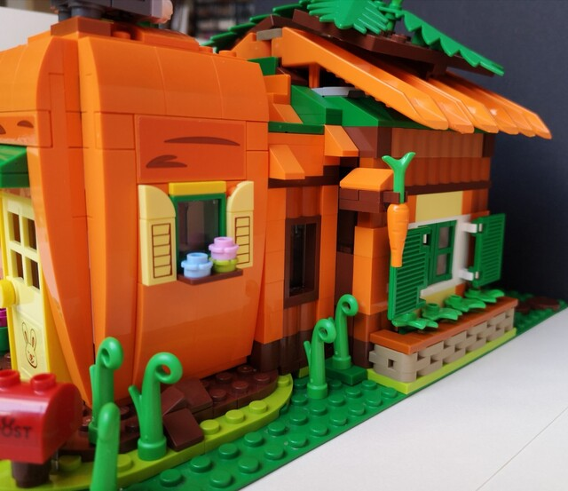](https://www.freelug.org/IMG/jpg/cf-03_grand_-4.jpg)

[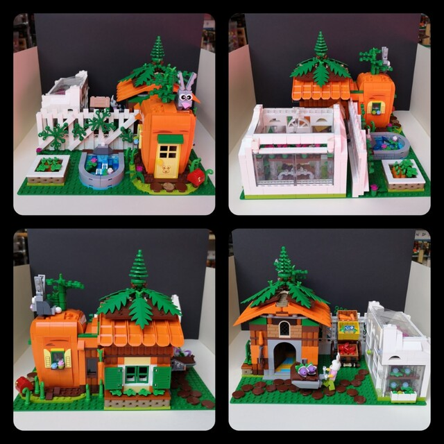](https://www.freelug.org/IMG/jpg/cf-04_grand_-3.jpg)

[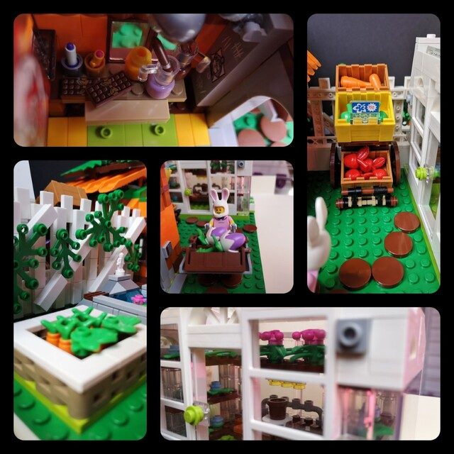](https://www.freelug.org/IMG/jpg/cf-05_grand_-3.jpg)

* * *

**06 - Amine R - Le Jardin de Pâques**

Bienvenue au jardin de pâques !!  
Présentez vous au fermier pour récupérer votre carotte et dirigez vous vers le jardin de pâques pour essayer d’attirer les lapins, qui avec un peu de chance vous mènerons vers le lieu où sont pondu les œufs de pâques.

[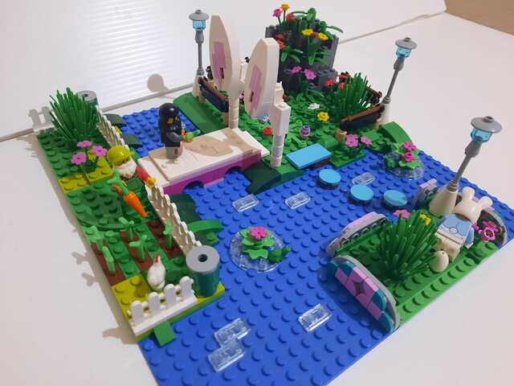](https://www.freelug.org/IMG/jpg/ar-01-2.jpg)

[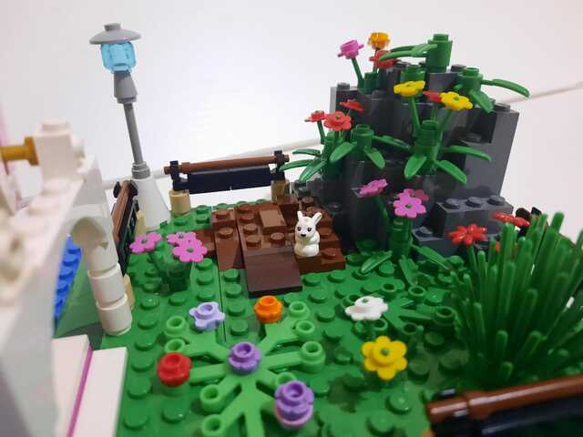](https://www.freelug.org/IMG/jpg/ar-02.jpg)

[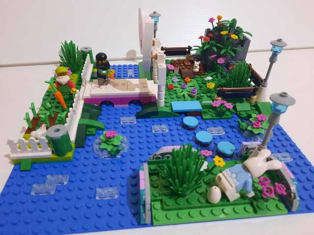](https://www.freelug.org/IMG/jpg/ar-03.jpg)

[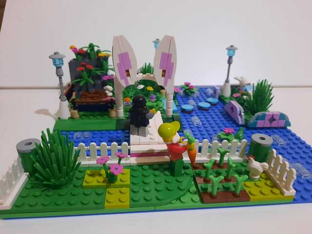](https://www.freelug.org/IMG/jpg/ar-04.jpg)

[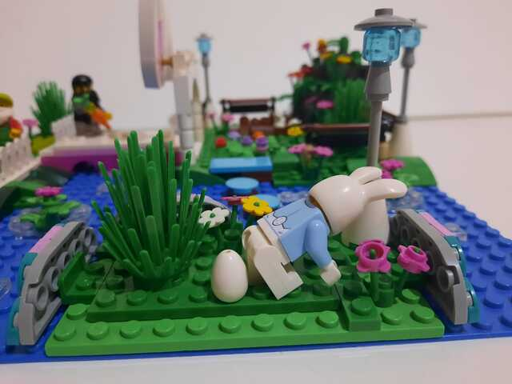](https://www.freelug.org/IMG/jpg/ar-05.jpg)

* * *

L’heureux gagnant de ce concours est **03 - Wilfried R. - Easterland : la fête foraine du Lapin de Pâques** qui remporte le set LEGO **Ref 11003 – Bricks and Eyes**

Classement :  
1\. Wilfried R. (4 pts)  
2\. Caty et Pierre (Ecrou Papillon) - Charles F. (3 pts)  
3\. Xavier D (2 pts)  
4\. Amine R. (1 pt)  
5\. Sylvain J. (0 pt)

Composition du jury :  
**–** Mathieu W. (GFC)  
**–** Pierre C. (Tribolego) (GFC)  
**–** Rémi L. (GFC)  
**–** Julien S.  
**–** Stéphane P.  
**–** Jérôme V.  
**–** Ève-Elise J.  
**–** Duy Hai D.  
**–** Julien B.  
**–** Sébastien MA.  
**–** Stéphane M.  
**–** Nadége B.  
**–** Nathan B. (enfant)

* * *

**Merci à toutes et tous et à bientôt pour un nouveau concours !**
