10 participants ont sorti leur appareil photo cet été pour immortaliser des figurines LEGO en décor réel mais 9 seulement seront jugés car la dernière participation reçue était hors délai. Il est temps de découvrir l’album photo des vacances.

Vous pouvez retrouver le [règlement de ce concours ici](https://www.freelug.org/spip.php?article3119).

Tout d’abord, nous tenons à remercier les 10 participants qui nous ont proposé de jolies photos où l’humour est omniprésent. Le 10 - Erik A. n’est pas inclus dans le vote car sa participation est arrivée hors délai mais cela n’empêche en aucun cas de présenter sa photo sur cette page.

Les participations sont présentées dans l’ordre de réception.

**01 - Duy Hai D. - Bonne trouvaille à la plage**

[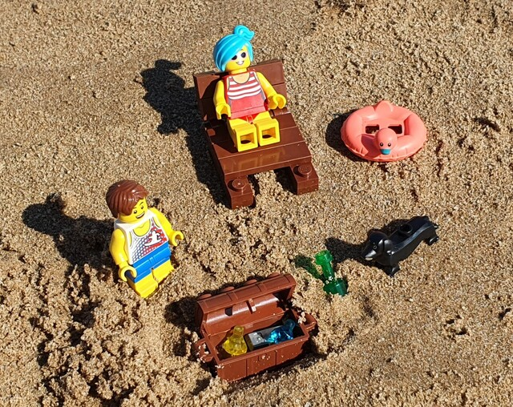](https://www.freelug.org/IMG/jpg/dhd_-_01_grand_.jpg)

* * *

**02 - Gaultier O.-G. - La Main Verte**

[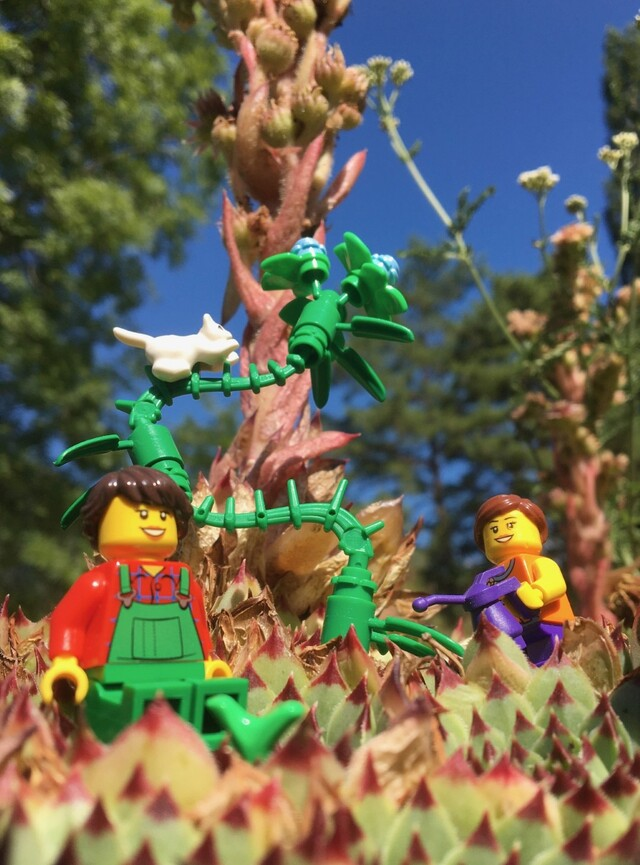](https://www.freelug.org/IMG/jpg/gog-01_grand_.jpg)

* * *

**03 - Nathan B. (11 ans) - Île du diable perdu**

[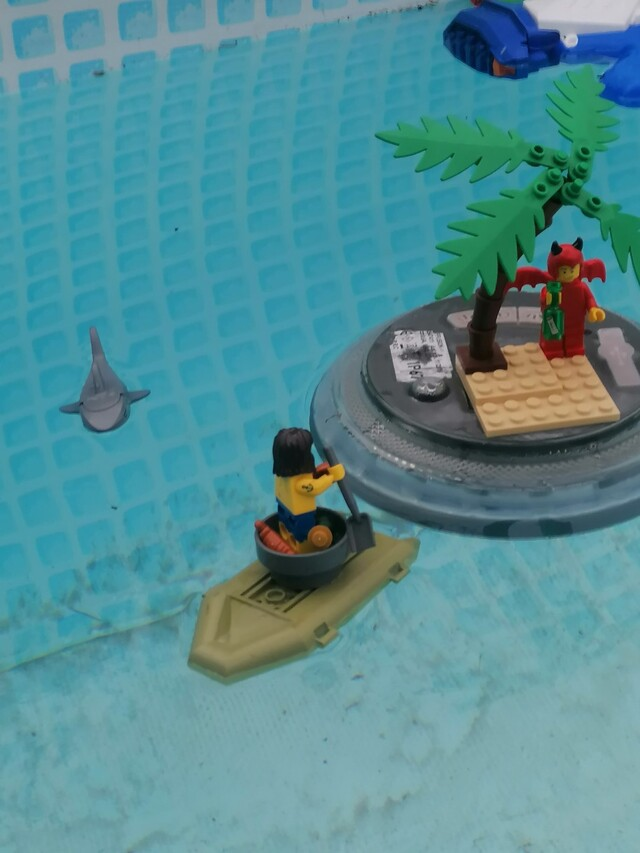](https://www.freelug.org/IMG/jpg/nab-01_grand_.jpg)

* * *

**04 - Nadège B. - Rencontre avec la baleinicorne**

[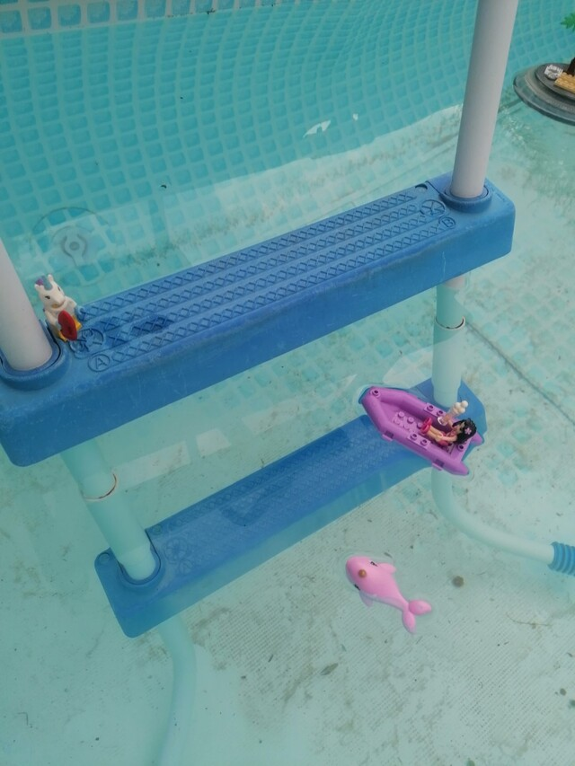](https://www.freelug.org/IMG/jpg/nb-01_grand_-2.jpg)

* * *

**05 - Camille V. - La revanche de la glace à la fig’**

[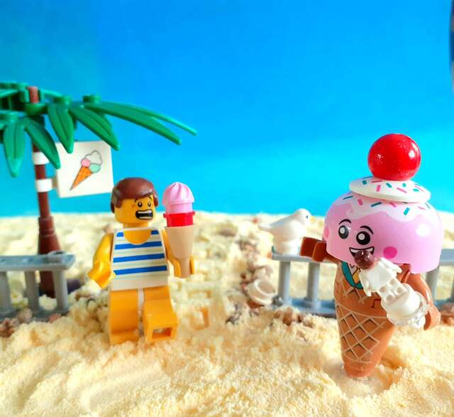](https://www.freelug.org/IMG/jpg/cv-01-2.jpg)

* * *

**06 - Rémi L. - Camping Sauvage**

[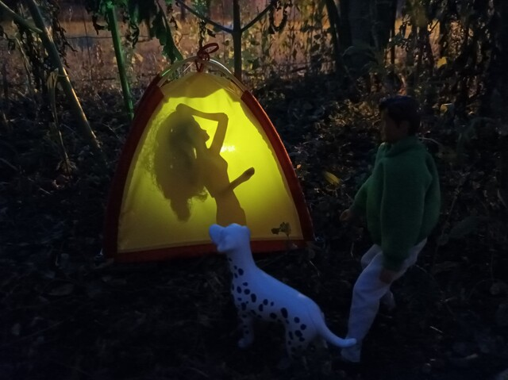](https://www.freelug.org/IMG/jpg/rl-01_grand_-5.jpg)

* * *

**07 - Maxime D. - Un BBQ sous un soleil Freelugien**

[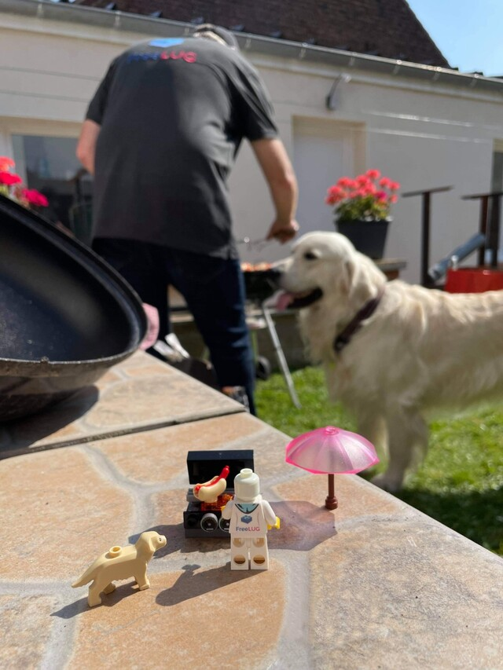](https://www.freelug.org/IMG/jpg/md-01_grand_.jpg)

* * *

**08 - Jean-Michel R - Vraiment l’été ?**

[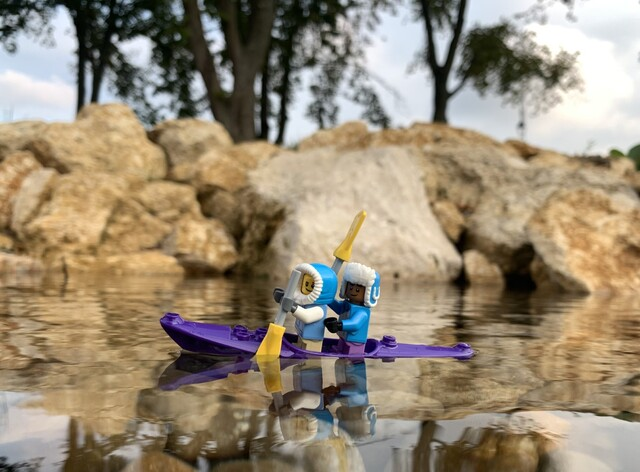](https://www.freelug.org/IMG/jpg/jmr-01_grand_-2.jpg)

* * *

**09 - Julien F. - Tea-Time au sommet**

[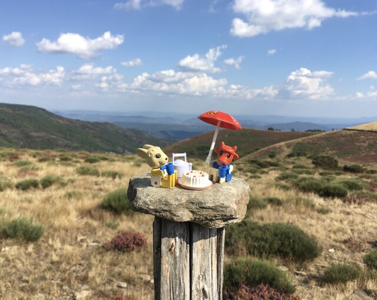](https://www.freelug.org/IMG/jpg/jf-01_grand_-2.jpg)

* * *

**10 - Erik A. - Mouette perchée**

[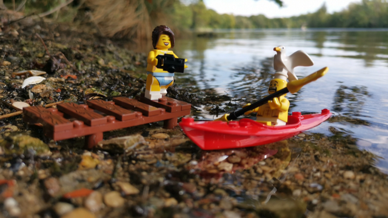](https://www.freelug.org/IMG/png/ea-01_grand_.png)

* * *

Edit du 30/09/2021 :

Il est temps de faire le tirage au sort pour ce concours. Pour être le plus juste possible et le plus transparent, nous allons prendre les résultats de L’EuroMillions du vendredi 01 Octobre 2021 pour tirer les gagnants aux sorts.  
Chaque participant s’est vu attribuer 5 numéros de la grille d’EuroMillions :

Photo 1 : 1,11,21,31,41  
Photo 2 : 2,12,22,32,42  
Photo 3 : 3,13,23,33,43  
Photo 4 : 4,14,24,34,44  
Photo 5 : 5,15,25,35,45  
Photo 6 : 6,16,26,36,46  
Photo 7 : 7,17,27,37,47  
Photo 8 : 8,18,28,38,48  
Photo 9 : 9,19,29,39,49  
Remise en jeu pour les numéros suivant 10,20,30,40,50

RÈGLEMENT :  
Le premier numéro dans l’ordre d’apparition du tirage qui sera annoncé sera le gagnant. Si ce numéro est 10,20,30,40,50 alors nous prendrons le 2ème numéro annoncé et ainsi de suite. Si par malchance tous les numéros tirés sont 10,20,30,40,50 alors nous prendrons les résultats du tirage d’EuroMillions suivant.

* * *

Edit du 11/10/2021 :

Pour ce concours, le GFC a décidé de récompenser 2 gagnants au vote en plus du gagnant au tirage au sort, soit 3 gagnants en tout.

Les heureux gagnants de ce concours pour le vote sont :  
**–** 05 - Camille V. - La revanche de la glace à la fig’ qui remporte le set Ref 31088 - Deep Sea Creatures  
**–** 08 - Jean-Michel R - Vraiment l’été ? qui remporte le set Ref 31087 - Dune Buggy

L’heureux gagnant du tirage au sort est :  
**–** 01 - Duy Hai D. - Bonne trouvaille à la plage qui remporte le set Ref 31098 - Outback Cabin

Vous pouvez retrouver la vidéo du tirage [ici](https://www.youtube.com/watch?v=vWCOFA9KUpk)

Pour expliquer le nombre de points plus élevés que d’habitude sur ce concours, ce n’est pas que nous avons eu plus de juges que d’habitude mais juste une nouvelle version de vote par critère. Chaque participant gagnait des points en fonction de critères définis. La méthode est intéressante et sera surement améliorée pour les concours à venir. Ci dessous le bulletin de vote vierge pour les plus curieux.

[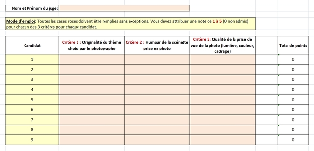](https://www.freelug.org/IMG/jpg/vote_022.jpg)

Classement :  
1\. Camille V. (125 pts)  
2\. Jean-Michel R. (112 pts)  
3\. Gaultier O.-G. (106 pts)  
4\. Julien F. (103 pts)  
5\. Maxime D. (93 pts)  
6\. Duy Hai D. (90 pts)  
7\. Rémi L. (87 pts)  
8\. Nathan B. (11 ans) (80 pts)  
9\. Nadège B. (71 pts)  
10\. Erik A. (Hors délai)

Composition du jury :  
**–** Mathieu W. (GFC)  
**–** Pierre C. (GFC)  
**–** Xavier D. (GFC)  
**–** Stéphane P.  
**–** Nicolas W.  
**–** Jérôme T.  
**–** Julien S.  
**–** Stéphane M.  
**–** Jérôme V.

* * *

**Merci à toutes et tous et à bientôt pour un nouveau concours !**
