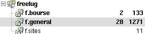

Internet est un vaste domaine, rempli de services. Le web, les e-mails, les listes de diffusion (mailing-lists), le chat (IRC), vous connaissez, mais le reste ?

Newsgroup ou forum de discussion, ce nom vous dit quelque chose, mais vous ne savez pas exactement ce que c’est ? Peut être vous le savez, mais est-ce vraiment ce à quoi vous pensez ?  
Il existe de nombreuses confusions entre les differents protocoles disponibles sur l’Internet, la traduction n’arrangeant rien.

Je vais essayer d’une façon simple de bien expliquer ce que c’est et surtout de vous permettre de configurer votre logiciel préféré pour y accéder.

## Les Newsgroups

Alors pour enlever tout de suite la confusion, il ne s’agit pas du tout d’une page web où l’on affiche des messages. Ca y ressemble, mais la version web est en fait un derivé plus "moderne".

C’est en fait le deuxième service qui est apparu sur l’Internet après l’email en 1970. Il est également connu sous l’acronyme NNTP.

**Description générale (hors FreeLUG)**

Les **newsgroups** ou forums de discussions sont en fait une sorte de tableau d’affichage où l’on met un message et auquel une communauté internationale peut répondre. Ces forums permettent de poser des questions, faire part de son expérience, donner son avis.

Les forums sont décomposés selon leur sujet, par exemple fr.soc.education traite de l’éducation en France, fr.comp.lang des langages de programmation (comp = computing = informatique).  
Il en existe des milliers dont certains sont propres à certains pays, entreprises, voir asso.

Ces forums ressemblent également aux liste de diffusion, sauf que l’on n’y accède pas par e-mail. Les messages sont stockés sur un serveur spécifique, indépendant de votre compte personnel. Cela permet surtout de ne pas avoir à se désinscrire lorsque l’on part en vacances. Le serveur sert aussi d’archivage , un nouvel inscrit vera donc tout l’historique .

Lors de la consultation, on voit juste les titres et en sélectionnant un article, le contenu est récupéré sur le serveur et apparait.

C’est simple d’emploi, efficace et il n’y a pas à donner son adresse email.

**Et sur FreeLUG ?**

Grace a notre admin préféré, nous aussi nous avons nos newsgroups. Ils sont fermés au monde extérieur afin de garantir un contenu correct et correspondant à notre passion.

La présentation a la forme suivante (sous Netscape) :

3 forums sont disponibles :  
**–** freelug.general : ce forum est dédié aux discussions d’ordre général sur l’association Freelug et sur les jeux LEGO en général  
**–** freelug.bourse : dédié aux ventes/achats/échanges de modèles et/ou briques LEGO.  
**–** freelug.sites : forum d’annonces de mise à jour de site ou de nouveau site web dêdié à la petite brique LEGO.

_Note_ : ces forums se retrouvent aussi sous la version liste de diffusion, mais la je vous renvoi vers [l’article qui en parle](/articles/nous-contacter/).

**Configuration de mon logiciel**

Paramètres généraux :

`serveur = news.ipsyn.net`

Accès en lecture seule :

login = _reader_, mot de passe = _reader_

Accès en lecture et écriture :

envoyez un email à [newsmaster](mailto:newsmaster@freelug.org)

**–** **Netscape v 6.x ou 7.x / Mozilla 1.x**

Lorsque vous êtes sur la page d’affichages des e-mails, sélectionner _Edition -> Configuration email et forums_.

Ajouter un forum  
**–** nom = freelug  
**–** email = celle avec laquelle vous êtes enregistré auprès de FreeLUG  
**–** serveur, cf ci-dessus  
**–** port 119 (par défault).

Et c’est tout.

**–** **Outlook Express 6**

Outils -> commptes -> Ajouter -> news

**–** Nom complet = Freelug  
**–** mail = celui avec lequel vous vous êtes inscrit à FreeLUG  
**–** Serveur de News (NNTP) = news.ipsyn.net  
**–** \[X\] connexion à mon serveur de News requise

Bon là Outlook, il est casse-pied, car il faut valider et retourner dans Outils -> comptes -> propriété de news freelug et prendre l’onglet "serveur" pour mettre le login / password.

Ensuite il propose la liste des newsgroups disponibles. Il suffit de sélectionner et de s’abonner.

C’est tout aussi.

**Conclusion**

J’espère que tout le monde a bien suivi. Croyez moi, lorsque l’on y a goûter, on a du mal à s’en passer :))

Comme dab, si il y a le moindre problème, email ou venir sur le chat.
