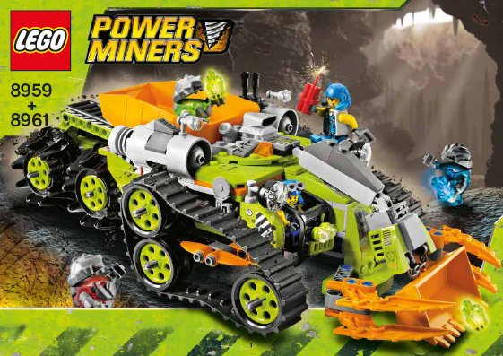
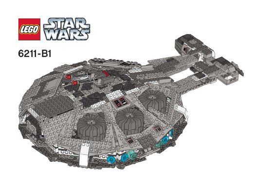

Souvent demandées, les notices pour des modèles alternatifs ont fait leur apparition en ligne il y a peu.

Il y a encore jusqu’à quelques années, les boîtes de la gamme System proposaient en leur verso des idées de constructions alternatives à partir des pièces contenues dans la boîte.

Et forcément, beaucoup demandait où trouver les notices. LEGO n’a jamais publié de telles notices, ces idées n’étant que des suggestions visant à stimuler l’imagination des enfants. Mais apparemment, cela en a frusté plus d’un :)

Ces modèles alternatifs ont disparu, sauf dans la gamme Technic, qui a, au contraire des autres gammes, toujours possédé une notice papier pour le modèle alternatif. Il faut dire qu’un montage Technic est plus difficile à deviner qu’un montage avec des briques de base.

Toutefois, on peut trouver des notices alternatives de montage sur le site de LEGO. Par contre, pas de recette miracle, il faut aller fouiner pour les trouver.

On ne les trouvera pas sur le [service de téléchargement des notices](http://www1.lego.com/eng/buildinginstructions/default.asp) mais sur les [pages "produits"](http://www.lego.com/en-GB/products/default.aspx). Elles peuvent être disponibles au téléchargement (fichier PDF) ou consultables en ligne.

On en trouve à l’heure de rédaction de cet article sur la [gamme PowerMiners](http://powerminers.lego.com/en-gb/BuildingInstructions/default.aspx), et bien sûr la [gamme Technic](http://technic.lego.com/en-us/buildinginstructions/default.aspx).

Par contre, on regrettera que les liens disparaissent en même temps que les produits. Ainsi, même si les notices alternatives de l’ISD 6211 ne sont plus indiquées, elles sont pourtant toujours disponibles en ligne... Mais pour combien de temps ?  
**–** [6211-B1](http://cache.lego.com/upload/contentTemplating/StarwarsProducts/otherfiles/downloadA15188E51E9D4FE6B73BC9BE96EF389D.pdf)  
**–** [6211-B2](http://cache.lego.com/upload/contentTemplating/StarwarsProducts/otherfiles/downloadAB48592C6A6D5BC2589A2AA280BA04D4.pdf)

Avec la diffusion par Internet, LEGO fait l’économie d’éditer des notices papier, et on ne peut qu’encourager une diffusion plus large de ces notices alternatives. D’autant plus que ces notices titillent nos âmes de collectionneurs prêts à acheter de quoi les construire, en plus des modèles originaux :) Mais pour ne pas les rater, il faut rester vigilant et surveiller régulièrement les produits.
