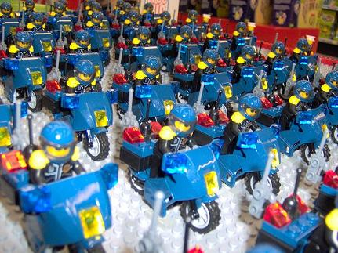
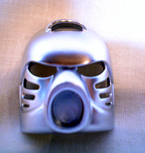
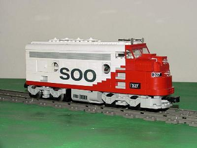
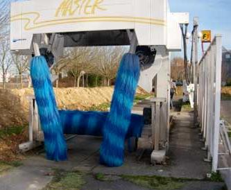
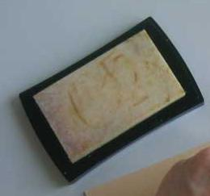
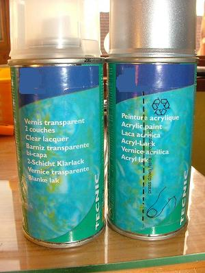
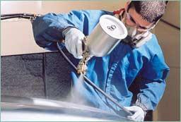
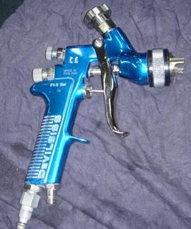
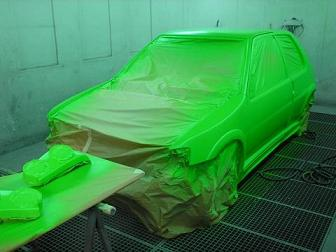
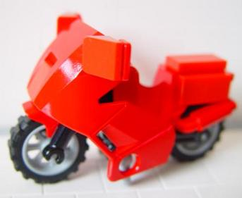

Mais jusqu’où peut-on aller avec nos pièces LEGO ?  
Longtemps rejetée par l’ensemble des AFOLs, peindre ses pièces LEGO est-elle une action encore tabou ?  
Je vous présenterai pourquoi un AFOL décide de peindre et comment peindre en respectant la brique.

## I ) Pourquoi peindre ces pièces LEGO.

A l’heure actuelle, cette pratique est largement condamnée par les puristes. Ces derniers estiment que les briques doivent suffire à elles seules à construire tout ce que l’on peut imaginer avec seulement les briques que LEGO produit. Cette argumentation tient tout à fait la route au regard du nombre de couleurs et de pièces existantes sur le marché. Mais qu’est-ce qui pousse ces AFOLs à choisir de peindre plutôt que de se contenter des pièces existantes ?

**A) Un manque de pièces dans certaines couleurs.**

Pour l’instant deux évènements m’ont obligé à utiliser cette méthode.

Tout d’abord, comme tous les enfants je reste rêveur de pouvoir faire tout ce que j’ai envie avec mes pièces LEGO. Longtemps je me suis toujours sous-estimé dans la réalisation de MOCs et donc je suis resté un grand collectionneur de sets officiels. Et pourtant aujourd’hui je tends à réaliser du MOC et je vous parle de peindre vos pièces. Serait-il devenu fou ? Non, il s’agit simplement grâce notamment à des groupes d’AFOLs comme FreeLUG d’évoluer et de s’ouvrir à tous les horizons.

_1) Combler un rêve de gosse._

Depuis tout petit j’ai toujours été fasciné par l’esthétique des engins militaires dont notamment les avions F-16 et F-14. Mais l’admiration pour le métier de motard de la gendarmerie m’a toujours poursuivi.

Comment peut-on faire quand les couleurs LEGO ne donne pas la possibilité de réaliser son rêve ? Le bleu gendarmerie est vraiment spécifique donc je n’ai pas eu le choix.  
De plus travaillant en parallèle sur la couleur Maersk, j’ai constaté que très peu de pièces existent dans cette couleur. Donc j’ai pris la décision d’avoir recours à une peinture professionnelle.

_2) L’évolution du LEGO vers le modélisme._

Ne nous voilons pas la face, de plus en plus les Mocs cherchent à être d’un réalisme surprenant. La peinture et les autocollants font partie sans nul doute d’une tentation de plus en plus fréquente. Surtout dans les modèles du thème du train. Cela dit, changer la couleur d’une pièce n’enlève rien à sa forme de départ.

Personnellement, la seule dénaturation la plus contestable est la création de nouvelles pièces non officielles à partir d’existantes. Le charcutage n’est plus LEGO mais du pur maquettisme.

Et encore peut-on encore rejeter ces pratiques, elles même utilisées par les designers de chez LEGO ?

**B) Redonner la vie à ses pièces.**

Je me souviens encore de la conversation que j’ai eu avec Pierre Normandin (QuéLUG) sur l’utilisation des pièces LEGO. Il m’avait dit que son choix se porte quasiment à 100% sur des pièces neuves quand il construisait.

_1) Le goût de luxe ?_

Cette réflexion de Pierre m’avait paru bizarre. Mais c’est en pratiquant Bricklink (magasin non officiel LEGO) que j’ai compris le pourquoi du comment. Il est vrai que beaucoup d’entre nous utilisent les puces, vide-greniers ou ebay pour avoir du vrac LEGO. Dans ce genre d’achats, les pièces sont plus où moins neuves voire décolorées. Avec Bricklink les pièces sont soit neuves soit quasi-neuves. Quand on commence à pratiquer l’achat de pièces neuves il est alors très difficile d’utiliser son vrac usagé tellement les pièces neuves au touché sont bien douces et belles.

Que faire alors avec des "mauvaises pièces" ?

_2) Chaque brique à sa place dans ce monde._

C’est l’un de mes principes : tout doit servir.  
La peinture donne une seconde jeunesse aux briques rejetées faute de belle couleur. Avec la peinture, non seulement les pièces redeviennent neuves mais en plus elles ont une couche de protection à l’usure. C’est pour cela que dans mes choix de pièces à peindre je privilégie autant que je peux les pièces qui ont perdu de leur couleur ou des pièces rayées ou abîmées.

Mais comment faire pour avoir un très bon résultat ?

## II ) Comment bien peindre ses briques ?

Bien évidemment si sacrilège il y a, autant le faire de façon correcte et professionnelle. Pour faire accepter les choses, il faut un résultat bluffant.

**A) Origine de la technique.**

Il se trouve que je travaille dans un lycée professionnel de l’automobile et que mes élèves travaillent sur la carrosserie/peinture. Un jour j’ai dû faire repeindre une partie de ma voiture. Ma curiosité était telle que j’ai posé la simple question de savoir si mes pièces de LEGO pouvaient se peindre. La réponse fut oui avec le détail sur la façon de faire.

**B) Peindre sur du plastique, les étapes.**

_1) Nettoyage des pièces._

Il n’y a pas de conseil particulier mais toutes les techniques sont bonnes de la machine à laver au lavage avec de l’eau froide avec de la javel avec une brosse à dent.

_(Remarque sur l’eau chaude : l’eau chaude a certes son efficacité mais en séchant, le calcaire peut laisser des traces. Si vous lavez à l’eau chaude, rincez à l’eau froide et faites sécher)_

On nettoie ses pièces pour deux raisons : enlever les saletés qui pourraient être visibles sous la peinture et enlever "l’huile" des mains (opération de dégraissage, pouvant se faire avec un liquide de dégraissage).

_2) Tamponner les pièces._

Une fois sèches, toutes les pièces doivent être tamponnées.  
C’est l’exercice le plus long. L’opération consiste à la finition du nettoyage et de la rayure des pièces.  
Le tampon est une sorte d’éponge plate rugueuse.  
Il faut appliquer ce tampon partout où la peinture sera mise. Il faut donc micro-rayer les pièces pour faire accrocher les peintures et enlever les résidus gênants.

_3) Mélange peinture et durcisseur._

**–** a) création de la peinture

Il faut maintenant préparer la peinture. Il s’agit ici d’une peinture voiture mais vous pouvez prendre d’autres peintures de professionnels (peinture pro pour matière plastique d’une maison etc.). Bien évidement la couleur de la peinture voulue doit être préparée par un spécialiste. Généralement deux techniques peuvent être utilisées :  
**–** soit par le système de jeu de couleurs : il y a des couleurs référencées, il suffit de prendre la couleur s’approchant le plus (système du nuancier).  
**–** soit par spectrographie : un appareil se place sur la surface de la carrosserie et indique avec une grande précision la composition pour réaliser la peinture.

_Remarque : pour mon projet Maersk, comme j’ai la peinture bleu Maersk pour intérieur maison, cette base va permettre aux peintres de voiture de réaliser la même couleur mais version voiture._

**–** b) peinture prête à l’usage

Une fois la peinture brute fabriquée, il faut rajouter un durcisseur pour donner de la résistance à la peinture.  
Cela permet une meilleure longévité et d’éviter une peinture craquelée.

Je vous conseille à cette étape de travailler dans un endroit sans poussière et prendre des vêtements spéciaux de telle sorte à ne pas "contaminer" les pièces (cheveux, bout de laine etc.).

_4) Mise en place de l’apprêt._

C’est un liquide permettant une meilleure adhésion de la peinture sur les pièces. Il suffit de prendre de l’apprêt en bombe vaporisant et de l’appliquer sur les pièces LEGO.

_5) Mise en peinture des pièces._

Là encore rien ne doit être négligé. Le meilleur procédé (en dehors de l’usage industriel par immersion) consiste à utiliser le plus petit des pistolets à projection. La projection avec pistolet et compresseur doit avoir une projection la plus faible possible pour deux raisons :  
**–** trop de perte de peinture si trop grosse projection  
**–** trop de couches de peinture sur les pièces.

Le plus fin des pistolets peinture (finition ou petite pièce sur voiture) coûte autour des 400 euros.

La vitesse d’exécution doit être très rapide :  
deux passages rapides sur la pièce doivent suffire.

_6) Séchage._

Une fois la peinture mise, faire sécher dans un environnement chaud (50°) pendant 1h.

_7) Prêtes à l’usage._

Vous pouvez maintenant les utiliser en montage.  
Seule petite remarque, les tenons étant à usage de frottement la peinture risque de partir dès le premier usage. Gardez toujours un fond de peinture et utilisez un pinceau fin pour ce genre de désagrément.

Si vous devez peindre plusieurs pièces comme un mur de briques mieux vaut construire votre édifice et mettre la peinture après plutôt que de peindre une par une toutes les pièces sélectionnées par vos soins. De plus, peindre à la pièce donne la sensation d’une pièce collée ou difficile à mettre en place.

## Conclusion

L’usage de la peinture est très très minoritaire dans le monde des AFOLs et il y a encore un long chemin pour faire accepter cela mais au moins la peinture a le mérite d’être créatrice à son tour de modèles LEGO (usage surement utilisé par les designers de chez LEGO S.A.).

J’ai testé pour vous deux techniques de peinture différentes :  
**–** l’une avec peinture voiture ;  
**–** l’autre avec peinture pour intérieur de maison.

L’avantage de la première est sa brillance et sa résistance, l’avantage de la seconde est l’absence du besoin de rayer les pièces et il est plus facile de trouver la couleur exacte. Après réflexion, la peinture voiture semble la mieux adaptée à nos besoins (coût entre 200 à 400 euros selon le modèle à peindre, main d’oeuvre comprise).

Pour le premier résultat de la peinture Maersk, [rendez-vous à Orléans les 8 et 9 novembre 2008 au grand salon du train](/articles/salon-du-train-miniature-a-orleans-les-8-et-9-novembre-2008/).

**Le mot de la fin**

Robert Frost disait : _"deux chemins s’ouvraient à moi, je pris celui où on allait pas"_.

## Liens

**–** [http://www.brickshelf.com/cgi-bin/g...](http://www.brickshelf.com/cgi-bin/gallery.cgi?f=166963)  
**–** [http://www.brickshelf.com/cgi-bin/g...](http://www.brickshelf.com/cgi-bin/gallery.cgi?f=97405)  
**–** [http://www.brickshelf.com/cgi-bin/g...](http://www.brickshelf.com/cgi-bin/gallery.cgi?f=45204)
