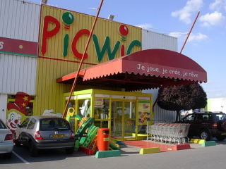
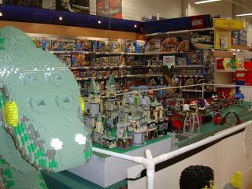
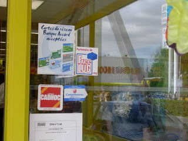

Dans le cadre de sa politique de partenariat, FreeLUG vous présente aujourd’hui : le PicWic de Sainte-Geneviève des Bois, qui vient s’ajouter à la liste des points de vente réservant bon accueil à nos adhérents.

Pour en savoir plus sur cette chaîne de magasins, cliquer ici -> : [PicWic](http://www.picwic.fr/).

## **Infos pratiques**

Le magasin PicWic de Sainte-Geneviève des Bois est situé dans la Zone d’Activité Commerciale de la Croix Blanche au sud de Paris, sur la N104 (Francilienne) entre Evry et Montlhéry.

Le magasin est ouvert tous les jours :

Du lundi au vendredi de 10h à 19h30, le samedi de 09h30 à 19h30 et le dimanche de 10h à 19h.

Merci de vous référer au site officiel de [PicWic](http://www.picwic.fr/page_plan.asp?magasin_id=7) pour prendre connaissance des coordonnées (téléphone et plan d’accès) de ce point de vente.

Adresse postale :

PicWic - ZAC de la Croix Blanche - 9 Avenue de l’Hurepoix,  
91700 Ste Geneviève des Bois

## **Présentation de la chaîne**

La magasin PicWic de Sainte-Geneviève des Bois fait partie d’une chaine de 11 magasins répartis essentiellement dans le nord de la France.

La première enseigne a vu le jour il y a maintenant 25 ans, à l’initiative de M. Stéphane Mulliez, qui bien il porte le nom d’une grande famille de la distribution (groupe Auchan), a souhaité créer, en toute indépendance des autres enseignes familiales, une chaine de magasins spécialisés dans le jouet.

Le message délivré par la chaîne répond au slogan de "Jouer, Créer et Rêver".

Et lorsqu’il s’agit de décliner ces verbes à tous les ages, afin de rassembler toute la famille autour du jeu ou des loisirs créatifs, sous toutes leurs formes, on peut considérer que ce n’est pas un hasard si cette enseigne a attiré notre attentation.

## **Présentation du magasin**

Le magasin de Sainte-Geneviève des Bois a ouvert ses portes fin 1997, sur une surface à l’époque de 1300m2.

Aujourd’hui, c’est 17 personnes qui oeuvrent quotidiennement sur les 2200m2, à l’issue de l’agrandissement réalisé en 2003.

Et effectivement, on remarque que le magasin respire et laisse une bonne surface pour accueillir toute une gamme de produits, couvrant tant les activités de plein air que les jeux et loisirs, en passant par la lecture et la vidéo.

Le magasin organise périodiquement des animations et ouvre des ateliers aux enfants.

Il parait même, que certains jours, le personnel (25 ans de moyenne d’age) s’adonne à la pratique de quelques activités ludiques, tel le paint-ball où autres jeux, qui permettent à chacun de garder l’esprit jeune.

**

## Le rayon des jeux LEGO®

**

**Rayon LEGO**

Le rayon des jeux LEGO® présente une grande partie de la gamme et suit de près les sorties des nouveautés au fur et à mesure des diffusions de LEGO France. Le rayon LEGO marque son emplacement à l’aide de quelques sculptures monumentales.

Sébastien, le responsable du rayon LEGO est véritablement un passionné, qui nous a reçu avec un vif intérêt (comme l’ensemble de l’équipe, soit dit en passant) et qui est heureux de pouvoir suivre notre actualité.

De par l’importance de la surface disponible, il est nous est possible de présenter plusieurs facettes de nos activités et de contribuer ainsi à jeter les bases d’un partenariat durable.

## **Les dispositions particulières**

**Partenaire FreeLUG**

L’équipe réserve aux adhérents munis de leur carte en cours de validité, des conditions d’autant plus attractives (-15% sur les LEGO®), que les prix se situent à un niveau raisonnable.

Pour bénéficier de la remise, il faut faire état du numéro de compte réservé à l’association et qui a été diffusé sur la liste réservée aux adhérents et présenter sa carte d’adhérent en cours de validité.
