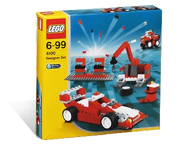

Voici quelques petits trucs pour pas vous ruiner dans vos achats de briques LEGO®

**Les sources de briques pas chers**

La source à priviligier pour les petits budgets sont, à mon avis, les vide-greniers (fuyez les brocantes). Même si vous n’y trouverez pas les derniers sets sortis les bonnes affaires sont encore courantes. C’est toutefois une activité saisonnière (printemps et automne).

Une autre source sont les sites d’enchères en ligne comme ebay. Toutefois les bonnes affaires sur les sites français sont rares. Pour trouver mieux allez voir du côté de l’Allemagne, même avec le port cela peut être très interessant.

Enfin une des dernières sources de briques pas chères sont les liquidations de magazins et les promotions diverses et variées (3 pour le prix de deux, sets pour un euro de plus, fin de stock, soldes...) Pour les connaitre rien de tel que de fréquenter régulièrement les lieux de ventes sans oublier le net ([LEGO Shop@home](http://shop.lego.com/specials/default.asp)). Une façon encore plus simple est d’adhérer à Freelug : les adhérents postent leurs trouvailles sur une liste de diffusion qui leur est réservée.

**Un meilleur usage des briques**

Vous avez enfin vos briques pas chères mais le modèle a été monté en deux trois mouvements et votre enfant se désinteresse de cette maquette qui prends maintenant la poussière sur l’étagère.

C’est qu’en fait nous oublions que le plaisir de ce jeu vient avant tout du plaisir de construire. La maquette une fois montée doit être vite redémontée !!

Par exemple les modèles de la gamme Technic&reg s’accompagne toujours (presque ?) d’un modèle "bis". C’est toujours très agréable de monter ce second modèle et cela accroit la durée de vie du jeu. Le Technic&reg c’est pour les grands !! mais la gamme Designer&reg propose non pas un mais plusieurs modèles bis. Ce sont donc des sets à priviligier dans vos achats.

Pour aller plus loin vous pourrez même trouver sur le net des notices de montage pour des [modèles officiels](http://www.freelug.org/article.php3?id_article=220) ou des [modèles de fans](http://www.freelug.org/article.php3?id_article=259@). Encore plus d’heures de montages pour occuper les enfants. Dans les cas désespérés faites un tour sur [BrickShelf](http://www.brickshelf.com/cgi-bin/recent.cgi). Vous y trouverez des photos des réalisations des fans, de quoi fournir des idées pour nourrir l’imagination de tous.
