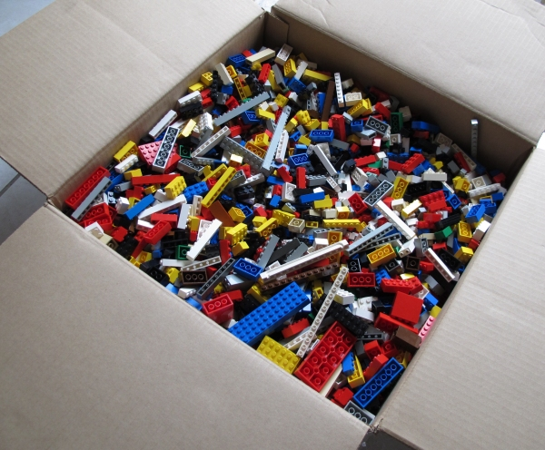
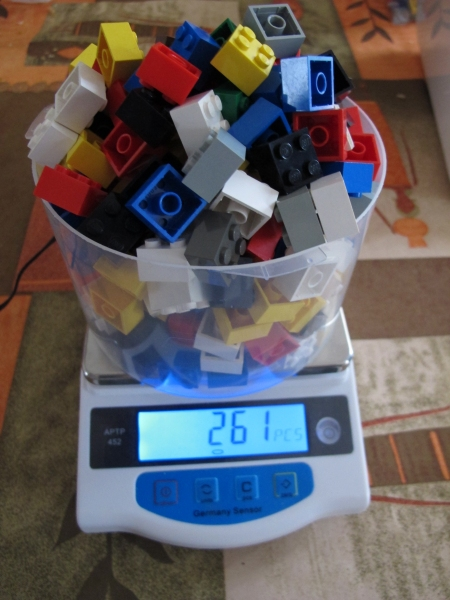

[La question est posée sur la liste de discussion](http://forum-freelug-discussion-generale-lego.974932.n3.nabble.com/Poids-moyen-d-une-brique-td3638046.html) : quel est le poids moyen d’une brique dans un vrac composé de briques allant de 1x1 à 2x10 (aléatoire, quantités de chaque taille inconnue) ?

L’échantillon de test : une carton rempli exclusivement de briques de base, issues de lots de brocantes, et lavées.

Poids total du contenu sur balance de cuisine : 6,84 kg

Détail du contenu après tri :

| Taille | Quantité | Pourcentage |
| --- | --- | --- |
| 1x1 | 690 | 14,28 |
| 1x2 | 915 | 18,94 |
| 1x2x2 | 12 | 0,25 |
| 2x2 corner | 96 | 1,99 |
| 1x3 | 259 | 5,36 |
| 1x4 | 805 | 16,66 |
| 1x6 | 192 | 3,97 |
| 1x8 | 81 | 1,68 |
| 1x10 | 12 | 0,25 |
| 1x12 | 10 | 0,21 |
| 1x14 | 2 | 0,04 |
| 1x16 | 5 | 0,1 |
| 1x1x5 | 23 | 0,48 |
| 1x2x5 | 39 | 0,81 |
| 1x3x5 | 2 | 0,04 |
| 2x2 | 861 | 17,82 |
| 2x3 | 257 | 5,32 |
| 2x4 | 466 | 9,64 |
| 2x6 | 43 | 0,89 |
| 2x8 | 27 | 0,56 |
| 2x10 | 15 | 0,31 |
| 2x2x3 | 12 | 0,25 |
| 2x4x3 | 2 | 0,04 |
| 4x6 | 2 | 0,04 |
| 4x10 | 1 | 0,02 |
| 4x12 | 3 | 0,06 |

Soit un total de **4832 briques**.

**Poids moyen d’une brique dans un vrac : 1,41 g**.

Ceci devrait alors permettre d’évaluer le nombre de briques dans un vrac de briques vendu au poids.

