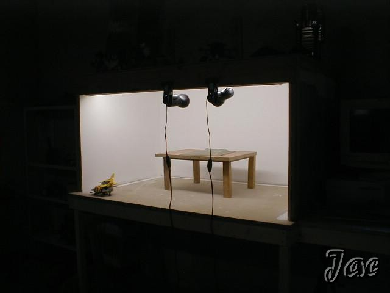
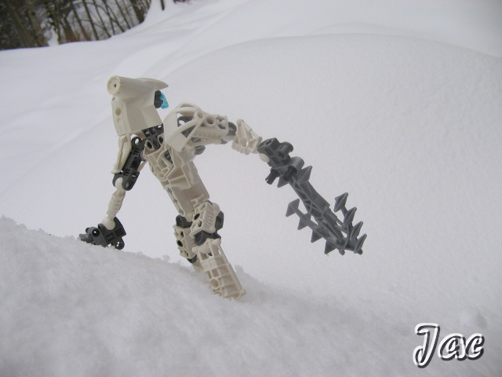
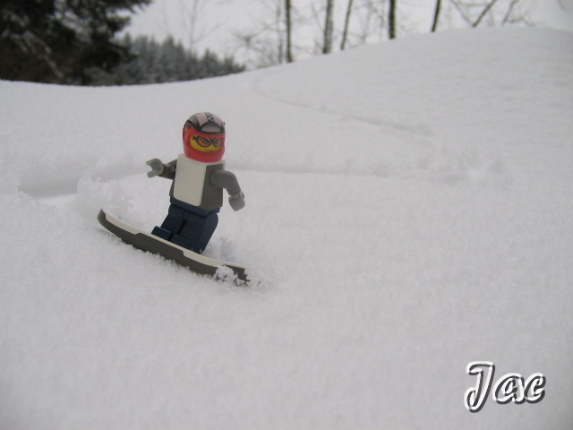
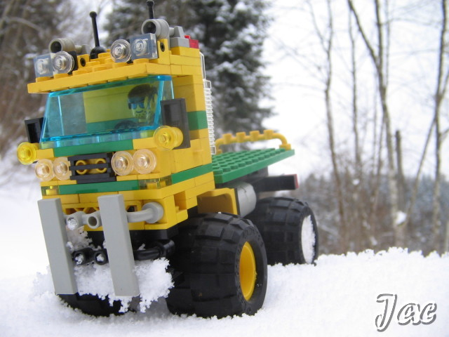

On a tous envie de prendre nos modèles en photo. Que ce soit des MOCs ou des modèles d’une gamme précise ou simplement parce qu’ils nous plaisent. Je ne vais pas faire un exposé sur les appareils photo, ça évolue très vite, mais plutôt sur les photos que l’on peut prendre.

Il y a d’abord, et simplement pour ne pas l’oublier, la manière simple : sur la table du salon, avec une feuille de papier blanche pour qu’il y ait un fond. Ou tout bêtement la mise en mémoire des étagères bien chargées, de toutes les briques.

Ensuite, je vais tenir compte seulement des modèles simples, car pour photographier un diorama d’une taille conséquente, un réseau d’expo par exemple, c’est tout aussi différent.

Ayant un peu de place, j’ai construis un mini studio photo. J’avoue avoir de la chance de ce côté là, même si l’hiver c’est un peu dur à chauffer. Sa construction pourrait faire l’objet d’un autre article. Mais, je peux déjà donner les grandes lignes. Tout l’intérieur est peint en blanc. Cela me permet de faire des fonds de couleur, même si je ne me suis pas encore amusé à le faire. Un néon blanc, éclairage industriel, éclaire l’intérieur. On ne le voit pas de dehors. C’est un peu en indirect. Ensuite, deux spots orientables à pince coulissent, selon mon choix, sur la planche du haut. La taille de l’intérieur me permet de mettre en place des dioramas d’une bonne taille, c’est à dire trois sur deux plaques standard.

Mais, il y a autre chose que j’aime bien faire, pour prendre des photos, c’est utiliser les éléments du décors naturel. Bon, j’ai peut être de la chance, là aussi, mais, il y a sûrement un parc assez grand, près de chez vous. D’ailleurs, c’est comme ça que j’ai commencé. J’ai pris beaucoup de mes modèles, de cette manière, et j’avoue me régaler. L’hiver, c’est l’occasion de faire des prises de vue dans la neige, et, en ce moment, il y a ce qu’il faut. Il ne faut pas oublier quelques trucs de base. Ils ont l’air simple et évident, mais peuvent vite gacher une belle image.

**–** Ne pas oublier de bien faire la poussière. On prends souvent en mode "macro", et là la moindre tache se voit. Je fais ça avec un pinceau fin, pour ne rien rayer.

**–** Bien vérifier que le modèle n’a pas perdu de pièces, avant et aprés les prises de vue. J’ai déjà perdu des pièces. Ah, bin, on a rien sans rien !

**–** Vérifier que tout soit bien correctement positionné, les antennes bien droites, les persos qui regardent au bon endroit, les mains dans le bon sens, les portes fermées, et tout ce que j’oublie à chaque fois.

Vous me direz c’est du numérique, et on refait, oui, bien sûr, mais, à force... Mais, ne vous inquiètez pas, malgré mon expérience, j’en oublie encore !

Je vais vous commenter quelques une des images que j’ai fait aujourd’hui :

La neige est le terrain de jeu du "TOA NUJU". C’était normal que je le photographie en plein effort. Il y a de la pente et beaucoup de neige. Il a besoin de ses grandes griffes pour pouvoir monter.

Le hors piste est autorisé, surtout quand une grande personne responsable est là pour surveiller ! En plus il y beaucoup de poudreuse, c’est trop cool. Il ne faut pas oublier de donner le mouvement aux personnages, le sens de la tête, la position des bras. Mais, surtout, et c’est très important à mon sens, la trace. Mon personnage arrive du haut, il a fait une marque.

Bin oui, il fallait bien que je vous montre un de mes camions sur le terrain de jeu.

J’espère vous avoir donné quelques idées. Ici, ce sont seulement mes dernières prises de vues. Mais, vous pourrez trouver quelques autres idées en visitant mon site internet, en cliquant [là !](http://www.chez.com/legojac/)
