## Petit rappel des faits

Vous êtes fan de minifigs LEGO et vous voulez un rare Boba Fett blanc ?

La rentrée est maintenant passée, c’est l’heure de la photo de classe : mettez en scène vos minifigs pour une photo de classe !  
Peu importe le thème, l’image que vous soumettrez doit représenter l’esprit d’une photo de classe : minifigs alignées sur plusieurs rangs.

Les contraintes : la scène doit contenir au moins une douzaine de figurines, et être photographiée de face, comme toute photo de classe.

Il peut s’agir de minifigs LEGO, de personnages Technic, Fabuland, Duplo, Belville, Scala etc. mais ne doit pas nécessairement représenter des enfants.

La photo peut être retouchée pour lui donner un aspect viélli par exemple ou lui adjoindre un cadre. Elle doit être au format paysage, et ne doit pas excéder 1024x768 px.

Un jury déterminera le vainqueur du Boba Fett blanc.  
En lot de consolation pour le second, un Dark Vador chromé (sauf si le second en a déjà gagné un par le passé) !

Une seule photo par participant.

Bonne chance à tous !

* * *

Le 31 octobre à minuit, 13 membres avaient envoyé leur création.

Ensuite les 13 œuvres ont été présentées de façon anonyme à un jury composé de 5 membres :  
**–** Brigitte Eury  
**–** Daniela Drost  
**–** Jean-Yves Brot  
**–** Emmanuel Bonnard  
**–** Pascal Breard

Chaque membre du jury a classé les photos par ordre de préférence. Un nombre de points a été attribué à chaque place :  
1 à la 1ére, 2 à la 2éme, 3 à la 3éme, ... , 13 à la 13éme.

Le total des 5 jurys donne le classement final du concours.  
Avec ce mode d’attribution de points, le vainqueur est celui qui à le moins de points, et plus on a de points plus on descend dans le classement.

En cas d’égalité c’est la photo ayant obtenu le plus de 1er, 2éme... places qui l’emporte.

[Galerie des photos](http://photos.freelug.org/main.php/v/FreeLUG/Concours/BobaFett/PhotoDeClasse/)

## Résultat

La première place revient à **Ronan C**

Photo J, 14 points, Elle met en scène 21 minifigs, à noter la présence de la minifig FreeLUG derrière la fenêtre. Meilleur classement 1, plus mauvais 5.

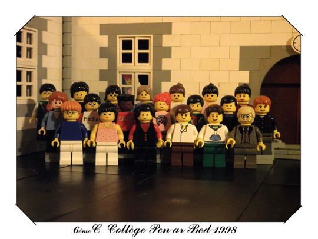

La seconde place revient à **Pierre C**

Photo G, 21 points, Elle met en scène 12 minifigs. Meilleur classement 2, plus mauvais 7.

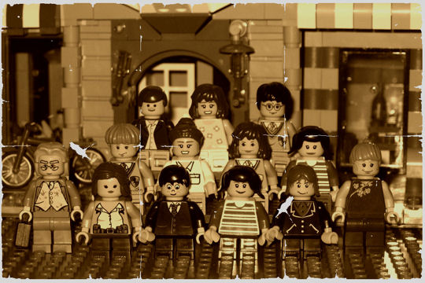

La troisième place revient à **Jérémy R**

Photo D, 26 points, Elle met en scène 12 minifigs, toutes sur le thème Toy’s story.

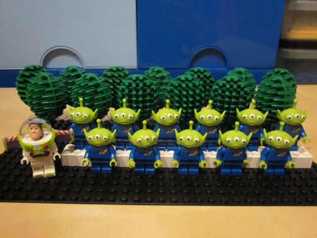

La quatrième place revient à **Danielle Q**

Photo A, 26 points, Elle met en scène 12 figurines Duplo. Meilleur classement 1, plus mauvais 10.

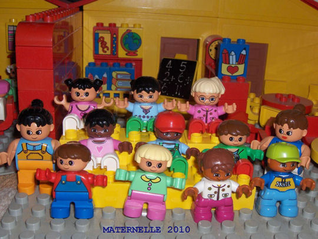

La cinquième place revient à **Pierrick D**

Photo H, 30 points, Elle met en scène 23 minifigs (le plus grand nombre). C’est aussi la photo qui a le plus varié dans le classement : elle a ainsi évolué de la première à l’avant-dernière place.

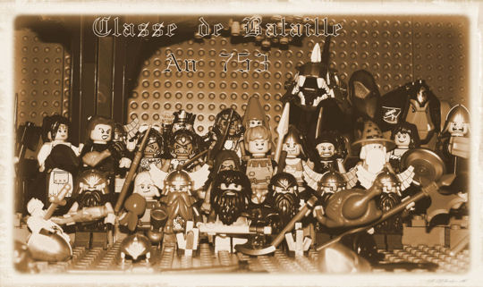

La sixième place revient à **Erik A**

Photo B, 30 points, Elle met en scène 12 minifigs. Meilleur classement 2, plus mauvais 9.

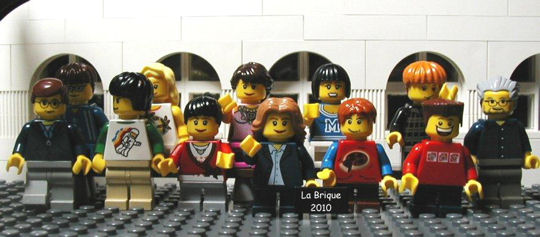

La septième place revient à **Laurent C**

Photo F, 35 points, Elle met en scène 14 minifigs sur un thème depuis longtemps oublié. Meilleur classement 3, plus mauvais 11.

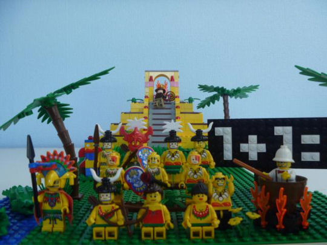

La huitième place revient à **Jonathan V**

Photo E, 35 points, Elle met en scène 16 minifigs. Meilleur classement 3, plus mauvais 11.

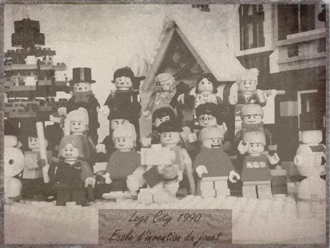

La neuvième place revient à **Pierre L**

Photo I, 37 points, Elle met en scène 12 minifigs visiblement échappées d’un studio de cinéma. Meilleur classement 3, plus mauvais 12.

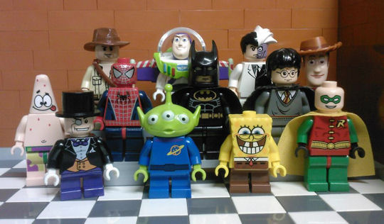

La dixième place revient à **Étienne L**

Photo C, 40 points, Elle met en scène 22 minifigs + R2D2 toutes issues de Star Wars. Meilleur classement 5, plus mauvais 10.

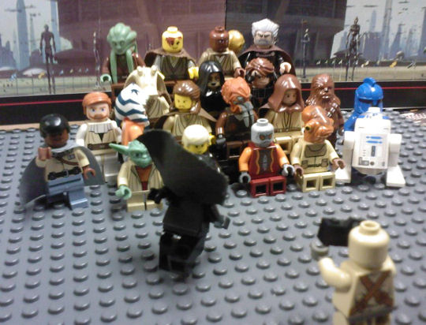

La onzième place revient à **Frédéric B**

Photo M, 45 points, Elle met en scène 17 minifigs. Meilleur classement 6, plus mauvais 11.

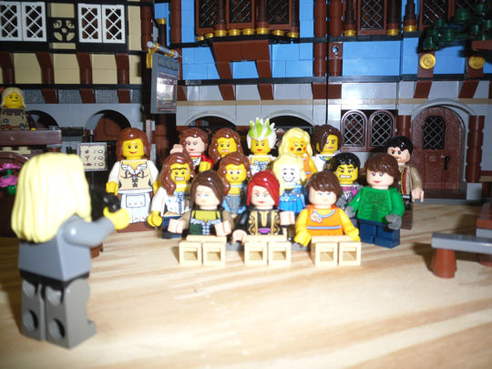

La douzième place revient à **Sébastien R**

Photo K, 51 points, Elle met en scène 17 figurines Duplo. Meilleur classement 4, plus mauvais 12.

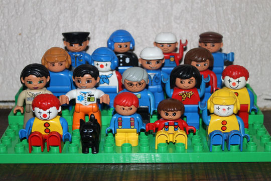

La treizième et dernière place revient à **Stéphane B**

Photo L, 65 points, Elle met en scène 12 minifigs + 1 Maxifig. L’utilisation du filtre a visiblement été mal comprise. Meilleur classement 13, plus mauvais 13.

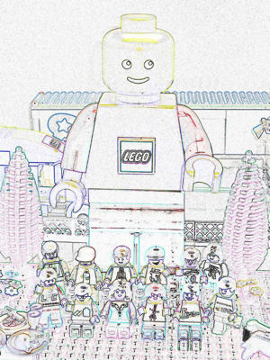

Merci à tous les participants.
