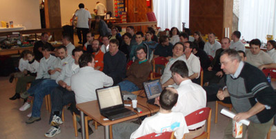
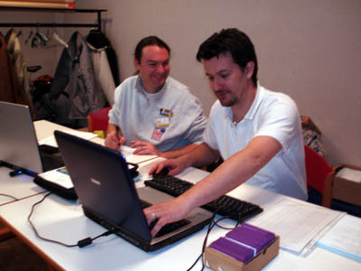
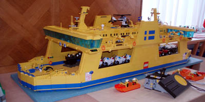
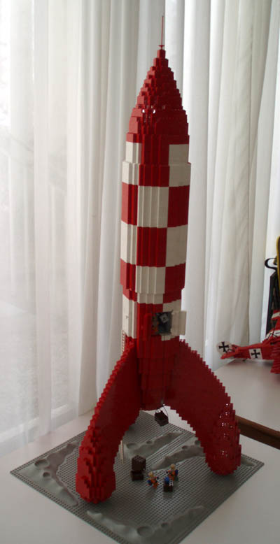
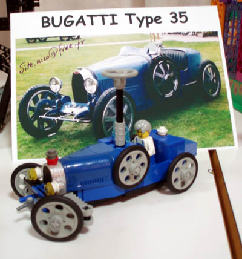
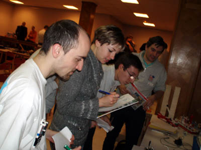
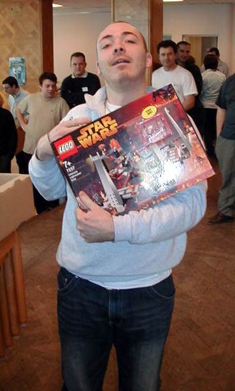
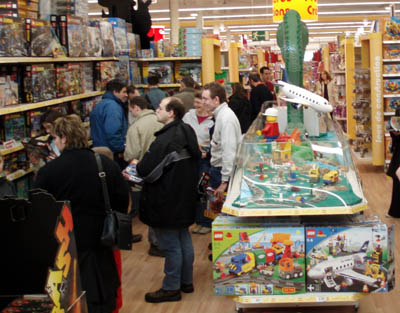
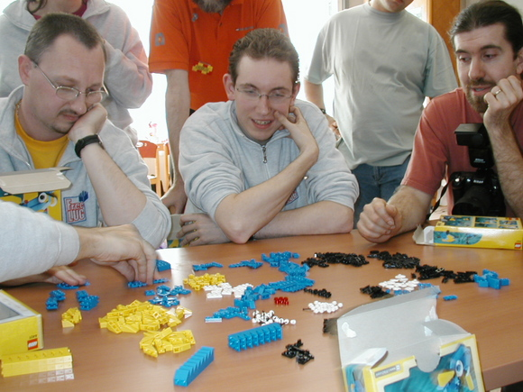

Comme chaque année nous nous sommes réunis à l’occasion de l’Assemblée Générale à Saint-Michel-sur-Orge. Plus de 60 personnes étaient présentes sur le week-end.

Dès l’entrée de la salle, nous étions accueillis par une joyeuse équipe constituée de Manu et Gaël.

Après avoir montré patte blanche, l’installation des "MOCs" pouvait débuter. Parmi ceux-ci on peux noter :

Ferry boat de Jean Marc

Fusée de Tintin par Erik

Bugatti avec pièces "super modifiées" de Nicolas

Nombreux MOCs qui ont donné l’occasion d’un concours avec son jury...

...et ses récompenses le dimanche matin.

Le classement du concours est le suivant :

| Place | Pseudo | Création |
| --- | --- | --- |
| 1er ex aequo | Chatpin31 | Miniville |
| 1er ex aequo | Brickerik | Fusée de Tintin |
| 2eme | Jean marc | Ferry |
| 3eme | Legnome | Ensemble train rue |
| 4eme | DenisL. | Moulin |
| 5eme | Gmi | Château |
| 6eme | Anthony | Camion technic |
| 7eme | Philo | Grue |
| 8eme | Qdm | Pacific 12v |
| 9eme | Nicolas93 | Le pont |
| 10eme | Acidburn | CC40100 |
| 11eme | Abigayl | Maison+ZOO |
| 12eme | Dominique | Boulangerie |
| 13eme | Stéphane | Rue du parc |
| 14eme | Richard | Motrice americaine |
| 15eme | Jeremy | Snoopy |
| 16eme | Lisa | Jardin d’enfants |
| 17eme | Flouflou | Grande roue |
| 18eme | Mederik | Grue portuaire |
| 19eme | Brice | Bulldozer |
| 20eme | Jac | Lavoir |
| 21eme | Phil C | Camion |
| 22eme | Nico | Contmaster |
| 23eme | Thierry meyer | Etable |
| 24eme | J. gerald | Camions |
| 25eme | Frogleap | Château d’eau |
| 26eme | Gyclore | Cellule X |
| 27eme | Stéphane bodin | Display |
| 28eme | Khan | Joystick |

Le samedi à 16h00 s’est tenue la traditionnelle Assemblée Générale, qui s’est achevée par la présentation des candidatures pour la rencontre estivale 2007.

En début de soirée, les participants ont pu retirer leur lot de briques offert par l’association.

Sans surprise, nous avons passé un petit moment le dimanche matin au PicWic de Sainte-Geneviève-des-Bois (Partenaire FreeLUG) où certains ont encore fait de grosses dépenses.

le dimanche après-midi, alors que les premiers repartaient (il y a de la route pour l’Alsace !), un draft a été organisé.

La fatigue de quelques-uns des participants ayant passé nuit blanche à jouer aux LEGO s’est fait voir :)

## Photos

Quelques galeries de photos :  
**–** [Photos de Philippe](http://photos.freelug.org/main.php/v/legophil/FreelugAG2007/)  
**–** [Photos de Jac](http://www.brickshelf.com/cgi-bin/gallery.cgi?f=238553)
