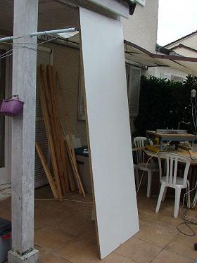
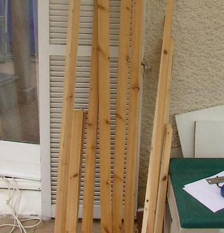
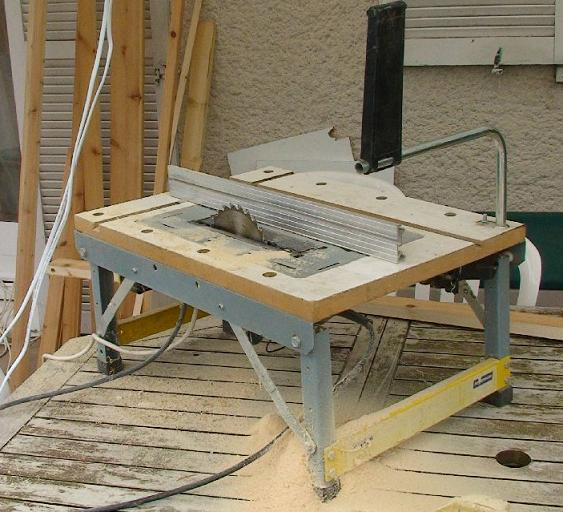
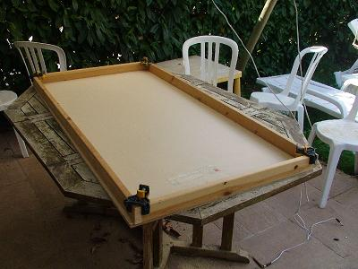
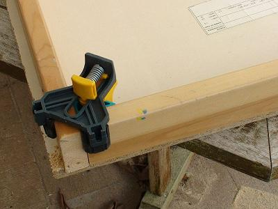
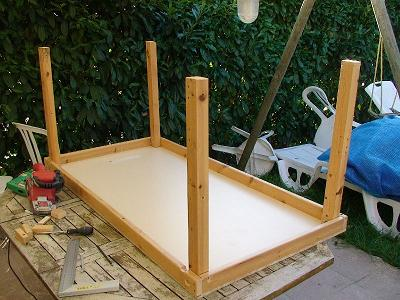
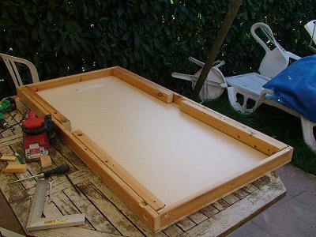
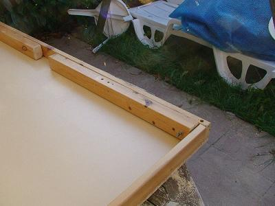
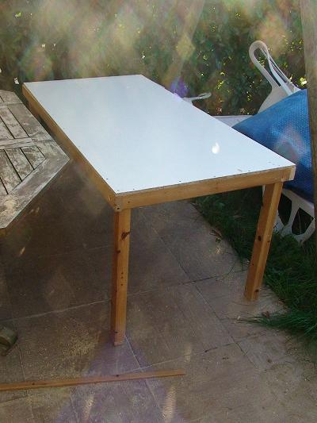
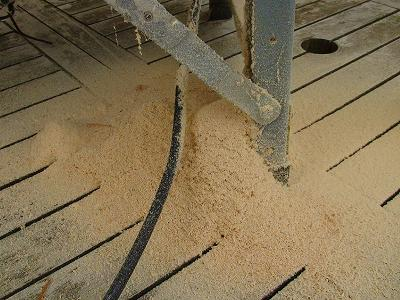

Fabrication de tables modulaires à partir de matériaux de récupération, provenant des encombrants... Donc écologiques et économiques.  
Voir écolonomiques ;-)

Cela fait pas mal de temps que lorsque je vois de belles planches sur le trottoir, je les récupère quand je peux.

Car pour ranger quelques briques, il faut aussi des étagères afin de poser les boîtes.

J’ai un faible pour les lits superposés en pin (chêne j’ai pas encore trouvé ;-)), car ils sont composés de grandes planches (2m) et surtout des montants de section carrée, idéal pour faire les montants des étagères mais dans mon esprit aussi des pieds de tables modulaires.

Le problème était de trouver les planches pour fabriquer les plateaux : environ 80 cm de large sur 1 cm d’épaisseur, longueur la plus grande possible.

On m’a proposé de récupérer deux portes de placard 240 x 90. Les portes de placard standard font plutôt 60 cm.  
Après avoir enlevé les parties métalliques, deux superbes plateaux.

Mon choix a été de faire des modules 3x6 car ils peuvent rentrer dans mes 2 voitures. En 3x9 il fallait sortir la galerie. Il me reste donc 2 plateaux 3x3.

J’ai d’abord coupé en deux les planches de lit dans le sens de la longueur pour fabriquer le cadre des tables, car elles faisaient presque 7 cm et cela aurait fait un peu haut.

J’ai la chance d’avoir un outil bien pratique (qui a vu beaucoup de lames de parquet)

J’ai coupé les plateaux et fixé le cadre dessus

aidé par de petits accessoires très pratiques pour faire des cadres :

Après j’ai fixé les pieds,  
**–** position sortie

**–** position rentrée

il suffit de les dévisser et revisser pour changer leur position :

Et table sur ses pieds :

il me reste à faire les trous sur le cadre pour la jonction  
entre les tables.

Ces tables n’ont pas la prétention de rivaliser avec les réalisations de mes camarades ([Table modulaire ‘xBaB’](/articles/table-modulaire-xbab/) et [Tables d’exposition modèle DELA02](/articles/tables-d-exposition-modele-dela02/), fabrication semi-professionnelle), mais elles seront plus pratiques que beaucoup de tables qui nous sont prêtées.  
Compatibilité à +/1 mn.

Mais je pense que c’est dans les moins chères fabriquées et elles se montent rapidement. Rendez-vous à KIDEXPO pour leur test en condition réelle d’utilisation. J’emmène  
quand même le rabot électrique et la perceuse... S’il y a des ajustements.

Un après-midi pour fabriquer deux tables, j’ai réfléchi pas mal de temps pour la fixation des pieds, le seul inconvénient comme j’ai percé au pif, chaque pied doit rester à sa place, sinon les trous ne seront pas en face ;-)

Grâce à un samedi ensoleillé j’ai pu travailler dehors car il faut de la place et surtout cela fait beaucoup de sciures :

Et encore une fois, les briques LEGO nous poussent à faire d’autres choses...
