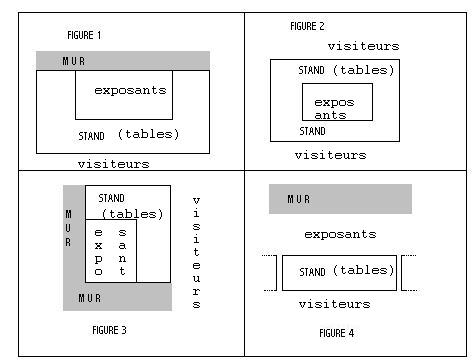

L’organisation d’une exposition passe par la création et l’agencement d’un stand . Encore faut il savoir comment il se situe dans la salle où se déroule cet événement.

**

## Prévoir son stand

**

Nous sommes nombreux à participer à des événements et différentes expositions. Certaines sont organisées par FreeLUG, d’autres par des Clubs AFOL’s et autres partenaires de l’association. Tout organisateur qui va investir de son temps pour permettre notre présence doit passer par le choix de la taille du stand, sa position dans la salle et son agencement.  
Je vous propose donc d’examiner ensemble les différentes configurations possibles, afin d’établir un plan qui sera conforme à ceux que nous allons rencontrer une fois sur place ! :)

**plan\_de\_ stand**

figure des différents agencements de stands possibles dans une salle

La figure 1 représente le stand situé contre le mur avec dégagement sur les 2 cotés : c’est le stand en forme de U.

La figure 2 représente le stand situé en milieu de salle sans voisin ! Le stand est complètement panoramique et permet le 360 ° . Les exposants sont situés dans le rectangle intérieur.

La figure 3 représente le stand situé dans un angle de la salle : c’est le stand en "L".

La figure 4 représente le stand situé dans une rangée , il a 2 voisins, un à gauche, un à droite. Les visiteurs sont en face du stand.

Cet article j’espère pourra permettre aux organisateurs d’événements de définir à l’avance sur quels types de stands ils devront s’appuyer pour établir leur plan.

Cordialement  
Eric L.
