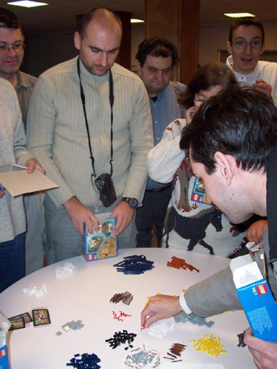
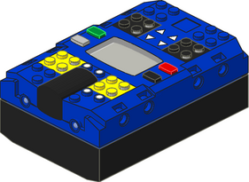

Voici un petit lexique du vocabulaire couramment employé par le fan de LEGO®

Ce lexique est un complément à l’article sur les [acronymes](/articles/liste-d-acronymes/).

**Clone** _(n.m.)_ : Les marques de jeux de construction autres que LEGO®. Ma déontologie m’interdit de les citer.

**Dark ages** _(n. pl., angl.)_ : Années durant lesquelles le fan de LEGO® adulte n’a pas pratiqué son hobby, généralement durant l’adolescence.

**Draft** _(n. m. ; angl.)_ : Pratique consistant à partager un ensemble de sets entre plusieurs personnes par piochage à tour de role des pièces triées. (Ndlr : Prière de laisser les pièces blanches à Jean-Louis.)

**Grogneugneu** _(n.m. ; neol.)_ : Robot LEGO® dont la taille imposante rend sa construction difficile voire inextricable, surtout en ce qui concerne le cablage des RCX.

**Meuh** (_Onom._) : Rappelant le meuglement de la vache. Tout bon AFOL se doit de placer un "Meuh" dans chacun de ses mails afin de commémorer la première remise de prix du meilleur MOC remporté par Erik lors de Bric’Mania 2004 à Grenoble. (Ndlr : Deux vaches qui regardent les trains passer).

**Minifig** _(n. f. ; abrev.)_ : Minifigurine, figurine System® Petit personnage articulé. Il en existe une grande variété (voir [Minimundo](http://www.minimundo.de/)). Il existe aussi des figurines Jack Stone® et Technic®

**Mocquer** _(v. ; néol.)_ : Faire une création personnelle : voir [MOC](/articles/liste-d-acronymes/)

**Module** _(n. m.)_ : Unité standardisée de présentation. Les modules permettent aux fans de créer chacun de leur côté des présentations qui formeront un ensemble cohérent lors des expositions. Il existe des modules ville/trains, espace ou minifig.

**Scout** _(n.m.)_ : Boitiers électroniques préprogrammés de la gamme Mindstorms®

**Set** _(n. m. ; angl.)_ : Boite de LEGO®

**Sorting Party** _(n. f. ; angl.)_ : Activité consistant à trier ses pièces LEGO® Cette activité si elle ne se renouvelle pas trop souvent peut être agréable mais deviens vite fastidieuse. Certains AFOLs esclavagistes font faire cela à leur parents retraités. Voir aussi cet [article](/articles/comment-je-trie-mes-briques-lego/)

**Sumo** _(n.m.)_ : Robot LEGO® destiné à [combattre](/articles/competition-sumo/) un autre sumo selon des règles qui peuvent variées.

|  |  |
| --- | --- |
| abrev. : | abréviation |
| angl. : | anglicisme |
| f. : | féminin |
| m. : | masculin |
| n. : | nom |
| neol. : | néologisme |
| onom. : | onomatopée |
| pl. : | pluriel |
| v. : | verbe |
