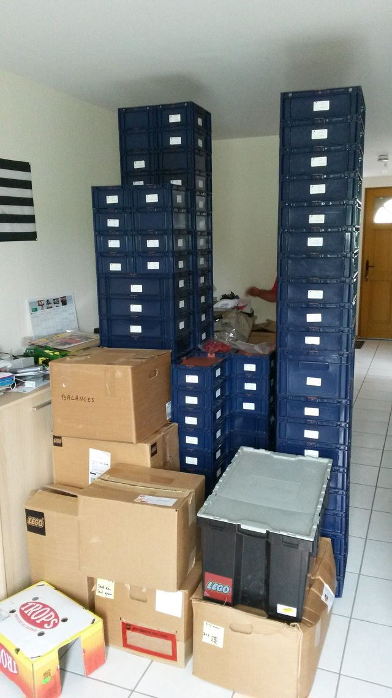
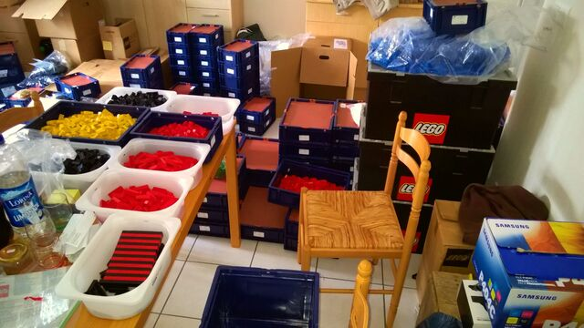
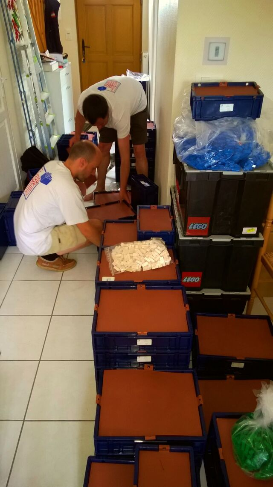
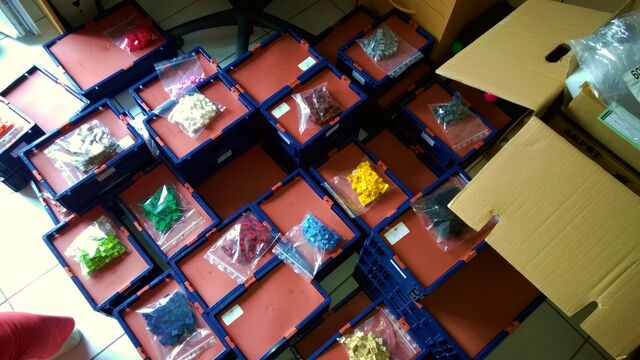
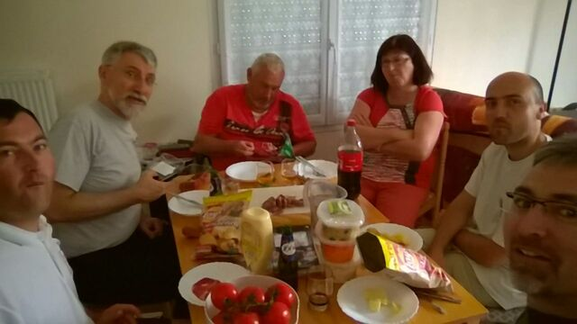
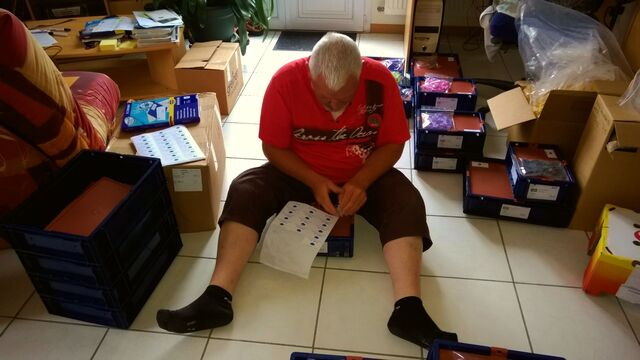
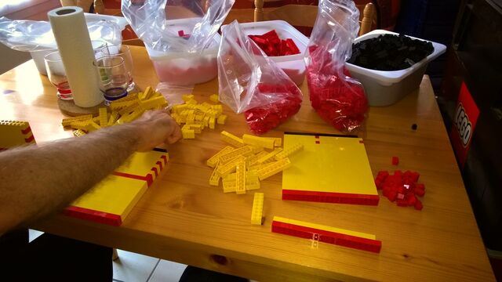

Le week-end du 3 et 4 juin, une poignée d’adhérents s’est retrouvée sur le secteur d’Orléans pour faire du tri et du rangement dans notre local de stockage.

Au programme : réorganisation des caisses mosaïque, étiquetage, marquage de plaques, transbordement de caisses...

Le samedi matin, nous nous sommes retrouvés à 8h40 devant le local de FreeLUG, Daniel, Béatrice et moi-même avions 20 minutes d’avance,  
Sébastien aussi, ça tombait bien ...

Lorsque Erik est arrivé, nous avions fini de charger le camion (coïncidence ou non, nul ne sait ;-) ) et nous étions donc prêts à aller chez Sébastien.  
Lorsque nous sommes arrivés chez Sébastien, nous avons voulu voir si on pouvait mettre des caisses jusqu’au plafond.  
La réponse est : Oui, au moins 3 fois !!!

Et encore, il manque quelques grosses caisses noires et grises, nous avons commencé un premier tri par couleur puis Stéphane nous à rejoint.

A toi, Stéphane :

**Florent**

* * *

Voilà à peu de choses près, l’état de l’appartement de Sébastien à mon arrivée ce matin là... un peu en retard (j’ai échappé au chargement du camion au local :D ), j’ai commencé ma journée avec Florent à démonter des piles (attention, ce qui suit peut faire "mal" aux âmes sensibles) de briques scotchées entres elles ! ... On entend vaguement quelqu’un murmurer "et dire qu’il faudra les remonter ce soir"... sûrement une blague ;)

Pendant ce temps, Erik et Sébastien organisent les caisses déjà triées et effectuent la pesée.

Une partie des caisses triées par genre et par couleur ! Heureusement, nous n’avons pas à subir le syndrome du "comment trier son stock par forme, couleur, année, genre, blablabla...", car nous n’avons que des briques de base (2x2, 2x4, 2x...)

La pause de midi (euh... 13h18...) est la bienvenue ! Autour de la table, Sébastien, Florent, Daniel, Béatrice, Erik, Stéphane.

Et c’est reparti, dans la joie et la bonne humeur ! Entre deux boutades, c’est du collage d’étiquettes pour certains, du tri de pièces (et oui encore), du tri de plaques de base, etc...

Ah... et oui... c’était pas une blague, il a bien fallu remonter des piles de briques !!! Ce sont les piliers qui serviront aux mosaïques FreeLUG. A base de 2x8 jaunes, pas mal de rouge, un zeste de noir, et quelques couleurs exotiques pour les manques. On remerciera particulièrement ceux qui ont suggérés (une fois fini...) que ça serait bien de faire un étage de plus :D

Cette première journée s’est terminée à la Cantine de Sébastien, un restaurant très sympa à Ingré (Le Tomate Cerise). On recommence quand ?? (_Sébastien : "Le plus tard possible !"._)

**Stéphane**

* * *

Le dimanche matin, l’équipe a légèrement changé (Daniela et Sylvain ayant remplacés Daniel, Béatrice et Stéphane) et nous avons continué par... les mosaïques 16x16 en briques 1x1 ! L’animation unique initiale s’est transformée en 2 animations de tailles égales, la remise en vrac d’une partie des exemples et nous avons enfin pu prendre notre pause déjeuner, sans doute à nouveau vers 13h :-)

Enfin, nous sommes repartis au local avec ce qu’il restait encore chez Sébastien et histoire de ne pas perdre notre temps une fois là-bas, nous avons fini l’inventaire de tout le stock que nous n’avions pas emmené chez Sébastien. C’est ça qui est formidable avec les LEGO : quand il n’y en a plus, il y en a encore (sauf quand on veut faire un MOC) ! Bon, nous avons quand même réussi à nous dire au revoir raisonnablement tôt, puisqu’il devait être à peine 17h.

**Florent**

* * *

C’est avec plaisir que j’ai accueilli les quelques adhérents motivés pour le tri et le rangement de notre local. Merci à toutes et à tous.

Promis Stéphane, on ne recommence pas tout de suite.

**Sébastien**
