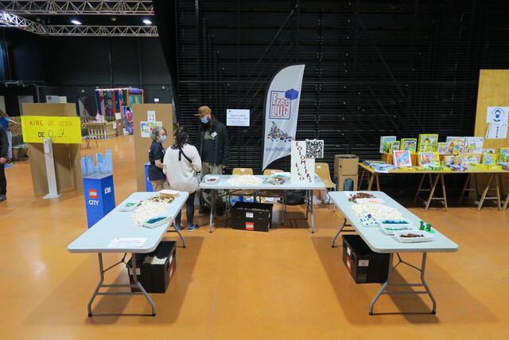
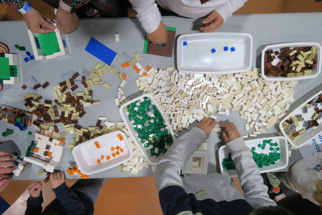
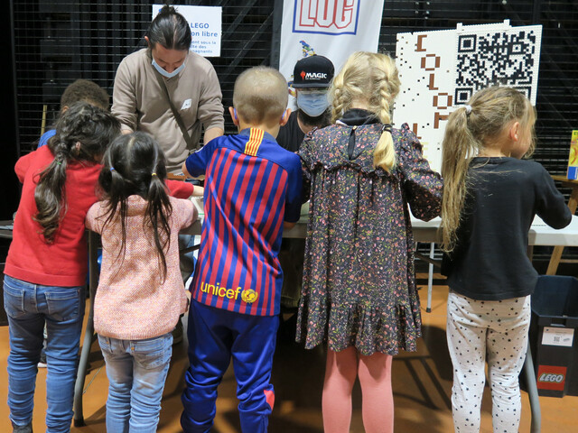
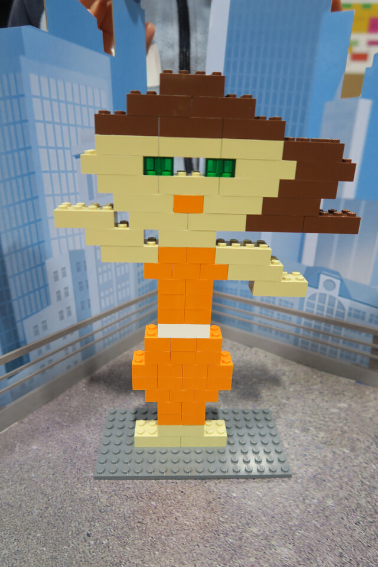
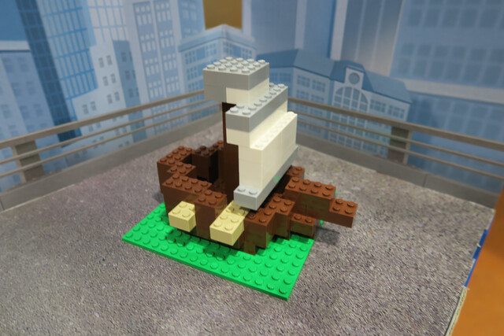
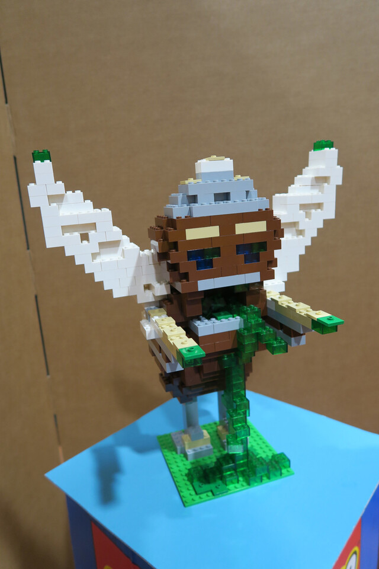
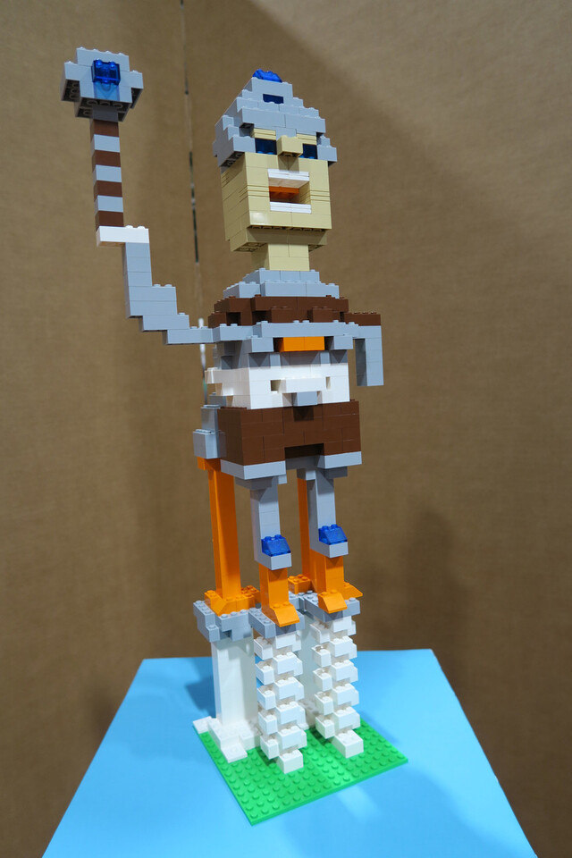
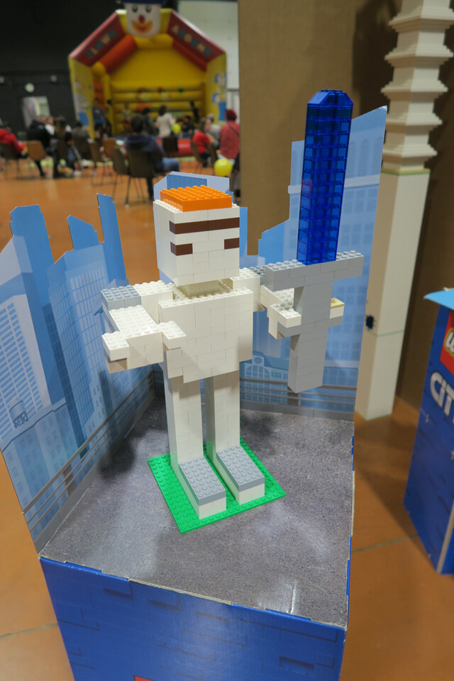

La deuxième participation de FreeLUG à la Fête du Jeu de Colomiers (23 et 24 octobre), notre première participation à un festival depuis la fin des restrictions sanitaires.

Nous attendions ce moment avec impatience et notre espoir n’a pas été déçu, nous avons passé un excellent week-end. Merci encore aux organisateurs.

Notre stand était spacieux.

Les constructeurs ont été nombreux, avec des pointes à 24 simultanément.

Merci encore aux amis qui nous ont aidés lors de ces deux journées. Nous n’étions pas trop de 4 !  
Nous avons touché un public de tout âge, de l’enfant de 2 ans au grand parent, des fans de LEGO comme des néophytes.

Toujours de belles surprises dont voici quelques exemples :  
Une princesse égyptienne

Une invitation au voyage en voilier

Un ... avec ailes et qui bave vert (le filet de bave sert de 3ème pied)

Thor avec son jetpack dans une mise en scène avec flammes et fumée blanche

Un chevalier/robot avec son épée laser

L’organisateur et le public nous attendent pour l’édition 2022.
