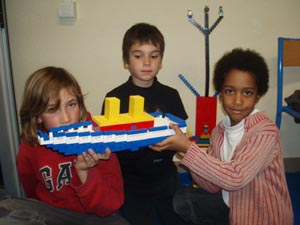
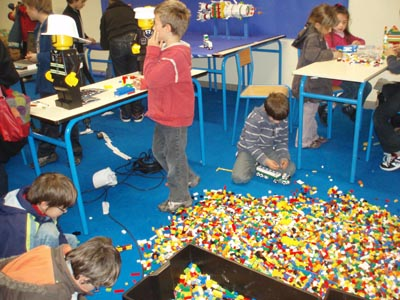
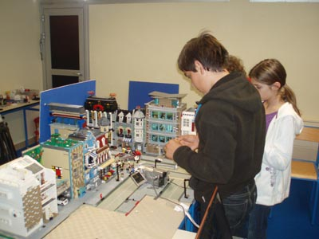
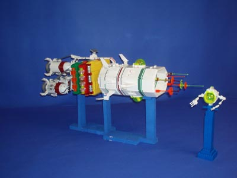

Du 27 au 30 octobre 2010 se tenait à Port-Leucate le festival des voix du cinéma d’animation. A cette occasion de nombreux ateliers ont lieux pour le public. comme l’année dernière FreeLUG était présent pour animer l’atelier BRICKFILM.

## Le festival 2010

Voix d’étoiles met en avant les voix du cinéma d’animation, cette année Jean Benguigui est venu présenter en avant première "Une vie de chat" il y a eu aussi beaucoup de rencontres avec les acteurs, les réalisateurs, les scénaristes, bref tous les artistes qui font que la magie du cinéma d’animation fonctionne et attire toujours autant de monde !

## L’atelier LEGO

Pendant ces quatre jours, j’ai donc animé un atelier de 12 enfants (jusqu’à 15 !), mon comparse Pierrick m’ayant fait faux bon pour la bonne cause : l’anniversaire de sa maman. LEGO France a prêté deux caisses pleines de briques de base, ce qui a permit à une partie du jeune public de réaliser des créations sympa :

**des créations suberbes**

**Des milliers de briques !!**

## Les plateaux de tournage

Deux décors étaient disponibles, la ville et le vaisseau dans l’espace :

**le décor de ville**

**Dans l’espace**

## Le résultat de 4 jours d’ateliers

Comme toujours en animation, le labeur est long pour quelques secondes de magie ! Le film raconte l’histoire d’un touriste un peu particulier et s’appelle [l’extratouriste](http://www.youtube.com/watch?v=rc1IuEUBZdg), pour conclure ce fût quatre jours intenses avec beaucoup d’amusement et de plaisir à animer.

[Vidéo de la publication d’origine](http://www.youtube.com/v/rc1IuEUBZdg?fs=1&hl=fr_FR)

**Vivement le prochain atelier et vive Voix d’Etoiles !**
