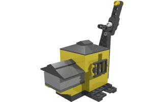
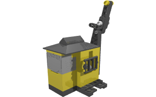
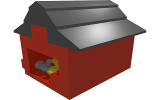

**Solutions à base de moteur ([**2838**](http://peeron.com/inv/parts/2838c01))**.

Employant à l’origine le mécanisme de Chris Alano, [**Amaury Jacquot**](http://www.esitcom.org/gallery/swremote?page=1) propose une version modifiée sur une base de moteur 71427 (voir ci-dessous). J’ai adapté son bloc pour l’emploi du moteur 2838. Ce mécanisme fait intervenir une transmission par parallélogramme déformable qui permet de placer le bloc bien plus près de l’aiguillage. Cela sans gêner le passage des wagons les plus longs. J’ai essayé avec la rame 4561, ça passe à un millimètre, mais ça passe. En revanche, je pense que les locomotives en 8 tenons de large ne passeront pas. Ce bloc fonctionne sur aiguillage non-modifié. Il y a aussi un sémaphore dans un ensemble compact qui permet un basculement rapide grâce au 2838.  
Le [**fichier Ldraw**](http://www.brickshelf.com/gallery/frogleap/Trains/Planches/bloc-a.jacquot-2838.mpd) et les trois planches de montage ([**page1**](http://www.brickshelf.com/cgi-bin/gallery.cgi?i=592249), [**page2**](http://www.brickshelf.com/cgi-bin/gallery.cgi?i=592250) and [**page3**](http://www.brickshelf.com/cgi-bin/gallery.cgi?i=592251)) dans la foulée.

A mechanism from Chris Alano & Amaury Jacquot adapted to the 2838.

**Solutions à base de moteur ([**71427**](http://peeron.com/inv/parts/71427c01))**.

1.  [**Steve Ringe**](http://www.brickshelf.com/cgi-bin/gallery.cgi?f=11064) a produit un petit bloc incluant un sémaphore et une limitation de couple par transmission par courroie (signalé par Erik Amzallag). Sans l’avoir essayé, je pense que c’est un bloc qui devrait fonctionner sur un aiguillage non-modifié. En effet, la puissance est transmise sur le levier jaune _via_ une démultiplication 1/3 à partir d’un moteur déjà puissant au départ.
2.  [**Thomas Waadeland**](http://www.brickshelf.com/cgi-bin/gallery.cgi?i=445416) propose un bloc très simplifié, pas de sémaphore, transmission directe qui exige un aiguillage modifié pour fonctionner. L’avantage, souligné par Thomas dans son message sur Lugnet, est d’être petit, simple et peu gourmand en pièces. Effectivement.
3.  Comme dit ci-dessus [**Amaury Jacquot**](http://www.esitcom.org/gallery/swremote?page=1) a fait évoluer le mécanisme de Chris Alano. Voici sa solution originale basée sur le moteur [**71427**](http://peeron.com/inv/parts/71427c01). Les même avantages que décrit plus haut. A noter que ce moteur est plus puissant, mais moins rapide à la manoeuvre que le [**2838**](http://peeron.com/inv/parts/2838c01). J’ai fait une version incluant le sémaphore en adaptant le mécanisme proposé par Amaury aux pièces disponibles dans mon stock du moment. Preuve s’il en est que ELTEP ! Voici le [**fichier Ldraw**](http://www.brickshelf.com/gallery/frogleap/Trains/Planches/bloc-a.jacquot-71427.mpd) et la notice de montage qui tient en trois pages ([**page1**](http://www.brickshelf.com/cgi-bin/gallery.cgi?i=592240), [**page2**](http://www.brickshelf.com/cgi-bin/gallery.cgi?i=592241) and [**page3**](http://www.brickshelf.com/cgi-bin/gallery.cgi?i=592242)).
    
    
    
    A power unit based on the mechanism of Chris Alano & Amaury Jacquot and powered by a 71427 motor.
    

Un complément pour le bloc à base de petit vérin [**x189**](http://peeron.com/inv/parts/x189c01). Les fichiers ".dat" sont disponibles grâce au travail de Marc Klein. [**x189a.dat**](http://www.brickshelf.com/gallery/frogleap/Trains/Planches/x189a.dat), [**x189b.dat**](http://www.brickshelf.com/gallery/frogleap/Trains/Planches/x189b.dat), [**x189c.dat**](http://www.brickshelf.com/gallery/frogleap/Trains/Planches/x189c.dat), [**x189c01.dat**](http://www.brickshelf.com/gallery/frogleap/Trains/Planches/x189c01.dat), [**x189c02.dat**](http://www.brickshelf.com/gallery/frogleap/Trains/Planches/x189c02.dat). Il suffit de copier ces fichiers dans le dossier "Parts" de Ldraw pour visualiser complètement la position du vérin dans le bloc proposé la dernière fois (recopié [**ici**](http://www.brickshelf.com/cgi-bin/gallery.cgi?i=578903) pour votre confort).

A power unit based on the small pneumatic cylinder.

Voilà. Merci à tous les informateurs pour ces compléments. En espérant que vous trouverez la source d’inspiration qui vous convienne.

Philippe "Frogleap" Label
