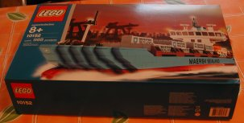
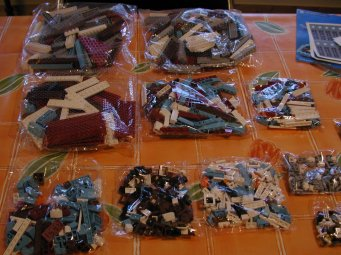
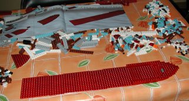
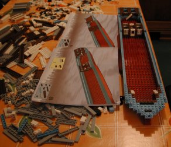
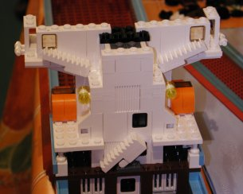
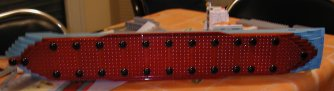
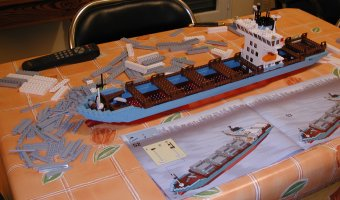

Le set [10152](http://guide.lugnet.com/set/10152) est disponible en quantité limitée puisque seul 14.000 exemplaires sont disponibles dont 4000 pour Maersk et le reste pour les magasins LEGO (Shop@home). LEGO a d’ailleurs vidé ses stocks de pièces de la couleur bleu Maersk, ce qui explique le nombre réduit disponible.

Le set se compose de 988 éléments, et un poids de près de 2kg (boite comprise).  
Le modèle construit mesure 69cm sur 15cm.

**Boite 10152**

Boite non ouverte du set Maersk Sealand 10152

## ouverture de la boite

Dès l’ouverture, on s’aperçoit que la boite est bien pleine. Une quinzaine de sachets contiennent les briques. Tout de suite, on remarque les rouges et une quantité non négligeable de bleu. Il y a également 6 planches d’autocollants au nom de Maersk.

**sachets sets 10152**

Les sachets sortis de la boite, non ouverts.

On distingue tout de suite de très nombreuses tiles (plate lisse) et surtout un nombre impressionnant de briques 1\*n en bleu Maersk.

## Construction

La base se compose de plate rouge sang (le nouveau rouge apparu avec les StarWars). Cela surprend un peu au départ car c’est une couleur assez crue. Tout de suite, on se rend  
compte de la taille de la "bête".

**Base 10152**

Etapes 1 et 2 de la construction du set 10152

Après 2 couches de rouge, on attaque le bleu. La proue et la poupe se composent de slopes 33 et 45 degrés mais également des nouvelles pièces [ref](http://www.peeron.com/inv/parts/500)  
en rouge (darkRed) et bleu Maesrk.

**coque**

La coque prend forme, 2 couches de rouge et une de bleu

Peu à peu, le poste de pilotage prend forme avec des escaliers à base de crémaillères blanches montées sur des charnières. De nombreuses petites fenêtres illustrent les cabines.

**Cabine**

la cabine du navire avec ses escaliers

Sous la coque de petites pieces rondes servent de support au bateau lorsqu’il ai posé. Y’en a quand meme 25 à mettre ;)

**dessous de coque**

Vue de dessous, on voit nettement les 25 tile rondes 2\*2

Une fois le bateau fini, on passe au support des containers. A partir de ce moment là, c’est un peu du travail à la chaine, notemment les containers gris au nombre de 30 !

**le navire**

Navire en entier sans les containers.

## Conclusion

Globalement très bien, une superbe conception, il est solide et se déplace  
sans problème (pas comme l’[ISD](http://guide.lugnet.com/set/10030)).

Le fond, de couleur rouge sang, se marie très bien avec le bleu maersk.

Cote design, les escaliers avec des crémaillères sont un peu  
fragiles, les premiers utilisent une technique qui consiste à les faire tenir  
sur un jumper ... idée étrange surtout que les deux derniers sont sur une plate  
2\*1, ce qui tient bien mieux.

Plein de bonnes piéces dans ce set, pas de gros morceaux, tout est dans la finesse.

Quant à la taille non compatible minifig, je suis plus mitigé, car en fait a part la cabine qui est pas adapté ce modèle pourrait très bien avoir des minifigs. Il faudrait en fait modifier l’escalier et agrandir un peu la cabine.

Par contre pour les containers, j’aurais aimé qu’ils soient de la même taille que ceux du set [1831](http://guide.lugnet.com/set/1831), car vu le nombre de petits, des grands auraient aussi fait l’affaire.

Cepandant, ce set vaut bien les 80E sur le shop.

Plus de photos sur ma [gallerie Brickshelf.](http://www.brickshelf.com/cgi-bin/gallery.cgi?f=84386)

[L’inventaire sur peeron.](http://www.peeron.com/cgi-bin/invcgis/inv/sets/10152-1?withpics=yes)

En espérant que vous aurez autant de plaisir que moi en le construisant.
