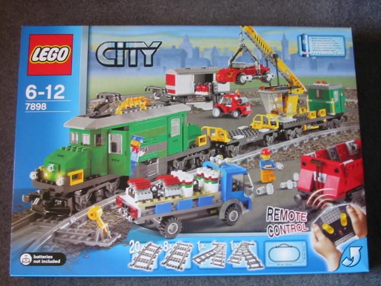
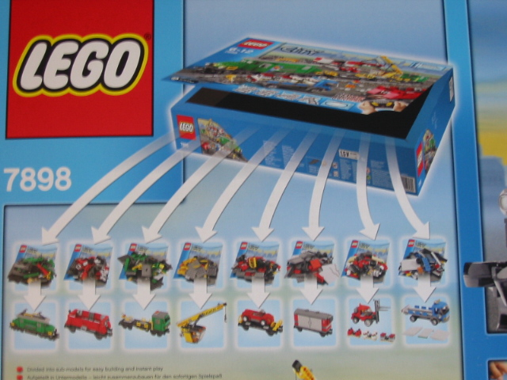
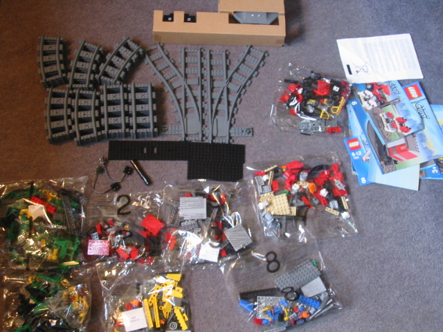
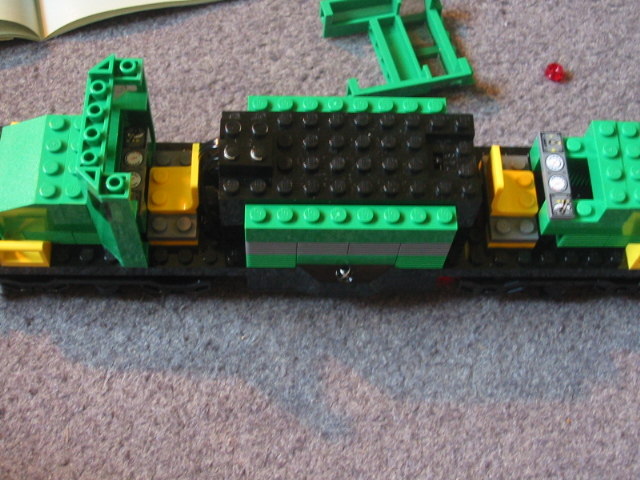
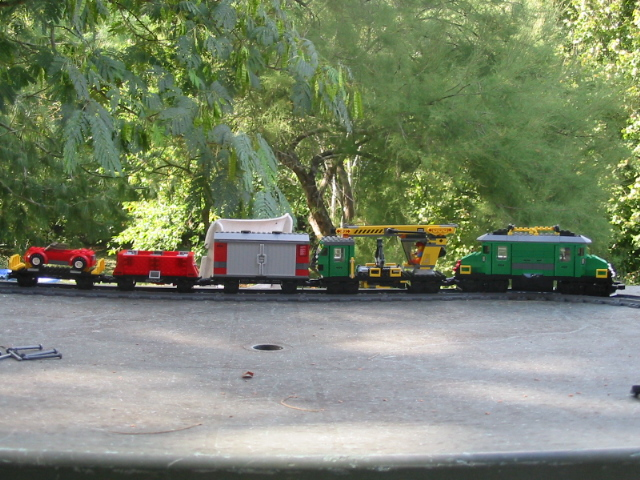
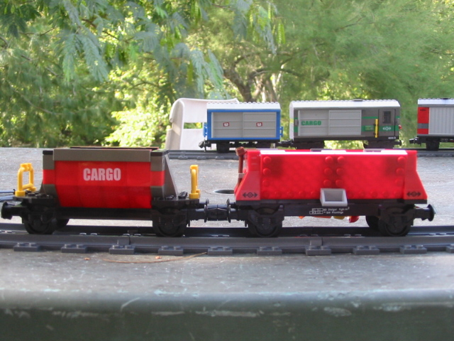
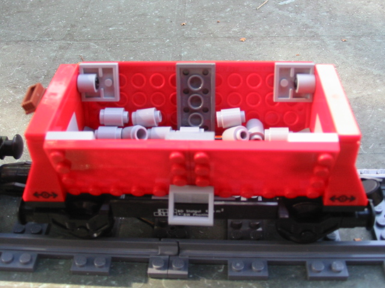
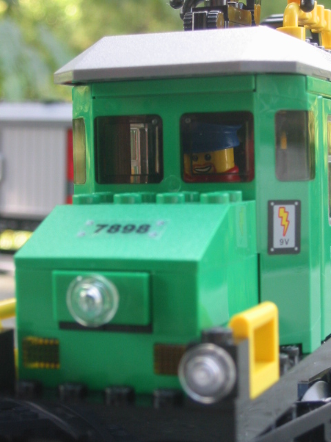
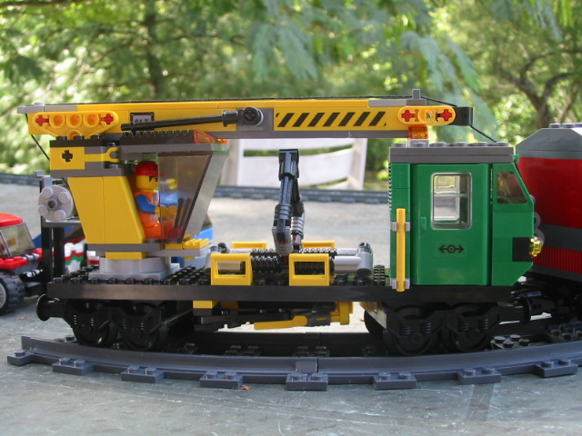

Le train de marchandises est enfin arrivé. Quelles bonnes ou mauvaises surprises LEGO nous a-t-il concocté dans cette boîte ?

**La boite**

**_Le set :_**

Après l’ouverture de la boîte, le set se décompose en 7 sachets pour un montage rapide comme la plupart des boîtes récentes.

**les sachets !**

**le contenu de la boîte comme le confirme la photo**

On commence par le montage de la locomotive, ensuite celui des wagons et on termine par les véhicules et accessoires.  
Le module irc est semblable à celui du [train voyageurs 7897](/articles/autopsie-d-un-train-irc-b-7897/). Le set comprend moins de métapièces que je ne le pensais ( par exemple pour la flèche de la grue ). Il y a des utilisations détournées de certaines pièces ( par exemple les pièces de moteur Technic ).

**locomotive en construction .**

J’ai l’impression que sur cette notice on voit mieux la différence entre le gris foncé et le noir. Je trouve par contre que les ténons noirs ressortent très mal surtout sur les plaques de base de train. Ca peut poser quelques difficultés de montage.

On trouve deux aiguillages et un peu plus de rails que dans le 7897 mais je trouve que la voie de contournement est très petite. L’achat de nouveau rails droits peut s’avérer nécessaire pour profiter pleinement des possibilités de ce petit circuit.

**vue générale**

**_Impressions :_**

Le design de la locomotive et de la plupart des wagons est réussi. On peut regretter le montage trop rapide du set. Les esprits chagrins noteront la ressemblance de certains wagons avec des modèles antérieurs. Je trouve sur le wagon rouge que les pièces qui tiennent le montage à l’intérieur sont trop visibles et nuisent à l’aspect général du wagon. C’était plus réussi sur le train précédent.

**comparaison**

**pas super l’interieur**

Le wagon porte-voitures est assez pauvre en pièces. On aurait pu espérer un nouveau conducteur de trains.

**vue proche....**

On notera de nouveaux autocollants au bas des wagons qui apportent une touche de réalisme supplémentaire.

En résumé, j’ai apprécié le nombre de wagons et de véhicules. Je regrette juste un montage un peu rapide et facile.

[Plus de photos dans ma galerie](http://photos.freelug.org/main.php/v/chatpin/7898/).

**la grue , en tout cas ça y ressemble**

N’hésitez pas à laisser vos impressions sur ce train dans les commentaires de l’article.
