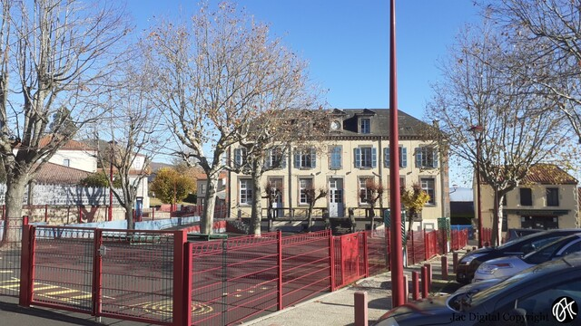
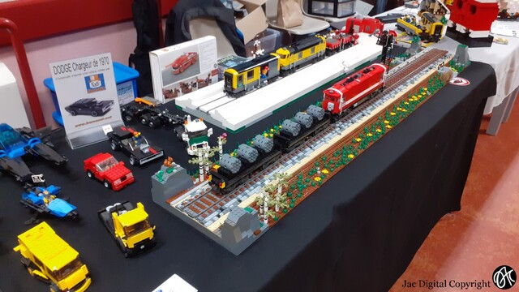
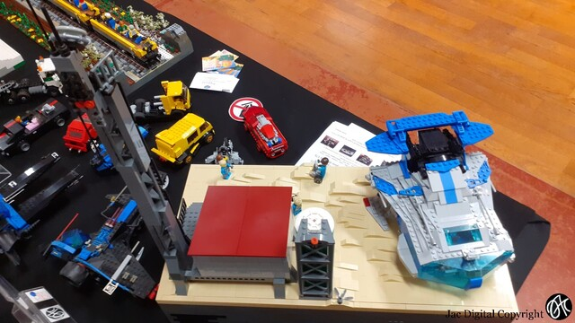

L’association "Auver’Briques" organisait sa deuxième exposition 100% LEGO à St Babel (63) les 20 et 21 novembre 2021. Voici un résumé de ces deux jours

En cette période peu propice aux expositions, je me consacrais uniquement à la convention SW de Cusset. Mais pour changer un peu j’ai eu envie de participer à une petite exposition 100% LEGO. Histoire de voir d’autres passionnés, d’autres choses, dans un cadre différent.

Donc, ce samedi 20 novembre, après avoir chargé ma voiture, me voilà parti sur les routes brumeuses des matinales d’automne auvergnat, pour rejoindre un petit village perché entre Clermont-Ferrand et Issoire.

Après une heure de route, je retrouve "Fabe", qui attend les exposants devant la petite salle des fêtes en plein cœur du village. Je ne suis pas le premier à arriver, mais pas le dernier non plus. Certains sont même déjà bien installés, mais je me concentre d’abord sur le déchargement de mes caisses et mon installation. J’arrive à contempler quelques stands petit à petit, surtout ceux qui se trouvent très proche du mien.

Le plus gros du stand est installé avant 13h, heure de l’ouverture de l’exposition. Mais le fignolage sera terminé plus tard dans l’après-midi. J’aime bien faire comme ça. Ca permet de s’occuper et aussi, les visiteurs ont une vue différente de ce qui est exposé. Ils nous voient construire. Ils disent même qu’ils apprécient cela. Bon après faut pas finir à 16h le dimanche hein ! Ca permet aussi d’avoir moins de risque de casse pendant le transport. C’est plus facile de transporter les plaques de voies sans les petites décorations.

J’avais aussi prévu de faire varier mon diorama spatial. Il était présenté en vol le samedi. Le dimanche matin, je l’ai posé à sa place et les explorateurs sont sortis...

Des rencontres très sympas avec les exposants et la possibilité de prendre du temps pour échanger sur les différents stands. Ce qui n’a pas empêché de recevoir beaucoup de monde et d’échanger sa passion, un peu plus de 1500 personnes pour la journée et demie d’ouverture.

Quelques souvenirs échangés avec Saroux qui était passé à Diemoz et une bonne discussion sur les trains d’autrefois, devant mes rails ballastés. Un emplacement de choix devant le stand d’Alban et à côté des musiques de Noël de Julie. Mais je ne vais pas énumérer tout le monde de peur d’en oublier. Le public en tous cas avait l’air ravi.

Bref une petite exposition sympathique qui a fait du bien, accueil chaleureux et bonne nuit de repos dans la salle malgré les ronfleurs.

Toutes les photos sont visibles en suivant ce lien :  
[https://photos.freelug.org/main.php/v/JAC/Exposition/2021/Babelbrique/](https://photos.freelug.org/main.php/v/JAC/Exposition/2021/Babelbrique/)
