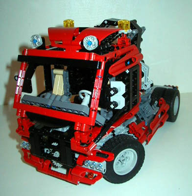
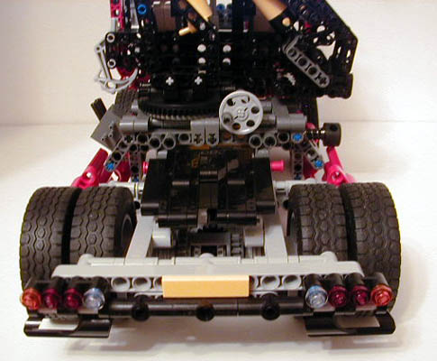
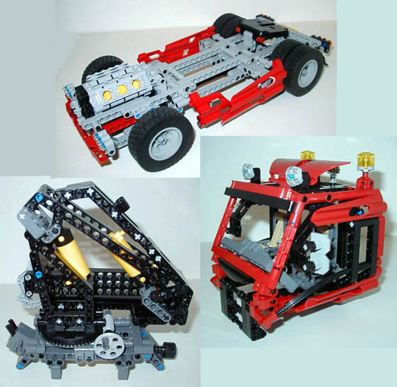
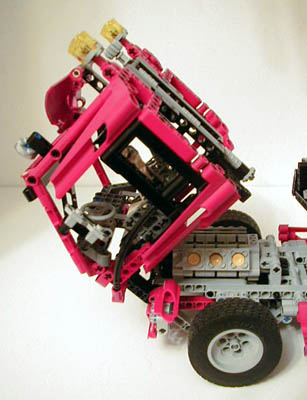
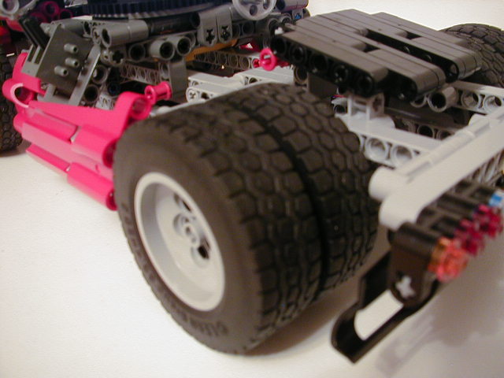
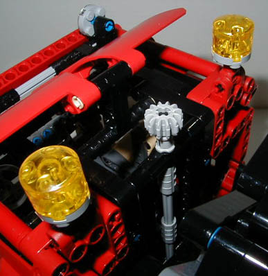

Une petite revue du modèle n°8436.

J’ai fini de monter le [camion 8436](http://shop.lego.com/product.asp?p=8436&cn=48&d=11&t=5) que Vauban m’a rapporté de Zwolle ([LEGOWORLD 2004](http://www.freelug.org/article.php3?id_article=319)).

Globalement, malgré une petite déception initiale (la maquette n’est pas aussi grosse que j’espérais) j’ai un avis positif sur ce modèle :

**–** L’esthétique globale est très réussie (même si c’est une question de goût), notez par exemple les feux arrière et les proportions générales,

  
**–** le montage est aisée grâce à la subdivision en 3 modules : châssis, cabine, outils,

  
**–** les modèles alternatifs pour les outils (une grue sur châssis, un support de remorquage, une pince) assureront des heures de montage,  
**–** la cabine bascule laissant apparaître le moteur factice et

  
**–** de nouveaux pneumatiques [^1] (roues) très réalistes réjouiront les fans de Model Team, associés à

  
**–** une grande jouabilité grâce par exemple au classique déport de la direction sur le toit et à une solidité appréciable.

**Les éléments techniques réjouiront les plus grands :**

**–** Le différentiel sur pont arrière est un grand classique devenu incontournable,  
**–** le moteur factice 6 cylindres est toujours aussi agréable à faire tourner,  
**–** les éléments pneumatiques (une pompe, deux pistons) redeviennent à la mode,  
**–** la nouvelle table pivotante Technic est aussi présente,  
**–** ainsi que l’éternelle direction (qui manquait cruellement au Land Busters [4404](http://guide.lugnet.com/set/4404)).

On regrettera l’absence de suspensions (au moins sur l’un des deux essieux). Les plus exigeants, les nostalgiques des "Super Car" 8880 et 8448 regretterons bien sur une échelle de maquette plus grande, la boite de vitesse et la généralisation de suspensions indépendantes à chacune des roues.

A peu de frais vous utiliserez les chevilles grises de votre collection en lieu et place de celles qui sont fournies : bleues, elles dénotent un peu avec la robe rouge du modèle [^2].

En bref j’adore au point que je conserve ce modèle en l’état plutôt que de le démonter pour récupérer les pièces. Un set qui j’en suis certain servira de base à des créations personnelles plus complexes, la sellette par exemple n’attend plus qu’une semi-remorque, une version camion porteur est aussi à envisager.

Liens :

**–** L’inventaire des pièces sur [Peeron](http://www.peeron.com/inv/sets/8436-1)  
**–** Galeries sur BrickShelf :

-   [1](http://www.brickshelf.com/cgi-bin/gallery.cgi?f=92028)
-   [2](http://www.brickshelf.com/cgi-bin/gallery.cgi?f=97981)
-   [3](http://www.brickshelf.com/cgi-bin/gallery.cgi?f=107818)
-   [4](http://www.brickshelf.com/cgi-bin/gallery.cgi?f=94521)
-   [5](http://www.brickshelf.com/cgi-bin/gallery.cgi?f=100434)

[^1]: en fait les mêmes que ceux du [Barcode Multi-Set n°8479](http://www.peeron.com/inv/parts/32019) de 1997

[^2]: Cette couleur permet de les différencier aisément d’autres pièces de forme proche, facilitant le montage pour les plus jeunes,
