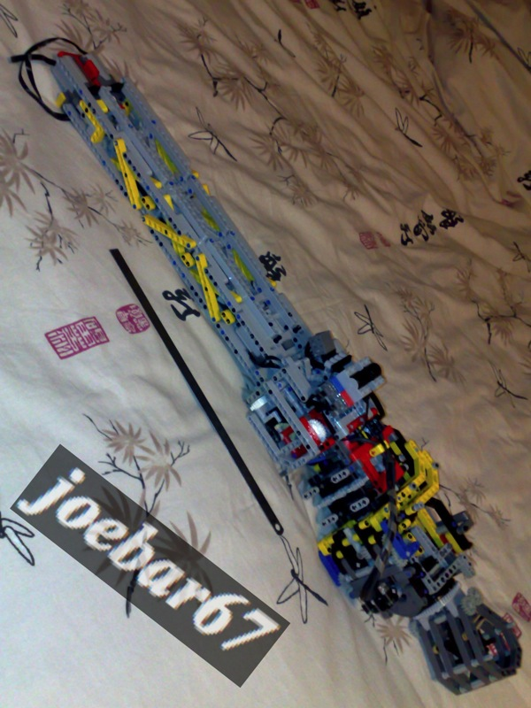

Le petit compresseur, dont j’ai laissé accès à la notice, est le système qui assure l’arrivée d’air comprimé sur mon engin.

**bras**

La fermeture de la pince est pneumatique et est gérée par une auto-valve pilotée par un moteur M via la télécommande.  
La pince trois axes vient tout droit des robots de production ; elle se compose de plusieurs ensembles, différentiés par des couleurs (plus simple à repérer visuellement) :  
**–** la rotation 360° de la pince en rouge (sur le coté opposé au bleu qu’on ne voit pas bien sur la photo) ;  
**–** le coté bleu c’est l’inclinaison de la pince à plus de 108°  
**–** la partie rouge et jaune est le poignet qui permet de faire tourner à 180° tout l’ensemble dans le prolongement de la poutre qui elle même est télescopique (partie rouge à l’autre bout de la flèche).

Le descriptif :  
**–** un jeu de LED pour l’éclairage ;  
**–** un moteur M pour la rotation de la pince en rouge ;  
**–** un moteur M pour l’inclinaison de la pince en bleu ;  
**–** un moteur M pour la rotation du poignet en rouge et jaune ;  
**–** deux moteurs M pour la télescopie du bras tout entier, en rouge à l’autre bout ;  
**–** un moteur M pour le groupe compresseur qui sera quant à lui dans le châssis.

Le tout, c’est à dire les 5 moteurs M embarqués + celui du compresseur hors de la structure sont entièrement PFS.

Vous pouvez aussi le retrouver sur le Forum BricTechnic : [Engin hybride de préhension](http://forum.brictechnic.fr/viewtopic.php?f=68&t=2108)

Et aussi :

[ma galerie BrickShelf](http://www.brickshelf.com/cgi-bin/gallery.cgi?f=404234)
