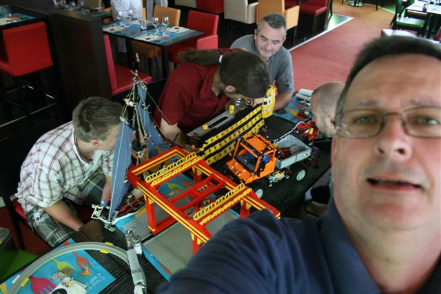
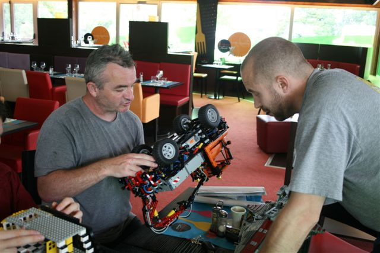
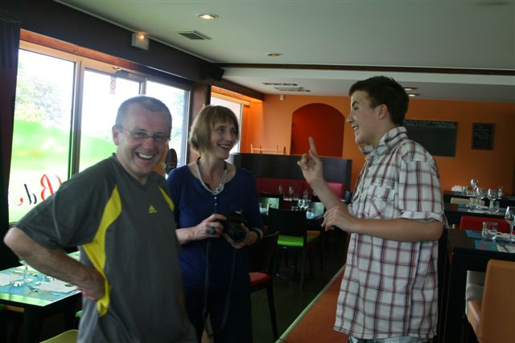

Malgré les nombreuses indisponibilités des AFOLS, le brick resto de Morlaix a pu accueillir tout de même 7 membres du coin sur la quinzaine (Malo et sa maman, Bruno et Laurent, Jean-Noël (Technic), Jérôme (Technic) et moi-même.

Juste après le repas et disposant du temps généreusement accordé par le patron, nous sommes restés jusqu’à la fermeture du resto, nous avons déballé plusieurs MOCs fort intéressants, SW grand impérial shuttle et autres modèles, TECHNIC dernier Unimog, ref 8810, train : mon portique rail route, des bateaux de Laurent.

En conclusion, bonne table, un excellent moment de convivialité, j’ai apprécié les MOCs inconnus et connus, du groupe, il s’est dégagé une volonté de se retrouver régulièrement, merci aux participants d’être venus.

_Jean-Marc_
