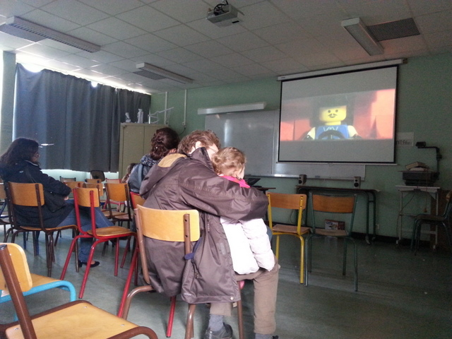
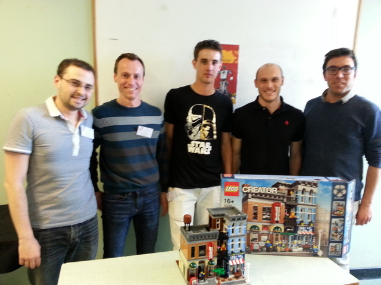
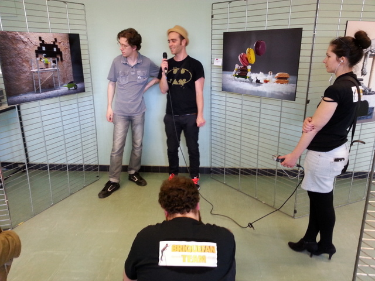
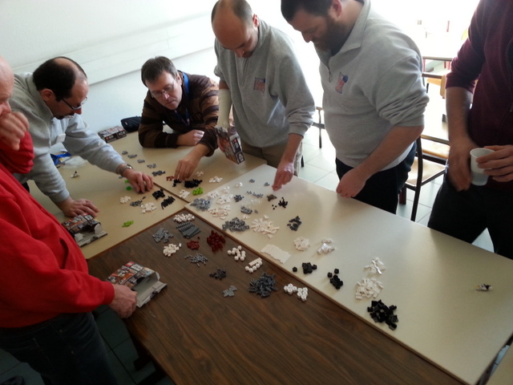
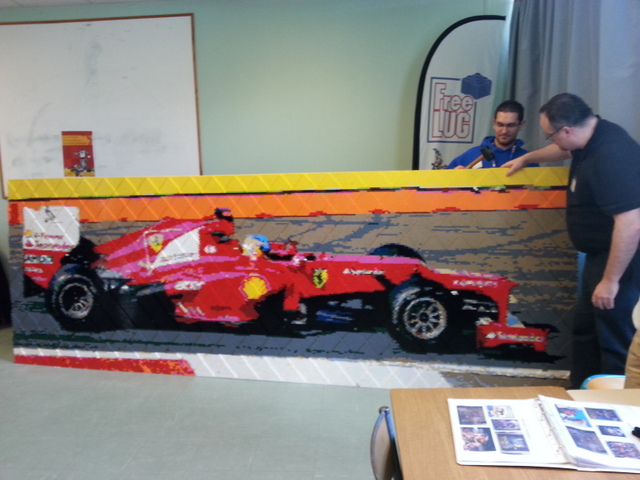
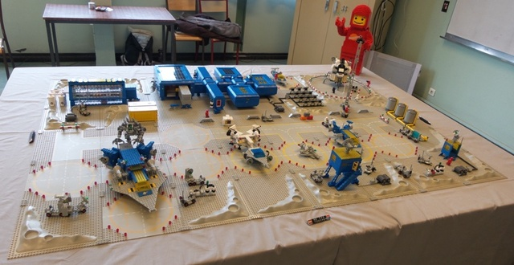
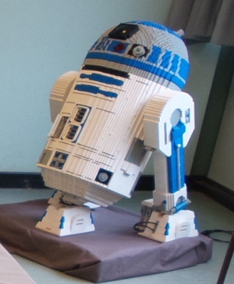
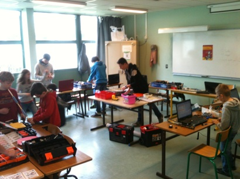
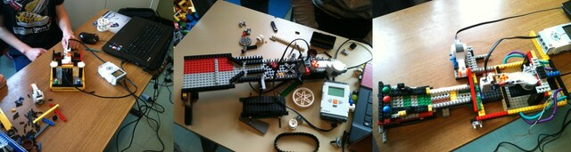
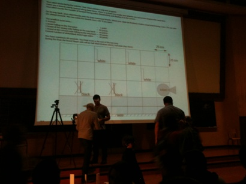

Les 4 et 5 avril s’est tenue la seconde convention 100% LEGO destinée en premier lieu aux Afols puis une ouverture au public afin de partager notre passion au plus grand nombre.

Après un coup d’essai en 2014 afin de se faire connaitre et découvrir les lieux (exposition en plusieurs petites salles...)...

Toujours brillamment aidé par les étudiants de la promo GMD de l’INSA, la nouvelle édition de 2015 s’est préparée avec de bonnes volontés.

Le premier objectif de cette Briqu’Convention est de proposer de nouvelles choses aux Afols, en plus des traditionnelles expositions.  
Nous avons donc découpé le week end en deux parties : des moments réservés aux Afols et exposants, des moments ouverts à tout public.

L’installation commença dès le vendredi 18h après la fin des cours...  
Les étudiants ont alors investi chaque salle pour les vider des tables et réagencées chacune d’entre elles afin d’avoir des salles d’exposition.

Le samedi matin l’installation s’est poursuivie puis à partir de 10h sont arrivés en plus des exposants, des Afols pour participer aux animations du matin.

Cela commença à 10h15 par Antoine !  
Le célèbre Youtubeur Briquefan nous a fait une présentation en live de ces célèbres vidéos :

[Vidéo de la publication d’origine](https://www.youtube.com/embed/M7Zgtmh5tQY)

Ensuite, c’est Didier"SixStudS" qui nous a expliqué différentes techniques de montages [à retrouver sous forme d’article sur le site](/articles/les-techniques-de-montage-avancees-le-snir/).

Ces deux présentations ont permis des échanges et débats entre Afols.

A 12h, c’est l’heure d’ouvrir au public...

La journée s’est passée au rythme des discussions, échanges et aux autres découvertes de chacun.

A chaque salle, le public découvre un nouvel univers.

Une salle était dédié à la stopmotion et l’atelier de Jean-Yves qui permettait aux enfants de réaliser des petites séquences en stop motion.  
Et dans la salle voisine étaient diffusées en continu Les Aventures d’Henri et Edmond avec les 3 Brickfilms de Maxime.

Durant l’après midi, un groupe d’Afols a monté en "speed building" le set 10246 Detective office. Ils étaient 5 à se partager le montage du set.

**c’est construit en un temps record !**

Durée du montage : 1h 20min 46s

L’artiste Samsofy était présent avec une galerie de ses photos.

**Samsofy interviewé par BriqueFan !**

Durant le week-end, un évènement parallèlea lieu, le LEGO ROBOT CHALLENGE ou LRC.  
Tout commence le vendredi soir à 18h où des étudiants de l’INSA après inscription se lancent pour 24h non stop.  
Leur but : monter un robot Mindstorms, le programmer afin de réussir la mission donnée.

La finale a lieu le samedi soir à 18h en présence du public venu nombreux assister aux combat de ces robots.

Quelques moment mémorables à voir !

Après cette belle journée, il y a eu la traditionnelle soirée en présence des étudiants qui organisaient l’événement avec nous.

Des jeux ont permis une distribution de boites... Il y a eu quelques heureux !

Après une nuit de repos, de nouvelles présentations avaient lieu le dimanche matin.  
A partir de 10h, c’est un draft qui a été proposé avec le set 75076 republic gunship. Les Afols participant se sont attribués des pièces chacun leur tour.

A 11h c’est Erik "Brickerik" qui nous a proposé une présentation sur les nouvelles pièces LEGO, et leur usage possible.

L’ouverture au public s’est de nouveau faite à 12h pour une nouvelle après midi de découverte, échange, discussion...  
Des groupes se formaient pour débattre des derniers sets ou dernières Minifigs sortis.

Vers 16h, le dernier module de la mosaïque a été posé.

**Une formule 1 en LEGO !**

Ce sont 33 800 briques qui ont été assemblées par le public pour découvrir cette FERRARI !

Cette convention s’est terminée par le tirage au sort de la tombola et du jeu enfants vers 18h.

Et le rangement a pu démarrer pour chaque exposant.

Un week end intense qui a permis à chacun de venir partager sa passion dans un cadre qui sortait de l’ordinaire.

Merci à chaque participants, exposants, bénévoles d’avoir passé le week end ensemble. Ce sont tous ces moments de partages en réel qui motive à continuer d’être actif au sein de la grande communauté Afol.

A l’année prochaine !!

Le compte rendu de BriqueFan

[Vidéo de la publication d’origine](https://www.youtube.com/embed/mQFwGTnPD9E)

* * *

Excellente formule ! Très bonne idée et plein de bonnes choses comme le regroupement dans une même travée, au rez-de-chaussée, avec des salles pas trop grandes. Je pense qu’exposants et visiteurs ont apprécié.

Cette année Grodédeu est revenu avec le badge officiel ! La classe... Et oui, ne pas oublier qu’il a fait ses débuts en public lors de l’édition 2014 de cette même Briqu’Convention. Mais il n’était alors qu’un invité de dernière minute, obligé de partager la pièce avec un photographe à chapeau ! C’est dire si les conditions n’étaient pas les mêmes... ;-)

Merci à tous et à la prochaine !

Jérôme Vannier (jivé69)

* * *

Pour cette seconde édition, c’est avec les membres de l’association Ludodiem que je suis venu pour animer le samedi un atelier "Robotique".

L’association [Ludodiem](https://www.facebook.com/pages/Ludodiem/197088343706442?ref=hl), est une association locale, à Diemoz qui propose des ateliers d’initiation à la robotique avec du Mindstorm et d’autres activités autour du jeu en général et Lego en particulier. L’association entretien des liens privilégiés avec l’INSA et avait donc répondu avec plaisir à leur invitation.

**Les enfants en pleine conception de leur module GBB**

Pour cette journée, j’ai proposé aux enfants de construire un module de GBB (Grand Bidule à Balles). C’est une activité à laquelle ils se sont déjà essayé et qui rencontre en général un franc succès.

**Les GBB construits par les enfants**

A côté de cela, nous proposions un espace Duplo pour les plus jeunes.

La journée s’est terminée en beauté avec la finale du Lego Robot challenge. Un moment de rigolade devant les robots qui étaient parfois très capricieux, mais aussi un moment d’émerveillement devant les performances de certains. Il faut dire que le sujet était particulièrement ardu !

**Explication des règles du Lego Robot Challenge**

Pour le dimanche, c’est l’équipe organisatrice de [BRIQU’Expo Diemoz](http://briquexpodiemoz.com/) qui a pris la relève pour assuré un atelier, avec les maintenant traditionnelles petites mosaïques, les stands de briques et Duplo : des valeurs sûres.

Un très bon Week End, avec des rencontres toujours aussi sympa !

Yannoch
