C’est une nouvelle édition de la convention qui s’est tenu à VILLEURBANNE les 02 et 03 avril où de nombreux Afols se sont rencontrés au milieu d’un public venu en nombre !

Et de 3...!  
Après 2014 et 2015, l’année 2016 restera marquée par une édition augmentée de toutes parts : taille, participants, visiteurs, qualité de présentation...

Le but de cette Briqu’Convention reste la même, proposer une convention unique aux AFOL avec des présentations, de nombreuses créations et de l’espace pour partager leur passion.

L’association des élèves de la promo GMD était de nouveau au rendez-vous pour s’occuper de mains de maître de toute l’intendance : préparation des salles, entrées, buvette, repas, coup de main...

[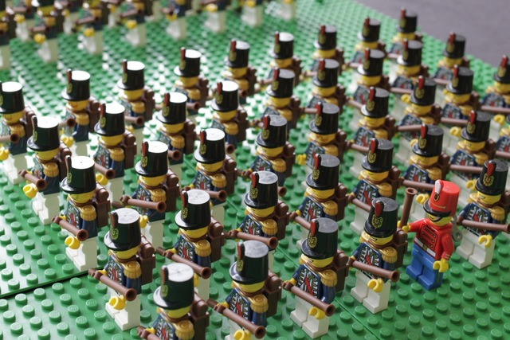](https://www.freelug.org/IMG/jpg/_MG_8185.jpg)

La particularité de cette convention est l’exposition qui a lieu dans des salles de classes. Les exposants étaient répartis dans 17 salles. Grâce à la grande diversité des thèmes apportés par les AFOL, nous avons pu découvrir des univers différents à l’entrée de chaque salle... Technic, Ville, Star Wars, Train, Bionicle, Friends...

[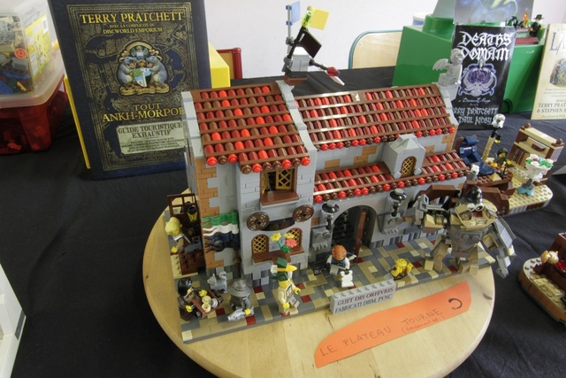](https://www.freelug.org/IMG/jpg/_MG_8374.jpg)

L’association Bionifigs était présente en nombre pour remplir l’espace qui leur était alloué.

Après une première sortie réussie lors de la Briqu’Expo de Diemoz en septembre dernier, Nicolas est venu présenter son cockpit d’un Airbus A320 où les visiteurs ont pu prendre les commandes !

La salle de projection diffusait en boucle les aventures d’Henri et Edmond, qui attire toujours son public.

Quant à la mosaïque, nous avons pu proposer la mosaïque présente lors de l’exposition de Fontaines sur Saône. Quelques milliers de briques rouges 2x4 étaient à disposition du public, ou encore de nombreuses belles créations d’un jour ont été présentées.

[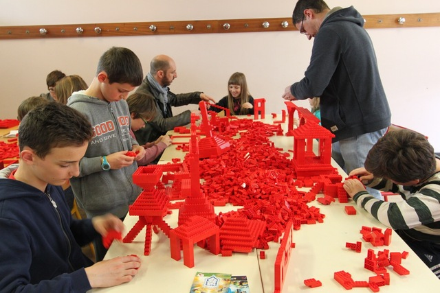](https://www.freelug.org/IMG/jpg/IMG_8383.jpg)

Pour la partie "AFOL", les matins ont vu les nouvelles présentations de Didier"SixStuds" sur "Tenons et antistuds" (que vous pouvez retrouver sur notre [site](http://www.freelug.org/spip.php?article2217)) et Erik"Brickerik" sur les pièces qui disparaissent du catalogue.

[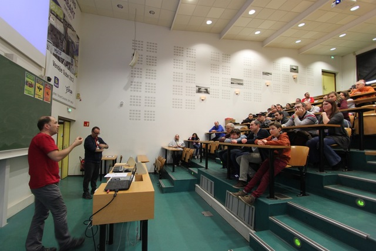](https://www.freelug.org/IMG/jpg/IMG_7934.jpg)

Un draft a été l’occasion d’un tour de table géant et des AFOL patientant leur tour pour choisir un sachet de pièces...

Le samedi à 18 h a eu lieu la finale du LRC (LEGO Robot Challenge), c’est un challenge ou des étudiants ont 24 h pour créer et programmer un robot LEGO Mindstorms.  
C’est 10 équipes qui se sont affrontées lors de cette finale.

[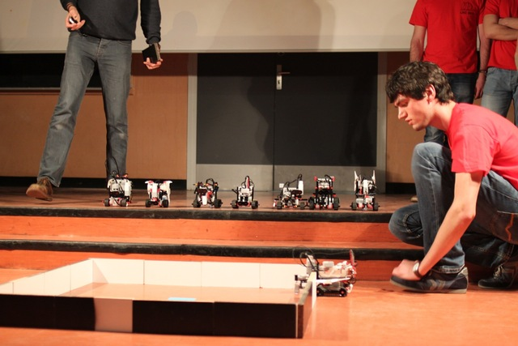](https://www.freelug.org/IMG/jpg/IMG_7974.jpg)

Durant le week-end, de nombreux échanges ont permis à chacun de débattre et de convaincre sur les meilleures techniques de constructions ou encore sur les nouvelles pièces...

[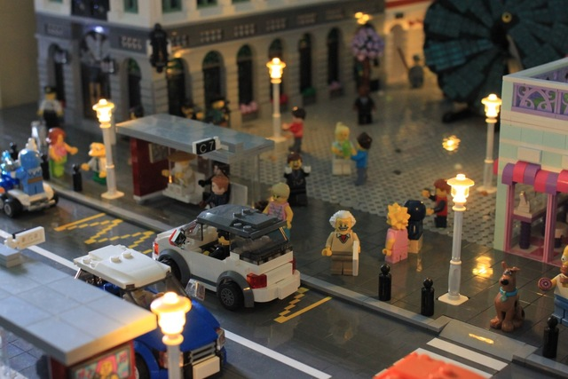](https://www.freelug.org/IMG/jpg/IMG_8098.jpg)

Nous sommes heureux de vous avoir proposé cet événement et souhaitons l’améliorer pour vous proposer de nouvelles choses...

Merci à tous et surement à l’année prochaine !!

* * *

Première Briqu’Convention pour Tigrounette et TitLego05 !

Pour notre seconde participation à un événement FreeLUG, nous avons été heureux de participer à ce dernier.  
Tout était au TOP, de l’organisation à l’accueil en passant par les conférences qui étaient très instructives.

[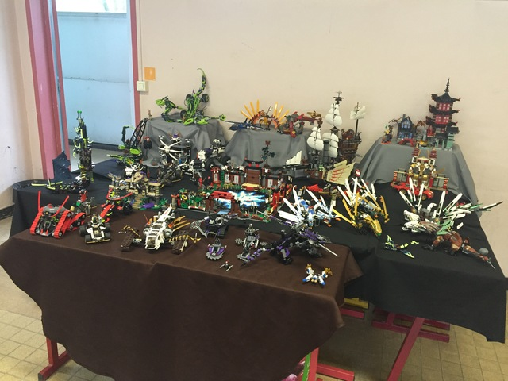](https://www.freelug.org/IMG/jpg/IMG_3634.jpg)

**Ninjago de Tigrounette et TitLego05**

Photo de la Briqu’Convention VILLEURBANNE

Ce que nous avons préféré ? Les regards des enfants sur nos petits Ninjago. Des sourires jusque derrière les oreilles, des parents intrigués et d’autres perplexes. Nous nous souvenons d’un petit garçon qui disait à sa maman : " c’est le plus beau jour de ma vie" (le souffle coupé).  
Nous reviendrons pour la prochaine édition avec des MOC.

_Sophie et Johan_

* * *

Bon, alors, la **Briqu’Convention** a ceci de particulier pour moi que la première édition fut ma toute première expérience comme exposant. Ce fut aussi la toute première sortie de Grodédeu. Il s’est donc créé un lien particulier. J’aime cet endroit et le format de l’exposition : plusieurs salles permettant de segmenter un peu les vagues de visiteurs (bon, là, il y en a eu vraiment beaucoup, du coup, parfois, ça sentait un peu la croquette...) et de créer des zones à thèmes.

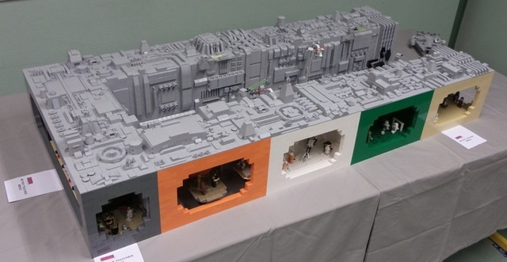

J’aime beaucoup également la partie convention, avec les opportunités de regroupement de tous les exposants. Autant d’occasions de dire des âneries, ce qui me change des éternelles questions de visiteurs (combien de pièces ? Combien de temps ? C’est vraiment vous qui avez fait ça ? Avec quelles briques ? Et tant d’autres...).

[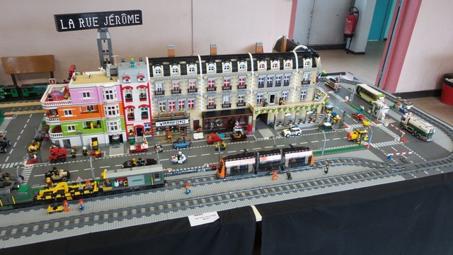](https://www.freelug.org/IMG/jpg/20160403_093059.jpg)

Merci **Fabrice Ville** et les étudiants du GMD pour tous vos efforts, votre gentillesse, votre accueil et le super couscous ! Préparez-vous psychologiquement : je reviendrai l’année prochaine ! :-)

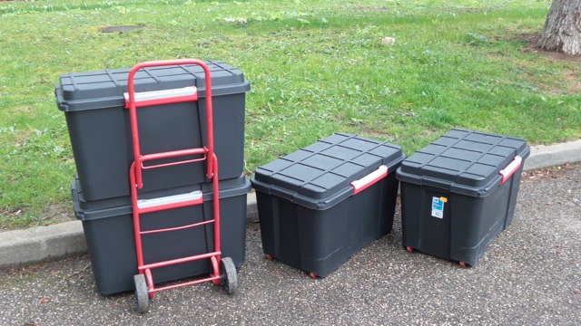

_Jérôme_

* * *

Première édition pour moi à la **Briqu’Convention** en tant qu’exposant (et oui j’étais venu l’année dernière en tant que visiteur) et j’avoue adorer le concept, le fait que différents thèmes se retrouvent dans différentes salles de classe permet de profiter plus pleinement des exposants et des réalisations/créations exposées.  
Les visiteurs étaient vraiment très agréables et très intéressés.  
La partie convention est un moyen bien sympathique de ne pas rester toute la journée sur une expo et du coup nous permets d’apprendre des choses intéressantes par des conférenciers tout aussi intéressants.

[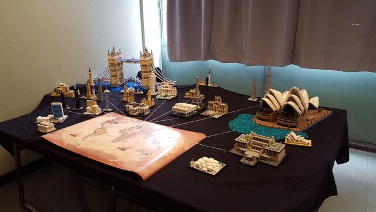](https://www.freelug.org/IMG/jpg/Briqu_Convention_2016.jpg)

**Briqu’Convention 2016**

Table Architecture by Pierrouk

Je remercie aussi toute l’équipe organisatrice et les étudiants du GMD qui ont fourni un boulot monstre.  
La soirée couscous fût très plaisante mais monter un set en sachet faut avouer que nous n’avons pas l’habitude :-)

_Pierrick_

* * *

Deuxième sortie pour **Air Brick** avec notre cockpit d’A320 et première participation pour nous à la Briqu’Convention. Pour cette édition, avec l’aide d’Emmanuel et de Benoît nous avons construit une cage de projection et acquis un vidéoprojecteur dédié. Le rendu visuel est très nettement amélioré, avec l’impression d’être "dedans".

[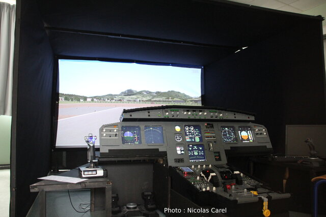](https://www.freelug.org/IMG/jpg/BC2016-Airbrick-3.jpg)

[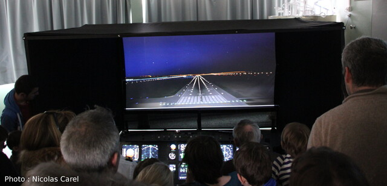](https://www.freelug.org/IMG/jpg/BC2016-Airbrick-6.jpg)

Dominique Brultey, instructeur A320 et Emmanuel Simon, pilote de ligne, sont venu m’aider à animer.  
L’animation s’est déroulée en deux parties :

-   les matinées ont été réservées pour les élèves de collège et lycée qui préparent le B.I.A (Brevet d’Initiation à l’Aéronautique). Quelques élèves des Lazaristes, Minimes et Bellecombe ont répondu à l’invitation. Nous avons fait une présentation de l’avion et un vol de démonstration. Le vidéoprojecteur de la salle nous a bien aidés pour afficher les instruments en grand.

[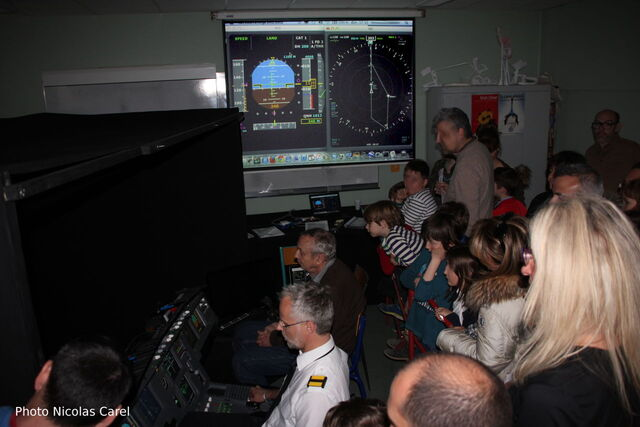](https://www.freelug.org/IMG/jpg/BC2016-Airbrick-7.jpg)

-   les après-midi, nous avons fait passer les jeunes visiteurs entre 10 et 15 ans pour un tour de piste de Lyon St Exupéry.  
    Merci à notre sponsor, [Aviasim](http://www.aviasim.fr/fr/), qui nous a permis de financer une partie du système de projection. Merci aussi à [QPAC](http://www.qpac.eu/index.php/a320-simulator-at-tu-dresden) qui nous a fourni la dernière version de la logique A320 pour X-Plane.

Nous étions tous les trois vidés à la fin de chaque journée, mais tellement heureux d’avoir fait découvrir notre passion.

Nous avons bien aimé les remarques des petits et des grands :

-   _Mais ! C’est en LEGO ! J’avais pas vu._
-   _Monsieur, c’est des vrais LEGO ou c’est un vrai avion ?_
-   _C’est filmé où ?_  
    _Nicolas_

* * *

Pour la deuxième année consécutive, l’association Diémoise [Ludodiem](https://www.facebook.com/Ludodiem-197088343706442/) (association qui a pour but d’initier les enfants à la robotique avec la gamme Mindstorm) délocalisait son atelier mensuel dans les locaux de l’Insa à l’occasion de cette nouvelle Convention.

L’objectif était de montrer sur une journée ce que les enfants étaient capables de faire, de partager avec les enfants d’une autre association de robotique et d’assister à la finale de la coupe de robotique, histoire de voir ce que les élèves ingénieurs sont capables de faire ... ou pas.

[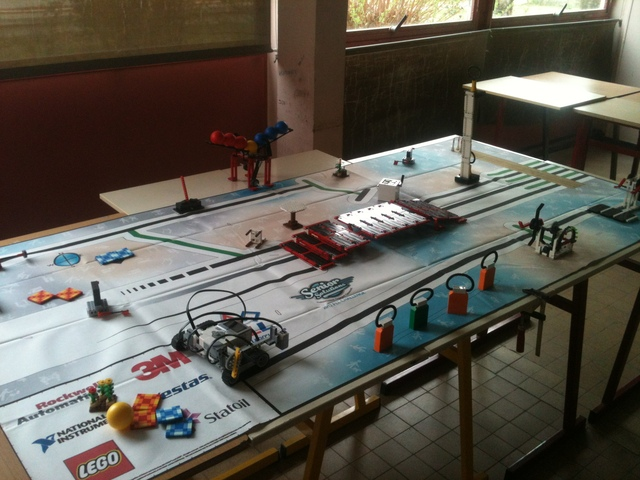](https://www.freelug.org/IMG/jpg/BC_Villeurbanne_1.jpg)

**Parcours de Robotique**

Cette année encore, les élèves nous ont proposé un beau spectacle, avec des robots parfois performants, parfois assez médiocre, avec une animation de Fabrice toujours dans la bonne humeur !

[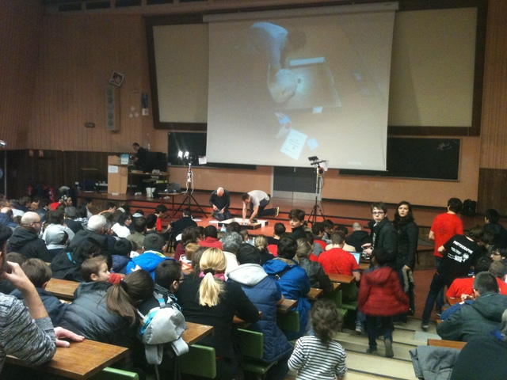](https://www.freelug.org/IMG/jpg/BC_Villeurbanne_2.jpg)

**Coupe de Robotique**

Enfin, un petit stand de stop motion avait été mis en place. Il s’agit en effet d’une activité régulièrement proposée par l’association. Les enfants ont pu ainsi réaliser quelques séquences vidéo :

[Vidéo de la publication d’origine](https://www.youtube.com/embed/J8XNA4J7OZk)

Encore une très bonne édition et vivement la prochaine !

Yannoch06/Yannick

* * *

Un an auparavant j’étais visiteur à la BC Villeurbanne et je rencontrais Loys qui me proposait d’exposer à Diémoz. Cette année je suis derrière la table.

Ce format d’exposition est vraiment sympa, découper la journée avec les animations entre AFOL le matin, les salles par thème, le concours de robots et les nombreuses activités. Ça change, ça fonctionne et c’est bien, on n’a pas le temps de s’ennuyer ! La traditionnelle soirée entre exposants est aussi une réussite, avec notamment un délicieux couscous !

Pour moi c’était la première présentation des "cubes", au nombre de 6 dont 3 participations d’autres AFOL ça commence doucement et j’espère que ça va s’agrandir.

[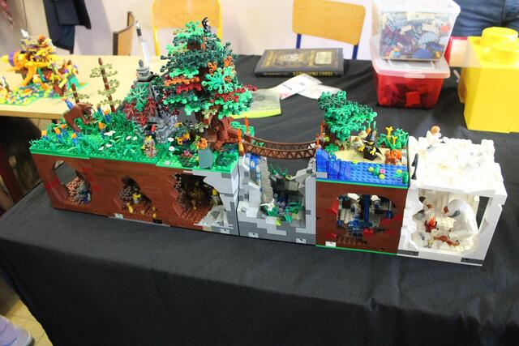](https://www.freelug.org/IMG/jpg/13009710_10209221120263448_67635375_o.jpg)

**Cubes Disque-Monde**

MOC collaboratif

Bref, du tout bon pour moi, vivement l’année prochaine !

_Bertrand / Fa_

* * *

Cette Briqu’Convention a été la première présentation d’un nouveau projet : monter d’un cran dans au niveau d’un diorama collaboratif City par rapport à ce que j’ai pu faire par le passé : plus de plaque de route, mais une route en SNOT, des raccords entre participants plus élaborés, des éléments communs (bancs, poubelles, bornes incendie, signalisation routière),... une première version plutôt réussie !  
Sinon, un super week-end, avec de la fatigue, du stress, mais la satisfaction de voir les exposants et le public au rendez-vous !

_Laurent_

* * *

Au fil de ces deux jours, les visiteurs ont pu, en compagnie de tous les exposants appréciés, au-delà des différentes techniques, toutes les créations et expositions de set ou MOC en LEGO.

[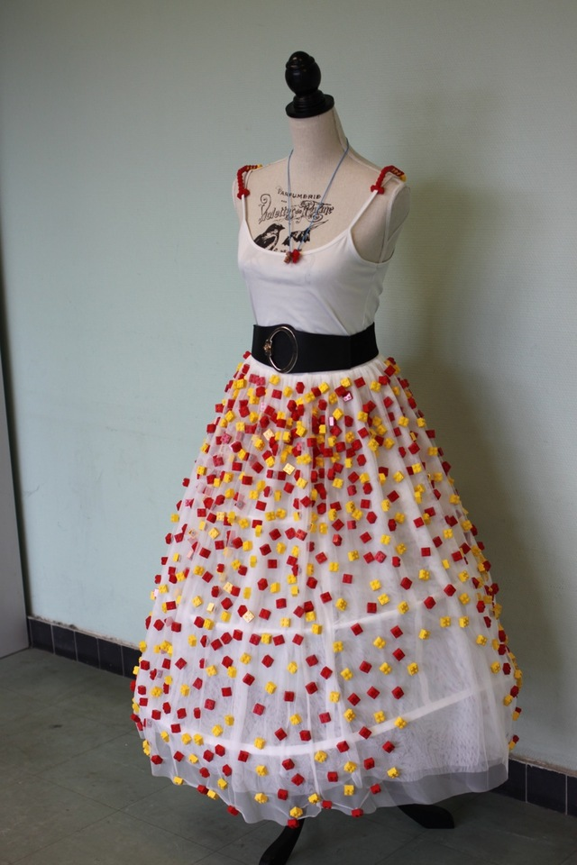](https://www.freelug.org/IMG/jpg/IMG_8056.jpg)

J’ai pu moi aussi participer à ce grand rassemblement en exposant des créations autour du monde de Disney et des Elves, dans une salle que j’ai partagé avec une jeune fille très attachante et prometteuse dans le monde des LEGO.  
(Un peu de rose dans ce monde de noir et parfois en gris très très foncé)

[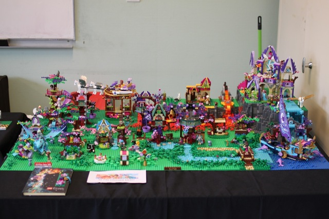](https://www.freelug.org/IMG/jpg/IMG_8057.jpg)

J’ai beaucoup apprécié les différentes interventions, les matins, faites par et pour les AFOL.  
Ce fut un week-end très enrichissant, ou j’ai pu rencontrer en me promenant des personnes sympathiques et ouvertes.  
La création et l’imagination n’a pas de limites. Mes créations se sont animés d’une vie nouvelle au contact du regard des visiteurs et cela poussent à créer et faire de nouvelles choses pour une prochaine exposition.  
Merci à tous les organisateurs, étudiants, exposants, visiteurs et j’en passe d’avoir participé à cet évènement.  
Je vous donne rendez-vous en 2017 pour la prochaine édition, pour une nouvelle aventure.

_Marie/Choupslego_
