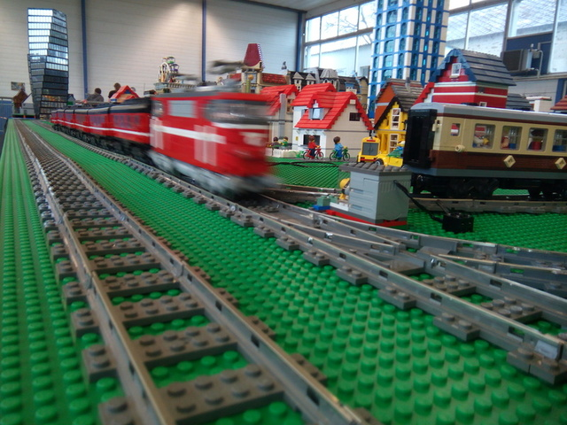
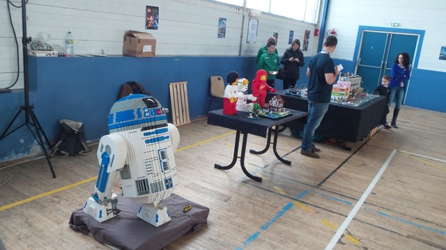
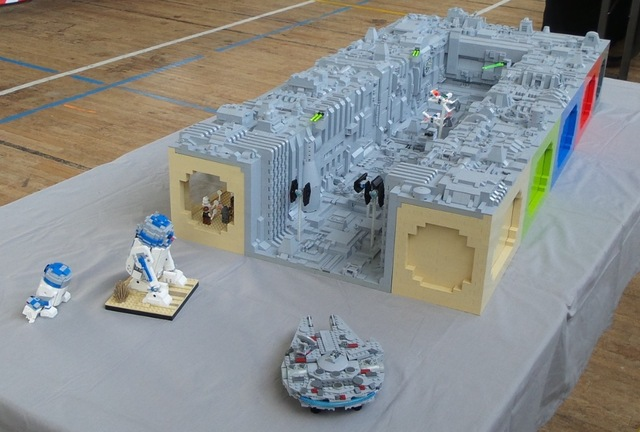
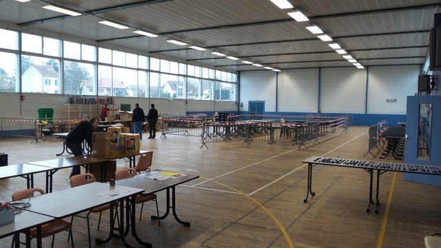
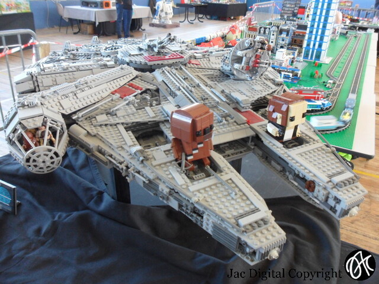
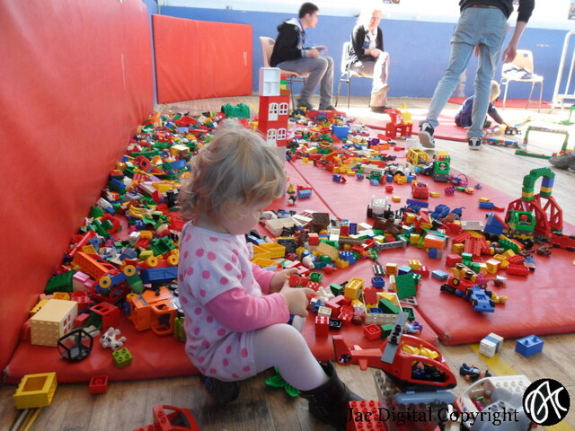
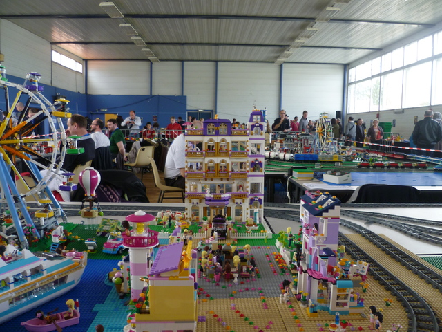
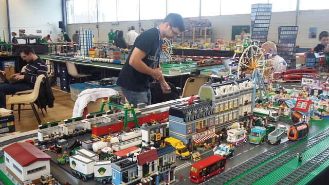

Les exposants ou visiteurs qui le souhaitent sont invités à développer leurs commentaires et impressions sur ce week-end ci dessous.

Arrivé de Clermont-Ferrand le samedi matin tôt, vers 8h00, pour la première de Briqu’Expo-Combrailles dans une grande salle omnisports très lumineuse située dans le village de Marcillat-en-Combrailles (900 âmes) où nous avions l’ambition de faire venir le public pour voir du LEGO.

Les tables étaient déjà en place, grâce à la mobilisation des bénévoles de la commune et alentours, mobilisation qui ne fléchira pas durant les deux jours de la Briqu’Expo. Merci à tous ces gens généreux de leur temps et de leur énergie.

Le montage de notre diorama s’est déroulé dans le calme comme sait si bien l’entretenir Mammy Danny (venue de Lezoux) qui plaçait sa ville au milieu du réseau de trains 9V que j’avais apporté. Enfin, précisons que ce n’était pas tout à fait du 9V classique, même si il fallait s’approcher et voir dans les détails pour s’apercevoir que les commandes étaient en DCC et chaque moteur équipé d’un décodeur numérique. Quelques visiteurs, à l’œil de modéliste ferroviaire averti, ont quand même remarqué la jouabilité de l’ensemble lorsque l’on marie LEGO et DCC.

Il y avait bien longtemps que je n’avais pas sorti ce matériel (quelques années), et le plaisir fut intact au moment de jouer avec les différentes rames et les aiguillages télécommandés. Le plaisir aussi de ressortir des rames complètes, conçues pour leur homogénéité et le résultat visuel final. Cela m’a donné envie de recommencer, et je pense bien que la prochaine exposition à Orléans en novembre va voir du DCC sur les tables...

Le public s’est montré très respectueux des dioramas et c’est un plaisir de pouvoir exposer avec un minimum de barrières et des visiteurs adultes et surtout enfants qui savent ne pas céder à la tentation de toucher à tout. Rien n’est collé sur les tables et même sans penser à mal, les briques volent facilement en morceaux, sans parler des collisions de trains provoquées par des exposants à l’esprit joueur, n’est-ce pas Jac ? :)

Un grand merci à Kris Heirman pour nous avoir permis de jouer au LEGO entre adhérents et aussi merci aux exposants pour l’ambiance familiale et sympathique de toute l’exposition.

Philippe - frogleap,  
[Photos de l’expo](http://photos.freelug.org/main.php/v/Frogleap/ExpositionsLego/BE-Combrailles-2016/)

* * *

Mais, euh ! J’étais preums ! 7h45, moi, monsieur !  
Eh bien, ils étaient déjà là, nos amis bénévoles et passionné(e)s de LEGO. Un grand merci à eux pour leurs efforts et leur accueil particulièrement enthousiaste.

Le Kris m’avait commandé 2 gros paquets (dont un qui commence à être un peu connu), du coup j’en ai amené 4...

Bah, je suis comme ça : j’ai du mal à choisir entre mes jouets... ;-)  
Mais alors, du coup : premier arrivé, dernier parti ! Mais ça valait la peine.

J’ai passé un excellent week-end avec toutes et tous. De nouvelles têtes et d’autres, comment dire, moins nouvelles... ;-)

Perso, je ne sais pas bien pourquoi précisément, mais j’ai adoré le sol en bois du gymnase. Eh ben voui, ça m’a plu. Idem pour les grandes baies vitrées qui ont permis d’avoir une belle lumière toute la journée.

J’espère sincérement qu’il y aura une suite à cet évènement. Je crois que je ne suis pas le seul, au vu des réactions des nombreux visiteurs.

Bravo et merci à Kris, à l’origine de ce beau projet, et à tous ceux qui ont suivi et donné de leur temps et de leur énergie.

Jérôme (jivé69)

* * *

De fait de mon travail je n’ai pas pu arriver très tôt sur les lieux. Mais j’avais prévenu et je sais aussi que l’installation peut se faire durant tout le WE. Le public apprécie aussi de nous voir construire nettoyer et préparer. Enfin je pense au vu des réactions. Première expo avec ma fille, ce fut une très belle expérience. Même si ça n’a pas été simple, j’ai été agréablement surpris d’avoir fini le montage le samedi soir.

Ce fut un plaisir de présenter à nouveau mon Millenium modifié. Je me suis rendu compte que ce set reçoit toujours autant de succès. J’ai ressorti aussi de vieilles constructions. Un peu trop vieilles pour certaines mais qui ont tout de même été appréciées. Notez la parabole "New style" du vaisseau !!

Très belle exposition en tout cas avec une bonne ambiance. Merci à tous les organisateurs et un petit plus à Daniela pour la marée de Duplo.

JAC  
[Ma galerie photos](http://photos.freelug.org/main.php/v/JAC/Exposition/2016/BEMarcillat/)

* * *

Pour moi aussi première exposition avec ma fille.  
Par contre elle aussi a amené ses LEGO :

Le but était de monter vite (et oui on vient de Toulouse). Du coup la partie ville était limitée, en modular il n’y avait que les MOCs.

Pour la grande roue, l’automatisation a eu du mal à démarrer, mais après ça a super bien marché. Au retour j’ai commencé à faire une cabane derrière pour cacher la partie électronique.

En tout cas ce fut un réel plaisir et les petits se sont éclatés.  
Ce fût un plaisir de revoir certains et de pouvoir mettre un visage derrière les e-mails reçus par les listes FreeLUG.

Nicolas
