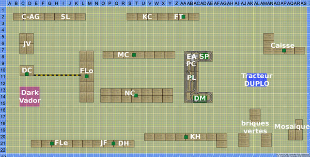
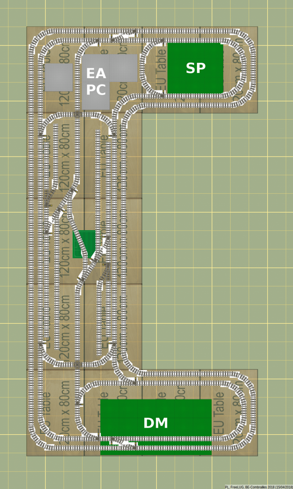
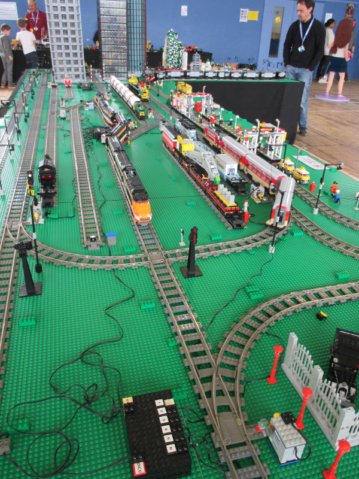
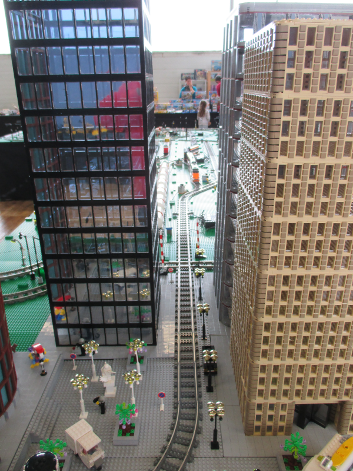

Une exposition 100% LEGO organisée dans les Combrailles (03) par FreeLUG

Pour la seconde édition de la Briqu’Expo Combrailles ([revoir les photos de la première édition](/articles/briqu-expo-combrailles-2016/) en 2016), nous avons investi la salle multi-sports municipale de Marcillat-en-Combraille le samedi 14 avril 2018 pour deux jours d’exposition publique 100% LEGO entre adhérents FreeLUG.

La salle était disposée de la façon suivante :

**Plan de la salle BE-Combrailles 2018**

Plan de la salle BE-Combrailles 2018

Philippe Label

Avec 20 exposant-e-s qui étaient tou-te-s adhérent-e-s FreeLUG.

**Diorama de train en DCC par Philippe, Erik, Pierre, Daniela et Sylvain**

Nous avons construit un réseau sur place, en apportant chacun sa partie, selon un plan préparé à l’avance.

**Plan du diorama DCC**

Plan du diorama DCC

Philippe Label

Ce plan a été réalisé grâce au super logiciel [BlueBrick](https://bluebrick.lswproject.com/) développé par Alban, un autre adhérent FreeLUG... que des bons, je vous dis !  
Nous avions une zone de fret, une gare de triage et de voyageurs (Philippe), un quartier d’affaire (Erik et Pierre) avec des gratte-ciels et une zone de ville représentée à l’échelle micro (Daniela et Sylvain).

**La zone de triage et la gare de voyageurs en pleine action.**

La zone de triage et la gare de voyageurs en pleine action.

François Svoboda

La zone de triage et la gare de voyageurs en pleine action.

**Le quartier d’affaire et ses immeubles imposants.**

Le quartier d’affaire et ses immeubles imposants.

François Svoboda

Le quartier d’affaire et ses immeubles imposants.

Sur place tout le week-end, Dimitri a fait une vidéo retraçant le contenu de cette Briqu’Expo.

[Vidéo de la publication d’origine](https://www.youtube.com/embed/28xBz6ttEgA)

[Vidéo de GeekMe3](https://www.youtube.com/watch?v=28xBz6ttEgA)

## Remerciements

Nous remercions Kris Heirman pour l’organisation et l’accueil sur place, M. Chito, Maire de Marcillat-en-Combraille, pour la mise à disposition de la salle et des tables, Monsieur le Maire de Virlet pour le prêt de tables supplémentaires, l’association "Les Ânes des Combrailles" pour la restauration sur place et Wendy Verboom pour la photo de l’affiche de l’exposition.

Voir en ligne : [Le site de la Briqu’Expo Combrailles](https://combrailles.briquexpo.org/)
