Et voilà, cette seconde édition est maintenant terminée. Comme en 2013, le Sou des Ecoles de Diémoz et FreeLUG ont travaillé main dans la main, et après 2 années de préparation, toute l’équipe d’organisateurs est très satisfaite du résultat :  
**–** 10207 visiteurs  
**–** 94 exposants et vendeurs  
**–** plus de 100 bénévoles  
**–** plus de 1200m² d’exposition (sans compter les espaces extérieurs et restauration)

Bien sûr, tout ne fut pas parfait, et ce fut difficile de refuser des visiteurs le dimanche, car la foule étant telle, il n’était plus possible d’accueillir de visiteurs après 15h30 pour conserver des conditions acceptables de sécurité.

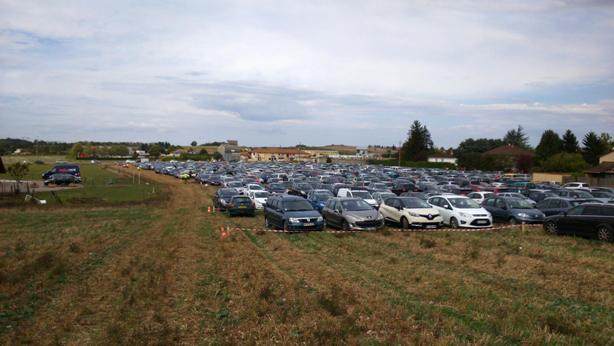

**Un parking bien plein**

Je remercie encore une fois tous les exposants, les bénévoles et nombreux partenaires, sans qui tout cela n’aurait pas été possible ! J’espère qu’ils auront tous passé un bon week-end.  
Le week-end fut très riche en bons moments, mais je garderai un souvenir particulier des moments "off", un peu plus calmes pour moi, comme le repas de Vendredi Midi, celui de Samedi Soir.

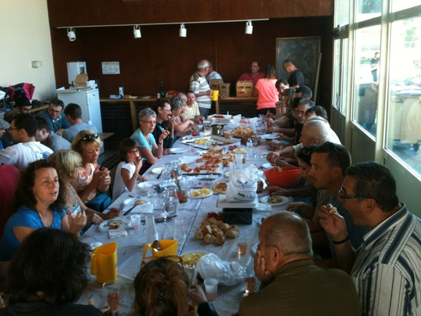

**Bénévoles et exposants le vendredi midi réunis pour un repas convivial**

Je tiens à remercier [Samsofy](http://www.samsofy.fr/) pour le concours de photos que nous avons organisé :

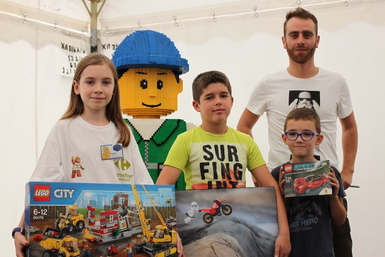

**Enfants primés au concours de photo avec Samsofy**

Ainsi que Will de [Hothbricks](http://www.hothbricks.com/) pour le concours de construction et [Briquefan](https://www.youtube.com/channel/UCeohvTWYjZDOubRaSIlpBCQ)pour sa présence et sa vidéo :

[Vidéo de la publication d’origine](https://www.youtube.com/embed/_9eZJc0bvQg)

Enfin, un grand merci à Jérémy pour les vidéos, et Denis/Gzu pour les photos et notamment la suivante :

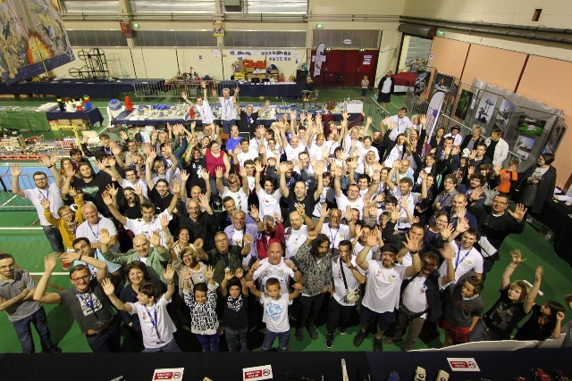

**Photo de groupe**

Plus de photos et articles de presse [ici](https://flic.kr/s/aHsk1ZSC2i)

_yannoch06_

* * *

**La LGV**

Avec seulement sa 2ème édition ; Brique’Expo a déjà tout d’une grande. Plus de 10 000 visiteurs !.  
Comme pour le première édition en 2013, la LGV a servit de support pour un gigantesque layout ’’train ville’’ présenté par FREELUG.

Ce n’est pas moins de 5 circuits de trains en plus de la LGV qui ont été présentés. Un belle réussite grâce à tous les exposants sur cette LGV.  
Merci à tous et maintenant à eux la parole.

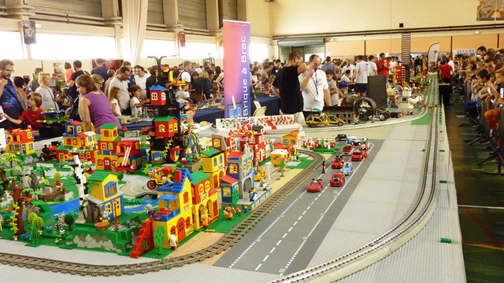

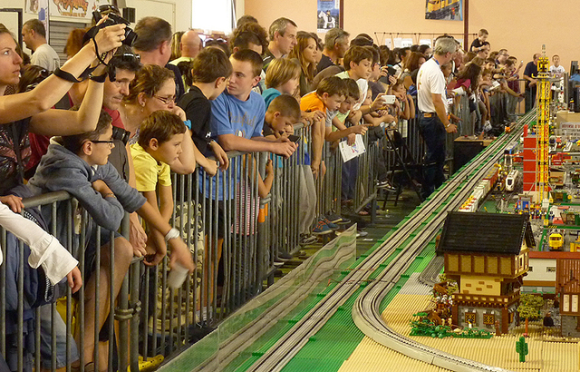

Montage et démontage de la LGV :

[Vidéo de la publication d’origine](https://www.youtube.com/embed/cP1Ao9AGb54)

* * *

**Un record en 20 tenons - Pierrick et Bastien**

Au vue de mes heures d’arrivée et de départ je ne pouvais exposer grand chose. Je me suis donc concentré sur la réalisation de 2 4x4 pour la piste de trial truck et d’un proto pour la LGV.  
**–** La piste de 4x4 a mis en évidence la difficulté de concevoir des véhicules efficaces sans avoir le terrain à disposition. Nous avons donc obtenue la 2ème et 3ème place (sur 3) face à un pilote émérite.

[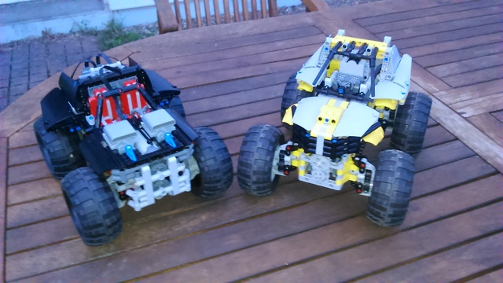](https://www.freelug.org/IMG/jpg/DSC_0009.jpg)

**4x4 - V3 Vs V4**

les 2 4x4 en course

**–** Pour la LGV la situation était différente. Fort d’une première expérience en juin a Fana’briques, j’ai créé un nouveau prototype minimaliste avec bissel avant amortie. Ce prototype (le Train De la Mort) a répondu à mes attentes puisque qu’aux mains d’un excellent pilote (Bastien) il a établi un nouveau record pour la discipline à 29.99km/h.

[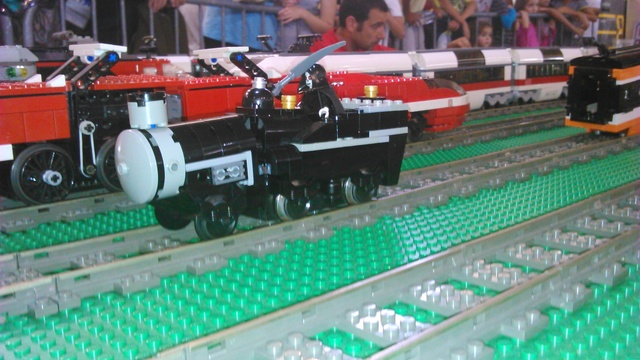](https://www.freelug.org/IMG/jpg/DSC_0022.jpg)

****–** Le Train De la Mort -**

Qu’est ce qui rattrape tous, mêle les plus rapide ? - La MORT -

Vivement la prochaine sortie de la LGV pour passer les 30km/h

* * *

Encore une fois quel plaisir de venir à Diémoz. Si PZ a battu le record de vitesse en train LEGO l’équipe des bénévoles du sou des écoles ont battu la vitesse de montage des tables !  
Encore une belle sortie de la LGV avec un décor toujours aussi cool et plein d’indiens attaqués par des TGV !

Le début !

[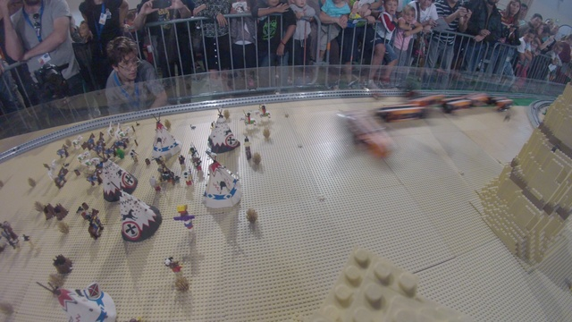](https://www.freelug.org/IMG/jpg/Preparation.jpg)

Le milieu !

[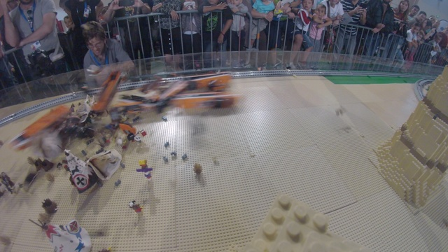](https://www.freelug.org/IMG/jpg/Action.jpg)

La fin !

[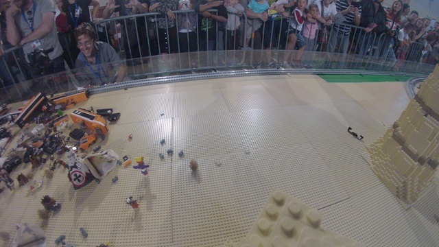](https://www.freelug.org/IMG/jpg/Resultat.jpg)

Des belles images et de bons souvenirs...à bientôt !

Xavier Viallefont

* * *

En 2009, pour une première version de notre LGV, un record est établi par un prototype de ma construction à 29,81 Km/h. C’est seulement cette année que Pierrick l’a battu, mais pas de beaucoup et sans passer la barre des 30. Aucune tristesse dans mes propos, c’est quelque chose que j’attendais car nous essayons tous d’aller au plus vite avec les crash que ça implique. Comme me l’a dis Denis, on est là pour jouer, mais l’envie de vitesse est grisante. La LGV est de mieux en mieux conçue pour ça, entre les rails posés de plus en plus droits et l’alimentation toujours plus performante.

Je suis venue à Diémoz avec 2 prototypes, le train de la mine étant juste pour le fun. J’avais l’ambition de passer au moins les 35 Km/h. Je pense ne pas avoir dépasser les 25... Mais j’ai appris des choses pour un prochain prototype, grâce à Pierrick, ben oui on apprend de ses défaites et aussi des gagnants :)

[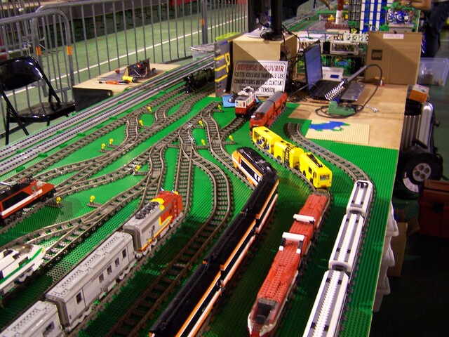](https://www.freelug.org/IMG/jpg/100_7416.jpg)

Mais bien sur je ne suis pas venu à Diémoz que pour ça, c’est surtout pour le jeu, les rencontres, la passion, voir des visages éblouis. J’ai aussi pris du plaisir à faire rouler mes locomotives sur la LGV en PFS.

Merci à tous pour cet excellent week-end en votre compagnie, avec une très marrante expérience à ranger les voitures sur le parking. Je me demandais comment tous ces gens allaient tenir dans la salle.

_JAC63_

* * *

Comme je suis content de mon week-end ! Il y avait vraiment tout pour qu’on soit bien et que les visiteurs (les gens, quoi) soient heureux.  
Au prix d’un Tetris géant avec tous les cartons dans ma petite voiture, j’avais amené des bâtiments pour la LGV, un peu de GBB, la base lunaire de Bob et tous ses amis qui habitent chez moi :

[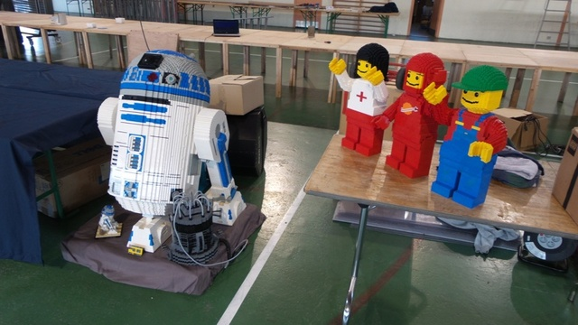](https://www.freelug.org/IMG/jpg/20150911_111841b.jpg)

On était tellement beaux qu’on est passé à la télé, maman !  
[http://france3-regions.francetvinfo.fr/alpes/isere/pendant-tout-le-week-end-diemoz-accueille-une-exposition-100-lego-pour-petits-et-grands-805635.html](http://france3-regions.francetvinfo.fr/alpes/isere/pendant-tout-le-week-end-diemoz-accueille-une-exposition-100-lego-pour-petits-et-grands-805635.html)

La soluce pour avoir du temps pendant l’expo et aller voir ailleurs, c’est d’embaucher (gratuitement, hein...) un assistant :

[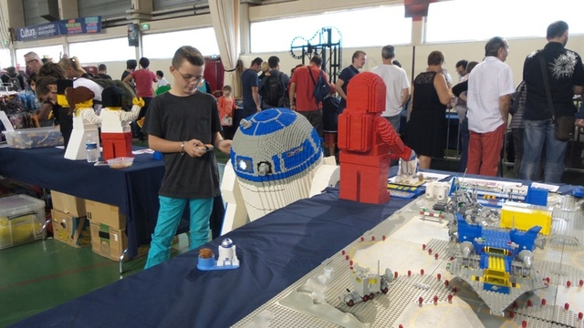](https://www.freelug.org/IMG/jpg/20150912_133440b.jpg)

Bien pratique... Merci Baptiste !  
Du coup j’ai pu constater les tentatives des jolies filles pour se cacher derrière les arbres de Fabien... Raté ! ;-)

[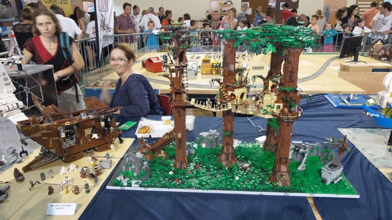](https://www.freelug.org/IMG/jpg/20150912_133601b.jpg)

Par souci de solidarité avec les copains prisonniers du GBB je suis allé proposer mon aide.

[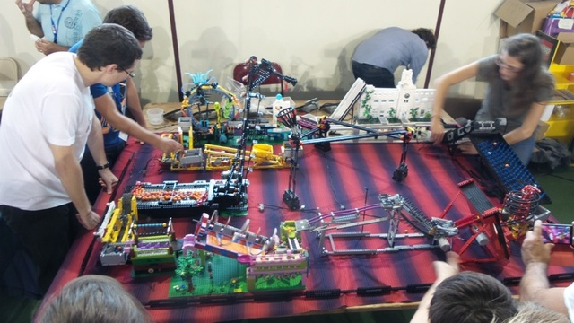](https://www.freelug.org/IMG/jpg/20150912_133614b.jpg)

Mais je n’ai pas pu rester longtemps : j’avais plein de trucs à faire, à voir...

[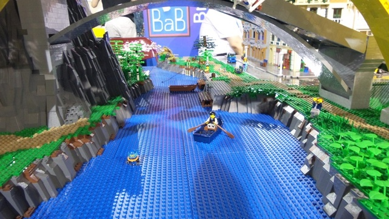](https://www.freelug.org/IMG/jpg/20150912_193710b.jpg)

Et à manger ! :-)

[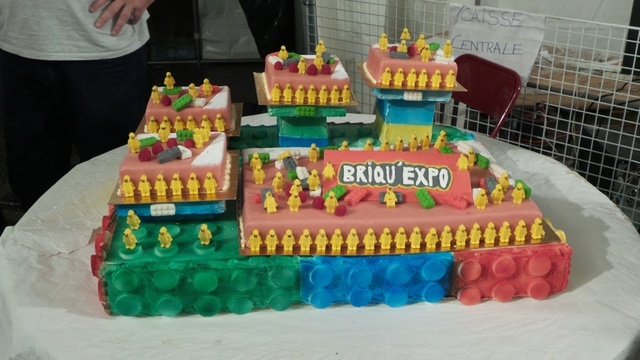](https://www.freelug.org/IMG/jpg/20150912_221148b.jpg)

Un grand bravo et un grand merci à tous les participants pour cette superbe fête du LEGO !

_jivé69_

* * *

Un an après Montélirail. Mon dépôt de marchandises refait plus de 500km pour une expo, mais cette fois en famille et un peu plus grand.

[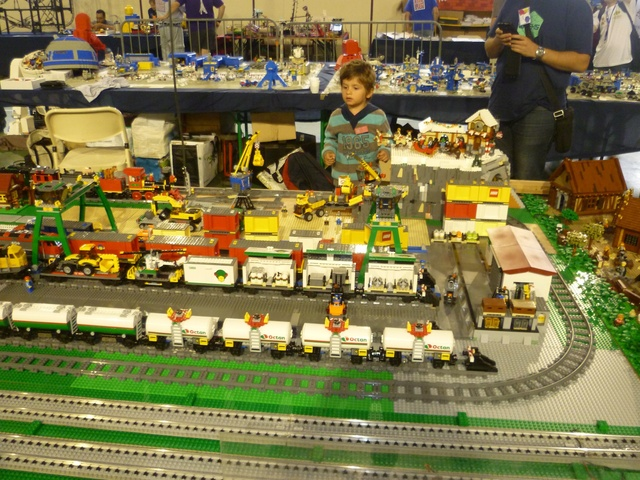](https://www.freelug.org/IMG/jpg/P1050868.jpg)

[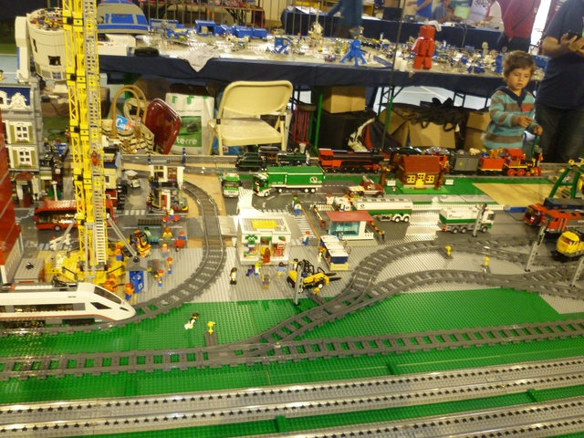](https://www.freelug.org/IMG/jpg/P1050869.jpg)

Puis la ville, ses MOCs et son immeuble en construction.

[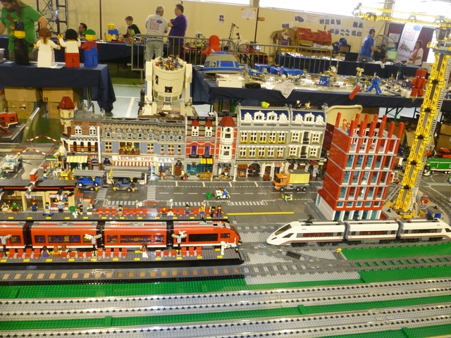](https://www.freelug.org/IMG/jpg/P1050870.jpg)

Avec quand même quelques sets officiels (Cette mairie est vraiment superbe).

[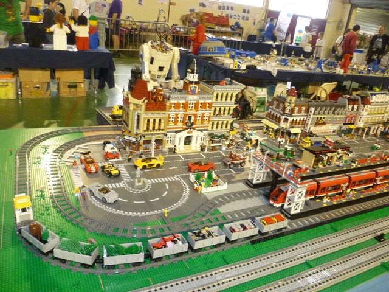](https://www.freelug.org/IMG/jpg/P1050871.jpg)

C’est vrai que du coup j’ai pris beaucoup de place sur la LGV.

[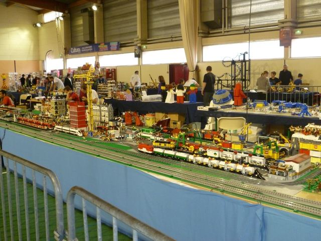](https://www.freelug.org/IMG/jpg/P1050901.jpg)

Mais bon il n’y a pas que sur la LGV qu’il y a des accidents.

[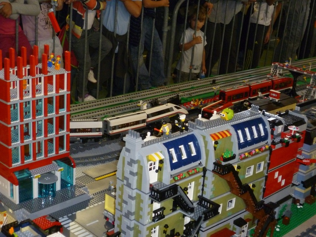](https://www.freelug.org/IMG/jpg/P1050928.jpg)

Petit clin d’œil au stand favori de ma fille.

[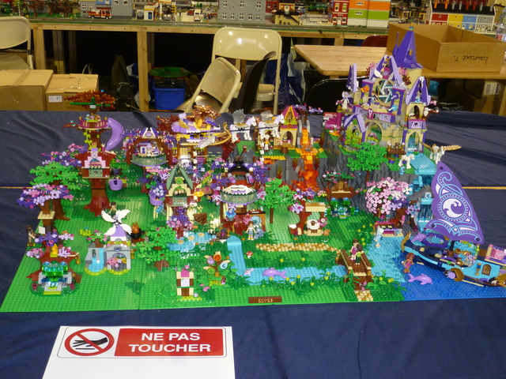](https://www.freelug.org/IMG/jpg/P1050832.jpg)

Les autres stands étaient aussi magnifiques.

_Nico_

* * *

Diémoz 2013 avait déjà mis la barre très haut. Avec cette course aux bolides, il m’a fallu déborder d’imagination pour cette expo. Cela faisait quelques temps que je pensais à une animation autour de l’aviation. Au départ, cela aurait pu être une maquette en LEGO Technic, animée par un NXT. Mais, la passion grandissant autour de la simulation de vol, je me suis lancé dans une aventure risquée : construire un simulateur de vol. Un modèle me passionne particulièrement depuis 2012, l’Airbus A320. Après une année de préparation, nous voilà donc prêt à prendre de l’altitude à plus de 400 km/h au dessus de Diémoz.

[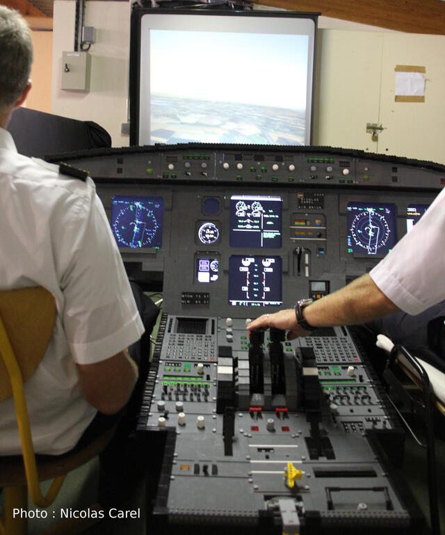](https://www.freelug.org/IMG/jpg/AirBrick-Diemoz-2015-6-small.jpg)

**AirBrick Diémoz 2015**

Simulateur de vol Airbus A320 en Lego. Diémoz 2015.

Avec Loïc et Emmanuel, pilotes de ligne, nous avons fait découvrir le pilotage à 40 jeunes de 10 à 15 ans. Au programme, un tour de piste de 20 minutes depuis Lyon - Saint Exupéry, avec le survol virtuel de Diémoz. Les cadets étaient tous très concentrés aux commandes de ce jouet hors du commun.

[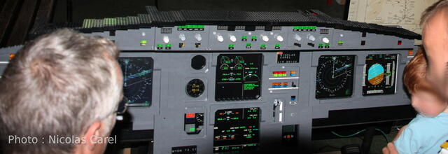](https://www.freelug.org/IMG/jpg/AirBrick-Diemoz-2015-5-small.jpg)

**AirBrick Détail**

Simulateur Airbus A320 en Lego

Quelques explications techniques. En sus de quelques milliers de petites briques, il y a 4 ordinateurs pour faire fonctionner le tout. Le vidéo-projecteur est connecté à l’ordinateur le plus puissant, fonctionnant sous Linux avec le logiciel [X-Plane 10](http://www.x-plane.com/desktop/home/) et la logique Airbus A320 conçue par [QPAC](http://www.qpac.eu/). Les trois autres ordinateurs sont de vieux Mac servant à l’affichage dans le cockpit. Le logiciel utilisé est [XHSI](http://xhsi.sourceforge.net/), dont je suis l’un des développeurs. Enfin, l’électronique du cockpit est gérée par une brique LEGO NXT et une carte d’interface de [Leo Bodnar Electronics](http://www.leobodnar.com/shop/).

Pour ceux qui ne nous aurait pas vu sur place, nous étions cachés dans la mezzanine du gymnase.

Promis, il y aura d’autre sorties...

_Nicolas / Colego_

* * *

Briqu’Expo Diémoz, ce sont de nombreux exposants mais aussi des ateliers et activités permettant aux plus petits et aussi aux plus grands de participer : espace Duplo, piste 4x4, construction libre et une mosaïque exceptionnelle qui a été montée deux fois au cours du week-end :

[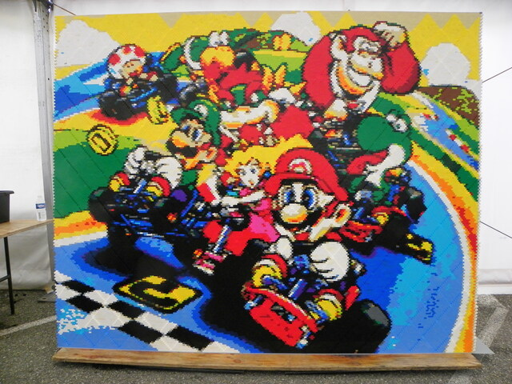](https://www.freelug.org/IMG/jpg/MosaiqueDiemoz2015.jpg)

**Diémoz 2015**

Didier

* * *

[Photos de Didier](http://photos.freelug.org/main.php/v/6studs/Expos/Diemoz2015/)

[Photos de JAC](http://photos.freelug.org/main.php/v/JAC/Exposition/2015/BriquexpoDiemoz/)
