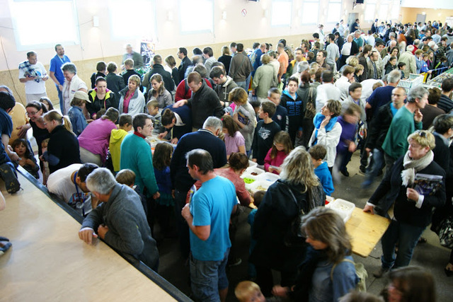
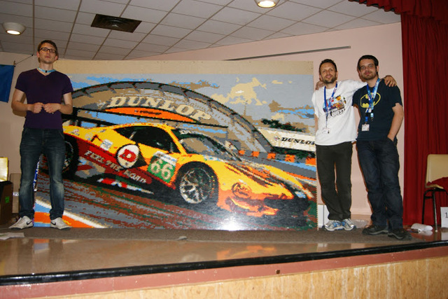
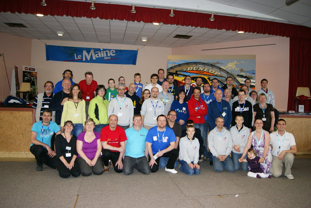

Salle Edith Piaf, Mulsanne, dimanche 12 mai 2013 16h00...

Une longue file d’attente se déroule devant l’entrée de la salle des fêtes de la ville de Mulsanne, en Sarthe...

Il reste 1h30 d’expo, mais la foule est toujours impressionnante ! Même si la commune est habituée au moment des 24H du Mans à une forte affluence, pour une exposition organisée par une association, ce doit être une première.

Et si dehors la foule patiente, à l’intérieur de la salle elle fourmille ! Il y a du monde dans les allées c’est le moins que l’on puisse dire... Mais les visiteurs ne semblent pas gênés outre mesure, et réussissent à profiter de l’événement.

**Beaucoup de monde**

Un peu plus d’1h30 plus tard, les portes sont closes et Jean-Claude procède au tirage au sort du concours. Une dizaine de lots décernés à des visiteurs heureux, et nous invitons ensuite la foule à quitter la salle. Les derniers (enfin presque tous...) partiront à 18h00. Pas de heurts, pas de cars de CRS, pas de mouvement de foule incontrôlé, le public de la région est un public très calme, habitué aux grands rassemblements ! Nous sommes quand même dans une des communes du mythique circuit des 24h du Mans, alors ce n’est pas une petite exposition de briques en plastiques qui va mettre à mal 80 années d’histoire...

Et bien si, malgré tout, nous avons un peu mis le bazar dans le dispositif. Cette commune, habituellement calme, de 4400 habitants a quand même vu 4000 personnes (enfin 3919 exactement...) admirer nos constructions !  
C’est donc avec le sentiment du devoir accompli que nous avons attaqué le rangement de la salle dimanche soir. Et si une fois tout terminé, à 2h00 lundi matin, nous étions moins fringants, nous sommes quand même allés nous coucher satisfaits.

Que ce soit le diorama city, le château d’Harry Potter, le diorama de la Cité de l’Architecture, les dioramas Star Wars, Egypte, Ninjago, pirates, mais aussi les Technic et surtout les Grands Bidules à Balles, tout a plu au public. Et que dire des animations ! Le pilotage des 4x4 a été un succès, et la réalisation de la mosaïque un "truc de fous". Elle représentait une Ferrari 458 sur le circuit des 24h, et cela a enchanté les visiteurs.

**La mosaïque**

C’est donc une grosse réussite que cette première exposition à Mulsanne. Un plus long article, avec les impressions de chaque exposant est à venir...

En attendant, vous pouvez d’ores et déjà noter dans vos agendas que nous reconduirons notre exposition en 2014 !

Merci à vous tous les exposants et bénévoles sans qui rien ne serait possible. Et surtout, merci à tous les visiteurs, parce que sans vous, nous serions encore cantonnés à assembler des LEGO dans nos caves ou nos greniers...

A bientôt

**es exposants et bénévoles**
