Joli succès pour cette seconde édition, puisque c’est près de 1500 visiteurs qui sont venus admirer les réalisations des exposants.

[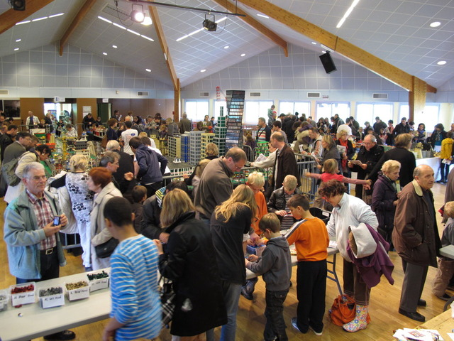](https://www.freelug.org/IMG/jpg/BEPL2012_Public.jpg)

## Les animations

Dès l’entrée de l’exposition, les jeunes visiteurs pouvaient construire des réalisations à base de briques jaunes 2x4. de nombreuses sculptures sympathiques ont émergé durant les deux jours. Les plus jeunes n’étaient pas en reste avec une piscine Duplo

En fil rouge sur les deux jours, une mosaique, préparée par notre spécialiste Simon, a nécessité un travail constant des visiteurs, officiels et exposants/bénévoles pour parvenir au bout des 32000 briques afin de reconstituer la photo de la mairie de Parigné-l’Evêque.

Le samedi, en exclusivité, nous proposions pour la première fois la construction du jeu Minotaurus à l’échelle 6.

[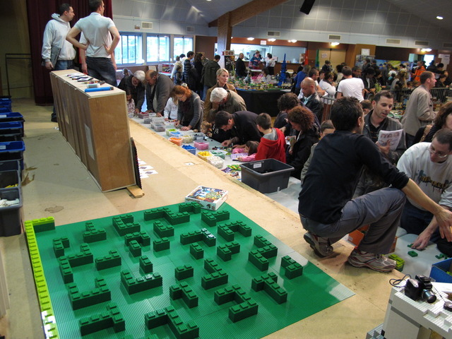](https://www.freelug.org/IMG/jpg/BEPL2012_Minotaurus.jpg)

Et le dimanche, la fusée Ariane permettait d’occuper les petites mains.

Une table invitait également les visiteurs à s’installer et de jouer à l’un des nombreux jeux de société mis à disposition.

## Commentaires des exposants

## Une expo en plein essor (Damien)

En tant que régional de l’étape, mon inscription à Briqu’Expo Parigné-l’Evêque était bouclée depuis quelques mois déjà. C’est donc avec impatience que j’attendais ce week-end. Une bonne occasion de mesurer l’impact des animations pédagogiques que j’ai pu commencer à faire dans les écoles du Mans et d’Arnage.

Tout ne commence pas de la meilleure des façons. En effet, lorsque nous passons, mon frère Manu et moi, vendredi en fin d’après-midi déposer les caisses de briques de la fusée, la base de celle-ci tombe… Merci Manu ! D’un passage éclair, notre visite se transforme en visite de réparation de presque 2 heures ! Ensuite, Jérémy nous explique les animations prévues tout au long du week-end avec le public. Nous sommes volontaires pour animer celles-ci quelques heures… Enfin, c’est ce que nous croyions.

Une fois de retour à la maison, il est temps de boucler notre partie de diorama. Bilan, un petit coucher à 3h00, pour un lever à 7h00. Mais nous réussissons à équiper notre partie d’une caméra, qui filme le public et qui renvoie l’image vers l’écran du cinéma en plein air que nous avons installé. La caméra est bien cachée, ce qui va faire que les spectateurs vont avoir à fouiller des yeux notre zone.

Samedi matin, installation à partir de 8h00. Nous retrouvons Stéphane devant la salle… fermée ! C’est Pierre qui vient finalement nous ouvrir. Il dormait dans la salle et était soi-disant « réveillé depuis 7h00 ». A 10h30 tout est prêt de notre côté. Par contre, dans la salle ça court partout ! Jean-Claude est dirons-nous « bien occupé »… Les trous du diorama principal sont bouchés avec des buildings, une ferme, et des tas de trucs, sortis comme ça, par hasard, de cartons qui trainent là ! Ça m’impressionne ça d’ailleurs, les exposants capables d’inventer du diorama sur place en quelques dizaines de minutes. Autre chose qui impressionne, notre président qui ouvre des boites de rails 9v neuves comme ça, à la pelle, comme s’il s’agissait de pièces courantes…

A 12h00, avec une heure de retard, c’est l’inauguration. Elle sera de courte durée, puisque les premiers spectateurs sont déjà là ! Bonne surprise pour moi, une élève d’une classe où je suis intervenu et son papa sont là, dans les premiers. Ça commence bien. D’autant que très vite, les spectateurs se pressent dans la salle.

Nous commençons donc les animations. Elles se déroulent sur la scène de la salle, un peu en hauteur. Cela permet aux visiteurs de voir le travail avancer, et à nous de respirer, car des spectateurs, il va y en avoir pour une ville comme Parigné ! Si nous obtenons un bon de sortie de 15 minutes, pour aller manger, Manu et moi ne bougeons ensuite plus de là ! Deux animations au programme de ce samedi, un « Minotaurus » XXL (36 plaques de base) et une mosaïque de 32000 briques, conçue par Simon. Je me charge du Minotaurus et Manu de la mosaïque. Nous arrêtons vers 19h00, sans avoir vu la journée passer ! Nous avons donc fait des heures supp aux animations, mais ça a été avec un réel plaisir. Les échanges avec les spectateurs ont été géniaux. Le minotaurus est terminé et la mosaïque en est à un peu plus du tiers.

Un peu plus de 500 visiteurs ce samedi, un très bon score je trouve. Les gens sont en plus restés longtemps sur place. Il était même difficile de circuler dans les allées à certains moments. Le soir, repas pour tous les exposants, après que chacun a réalisé une partie de la mosaïque. Nous rentrons nous reposer vers 22h30.

Dimanche matin, nous arrivons à 8h30 pour le petit déjeuner, mais très vite nous sommes sur la scène pour les animations... Dès 9h00, il y a du monde devant la salle ! Niveau animation, la mosaïque continue et nous refaisons l’intérieur du labyrinthe du Minotaurus avec les briques en plus. Nous attaquons également la construction de la fusée Ariane 5. Le temps passe, les gens aussi ! Un monde fou ! Nous avons droit à 20 minutes de pause, aux alentours de 14h00. Nous nous régalons de crêpes faites sur place, un délice. La fusée est terminée vers 16h45 et la mosaïque vers 18h00, juste à temps ! La journée est passée à une toute vitesse. Cela a été épuisant d’être en permanence à genoux, mais que de rencontres sympas avec les visiteurs ! Je suis heureux d’avoir vu des tas d’enfants et d’institutrices, et leurs familles, que j’ai rencontrés au travers de mes animations pédagogiques.

Et comme à chaque expo, il reste donc le démontage… Il se finira à 23h20, après un nombre incalculable de voyages chez Jean-Claude, sous une pluie diluvienne. Nous avons quand même le temps de dîner avec les « restes ». De bonnes crêpes au rosbif, avec de fines tranches d’emmental ! Nous rentrons épuisés mais heureux de ce WE. Vivement PL 2013 !

Damien

## C’est reparti ! (Stéphane)

[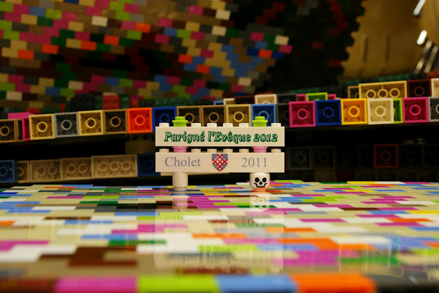](https://www.freelug.org/IMG/jpg/DSC00289_20-05_.jpg)

Tôt le samedi matin, j’arrive sur place, et commence mon installation. Tout le monde n’est pas encore arrivé, certains ont dormi sur place (vive le camping sauvage au milieu des minifigs !), d’autres ont préféré le confort d’un bon lit ! Il m’aura fallu un peu moins de deux heures pour reconstituer le diorama City que j’avais préparé pendant les semaines précédentes : un Centre ville constitué de plusieurs modulars, et un petit aéroport de province.

[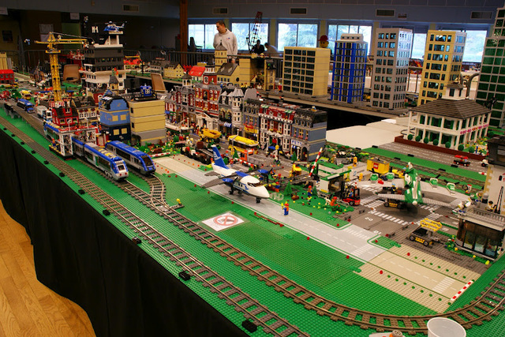](https://www.freelug.org/IMG/jpg/DSC00180_2820-05_29.jpg)

Ce montage rapide me laissera un peu de temps pour voir tout le monde avant le coup de feu de 12h (heure de l’ouverture au public), faire un tour rapide de notre réseau City / ferroviaire (un grand "U" d’environ 10 mètres de long tout de même !), et bien sûr, saluer tous mes compagnons de jeu (flûte... on a oublié de faire LA photo de groupe !). Le maître de cérémonie, Jean-Claude, ouvre le bal avec les officiels, et nous accueillons nos premiers visiteurs sous un ciel qui commence à se charger. La météo de ce week-end ayant décidé d’être assez capricieuse.

[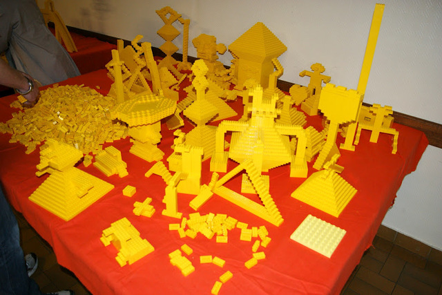](https://www.freelug.org/IMG/jpg/DSC00165_19-05_.jpg)

Dès l’entrée, le visiteur a le choix. Il peut se laisser tenter par de la construction toute personnelle avec des milliers de petites briques 2x4 jaunes...  
Les plus jeunes n’étant pas en reste, avec une "piscine" remplie de Duplo ! Une double activité vraiment addictive, et qui a même lancé des idées de construction pour, pourquoi pas, une troisième édition !

[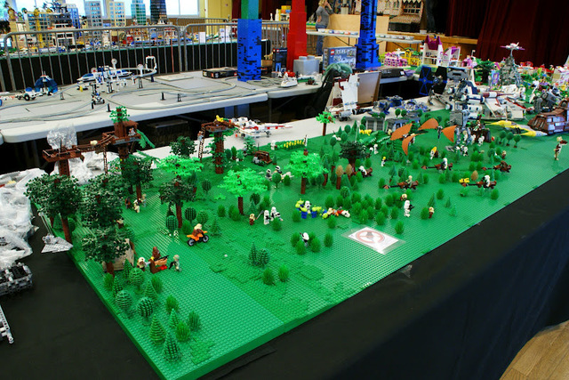](https://www.freelug.org/IMG/jpg/DSC00261_20-05_.jpg)

[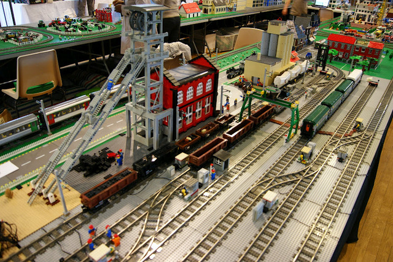](https://www.freelug.org/IMG/jpg/DSC00062_19-05_.jpg)

Puis, en suivant la foule, il (le visiteur) entre pleinement dans la grande salle de pratiquement 600m² et subit le choc en découvrant toutes nos créations ! De StarWars à la nouvelle gamme Friends, du City avec ses trains traversant des villes, des buildings, des tunnels ; une incursion dans l’ancienne Egypte, un tour sur une piste de course, et finir par un GBB (Grand Bidule à Balle) rodé aux petits oignons. Tenter de tout décrire, tout montrer serait vraiment très difficile, alors petit tour de ce que vous avez pu voir, admirer, apprécier (si... vous aviez été sur place :-D ... Aller, je ne t’en veux pas, à toi qui n’a pas pu venir ;-) ... On t’attendra l’année prochaine !).

[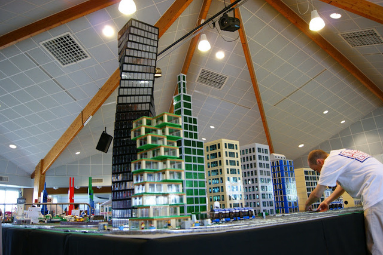](https://www.freelug.org/IMG/jpg/DSC00096_19-05_.jpg)

[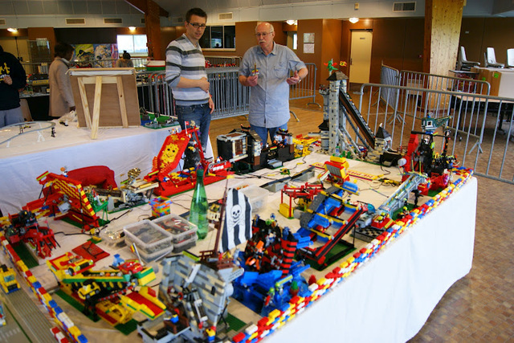](https://www.freelug.org/IMG/jpg/DSC00113_19-05_.jpg)

En marge de l’exposition, plusieurs activités communautaires ont permis de faire participer le public à trois constructions "modulaires". La première était une reproduction à grande échelle du jeu de plateau Minautorus.

[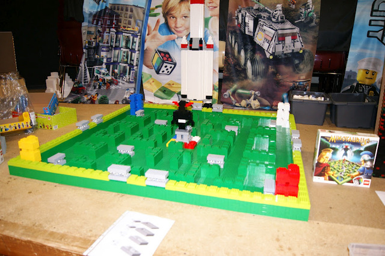](https://www.freelug.org/IMG/jpg/DSC00155_19-05_.jpg)

La seconde, une reproduction de la magnifique, l’unique, la prestigieuse fusée Ariane 5 ! (Oui, ben c’est du "Made in chez nous", alors, on applaudit ! Non mais oh !)

[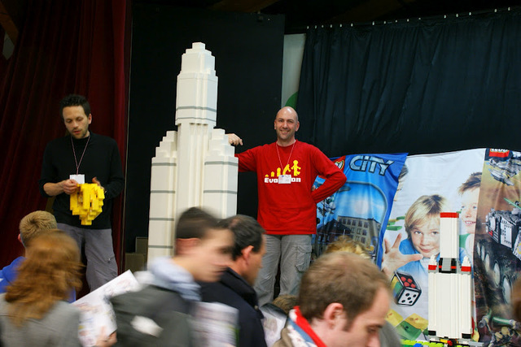](https://www.freelug.org/IMG/jpg/DSC00013-2.jpg)

Et enfin, ce qui aura donné beaucoup de sueurs (surtout si on voulait manger des crêpes samedi soir, petit clin d’oeil), d’ingéniosité (parce que forcément, ça dépasse de tes caisses Jean-Claude !!), d’attention (pour corriger les petites fautes), d’usures de petits doigts, et toute une génération de visiteurs de 7 à 77 ans, pour construire une mosaïque géante représentant la mairie de Parigné l’Evêque !

[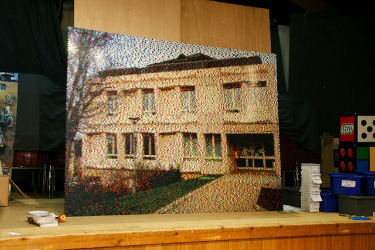](https://www.freelug.org/IMG/jpg/DSC00026-2.jpg)

Mais mais... parlons un peu de mon diorama, parce que bon... hein ^^ ...  
Seconde sortie de mon TER AGC 81500 avec des boggies modifiés pour encaisser les virages, les différences de niveau inhérentes aux tables (tout n’est jamais vraiment plat en exposition !), qui s’est soldé par une belle réussite visuelle ! Les deux moteurs 9V ont bien tracté l’ensemble sans jamais faillir, et il n’a pas une seule fois déraillé... (ou presque ! ... le passage sur le grand réseau ne s’est pas fait sans mal du fait de son grand débord en virage ! Le tunnel de Sylvain a été profondément modifié sans succès, et le réseau a finalement était scindé pour l’éviter. Merci à Philippe et Sylvain pour leur aide et compréhension de mon problème !). Le public l’a semble t-il bien accueilli, et j’ai même eu droit à des petites taquineries et anecdotes sur les déboires de la SNCF le concernant !

[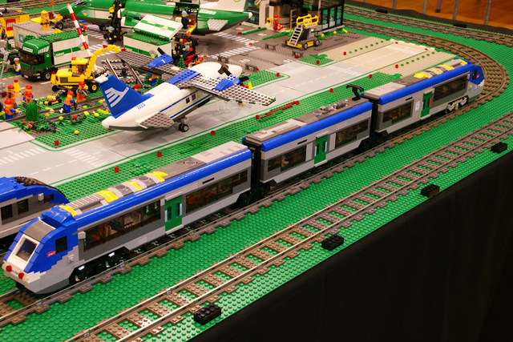](https://www.freelug.org/IMG/jpg/DSC00208_20-05_.jpg)

Sur le stand, j’avais mis en place un questionnaire très simple qui invitait les spectateurs à trouver des petits détails plus ou moins cachés... Dans le désordre, une famille de cro-magnon, un diner de monstres, un incident nucléaire, un gorille, des skateurs, un groupe de marins, un étrange pêcheur, un petit garçon avec son doudou, un mécanicien d’avion, une chèvre pas contente (qui s’est transformée dans la nuit en une chèvre abusée !) ! Pour les plus grands, quelques recherches plus corsées comme un Michael Schumacher (souvent confondu, il y avait un piège !), le mime Marceau, un garde anglais typique, et le Docteur Who (très peu connu !).

Mais je n’étais pas le seul à présenter des scènes cocasses (parfois gores :-D ... Bon... à part les dinosaures qui ont fait une incursion au cours de la nuit de samedi dans le petit monde rose bonbon des Friends !)...

Malheureusement, tout à une fin.... et le dimanche soir, il a fallu fermer les portes... sortir les boites, les cartons, et ranger nos rêves, nos présentations,... et comme si le ciel de Parigné regrettait déjà notre départ, il déversa des tonnes d’eau sur nous pendant que l’on chargeait les voitures ! ... Satanée météo

[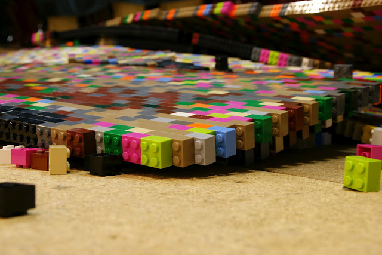](https://www.freelug.org/IMG/jpg/DSC00040-2.jpg)

**Merci** à Lydie pour m’avoir permis de passer un week-end coloré (et les corrections de fautes !). **Merci** à Jean-Claude de m’avoir fait confiance. **Merci** à Sylvain pour les idées qui fusent et les arbres. **Merci** à mes voisins de table pour ce partage. **Merci** à Gaelle pour mon cutter !

Deux jours marathon, une affluence record en comparaison de l’année passée (environ 1500 visiteurs sur les deux jours), une organisation aux petits soins avec nous, notamment grâce aux bénévoles venus prêter main forte à l’entrée, et pour gérer les repas. **Merci à vous !** Petite pensée pour ceux et celles qui auraient voulus venir mais n’ont pas pu pour diverses raisons. **Merci** à mon sac de couchage qui m’a bien trahi pendant la nuit de samedi à dimanche en m’empêchant de dormir plus de quatre heures. **Merci** aux visiteurs d’être aussi étonnés, curieux, surpris, et aux enfants avec leurs yeux pétillants (tout comme les grands-parents !).

**–** [Extrait issu du blog www.lego-blog.fr](http://www.lego-blog.fr/index.php?post/Briqu-Expo-Parigne-2012)

## Une expo multi-thèmes (Rémi)

Pour ma partie, j’ai apporté 2 thèmes :  
un circuit automobile

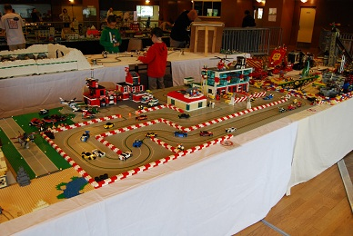

et une partie Egypte / aventure.

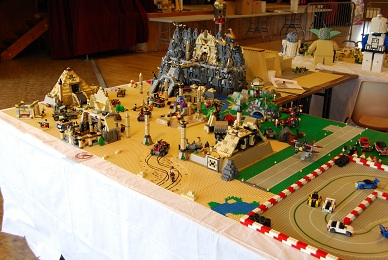

Arrivé sur les lieux vendredi soir avec ma petite famille, ça commence par la mise en place des tables et des nappes.  
Ensuite, je commence à installer des dioramas, avec les contributions de Jérémy pour le prêt de plaques tan et de Jean-Claude pour le transport du temple égyptien et des stands.

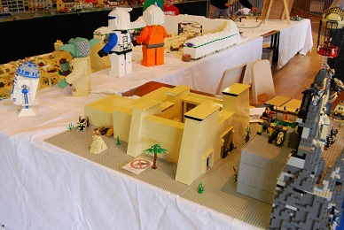

Samedi matin, je finalise des dioramas avec l’aide de ma femme, Anne-Laure, pendant que ma fille, Loïs (4 mois), fait une petite sieste. On a ensuite installé l’espace jeux de société. Tout au long de l’exposition, cet espace a permis aux jeunes et au moins jeunes de découvrir les jeux de société LEGO. Ces jeux plutôt méconnus, ont été très appréciés, certain passant même une grande partie de l’après-midi à jouer à la table.

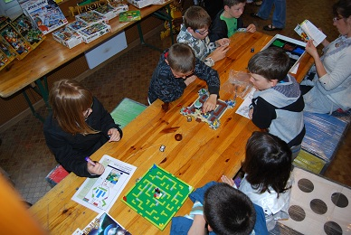

Dès l’ouverture, beaucoup de monde se présente, et ça sera sans arrêt jusqu’à la fermeture. Entre surveiller les dioramas, les jeux de société et un peu de mosaïque, l’après-midi est très vite passé, pas le temps de s’ennuyer.

Le dimanche fut encore plus intense, avec beaucoup de monde toute la journée et très peu de temps mort (vive les rotations, ça permet de prendre une pause pour déjeuner).

Je parle beaucoup de moi, mais heureusement, je n’étais pas tout seul, plusieurs thèmes représentés : récent, ancien, classique et plus rare, il y en avait vraiment pour tous les gouts. Plusieurs thèmes également pour jouer avec les briques : DUPLO, LEGO en vrac, mosaïque, Minotaurus géant, fusée Ariane V…

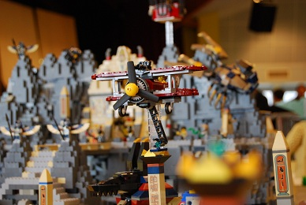

Ce fut un weekend très bien organisé, très riche en rencontres, de simples visiteurs aux futurs adhérents. Très bonne ambiance lors des repas et finalement, on a pu exposer en famille sans trop de difficulté. Mais content d’être rentré pour me reposer un peu ! A bientôt pour la prochaine édition et merci à tous pour l’organisation exemplaire et la bonne ambiance.

## Du train, du train, du train !!! (Philippe "frogleap")

C’est la première fois que j’arrive à poser sur un réseau pratiquement tous mes rails. Il restait encore des courbes dans les caisses. Nous avons tous, au moins ceux qui font du train, trop de rails courbes. Quitte à les utiliser, une bonne idée est de faire comme Xavier qui les modifie pour en faire des rayons plus grands. Mais je m’égare (... de voyageurs). J’avais amené deux centrales de commande DCC et bien m’en a pris car après une dernière adaptation du plan en temps réel au moment du montage vendredi, je me suis retrouvé à installer non pas un, mais deux réseaux DCC sur notre énorme diorama. Eric a pu jouer au chef de gare de marchandise, avec ses magnifiques rames dont il a le secret. Mais aussi pendant toute l’exposition en pilotant la rotonde de Pierre en DCC et en gérant seul ses aiguillages motorisés.

De mon côté je jouais avec des trains de voyageurs sur le grand triage au pied des gratte-ciels. Tous les aiguillages étaient motorisés et c’est tant mieux, parce que avec la longueur de tables dont nous disposions, j’étais très heureux de ne pas avoir à me déplacer toutes les cinq minutes. C’est quand même arrivé à l’occasion de déraillements et autres chutes qui font toujours forte impression sur le public et qui occupent un bon moment pour le remontage en catastrophe sur le bord d’une table. Je ne sais pas pour vous, mais souvent il me reste des briques en trop après un remontage en urgence. On va dire que c’est l’érosion naturelle...

L’ordinateur était là pour se souvenir à ma place du plan du réseau et des numéros d’aiguillages à actionner à distance. Nous avons pris quand même une leçon sur cette exposition : éviter de placer le chef de gare derrière un mur d’immeubles. Ce fut la cause de plusieurs accidents ayant pour origine un manque de visibilité.

[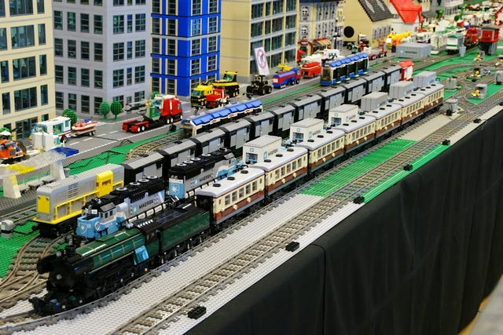](https://www.freelug.org/IMG/jpg/DSC00229_20-05_.jpg)

Je terminerai en ayant une pensée pleine de respect et de gratitude pour tous les discrets de l’organisation qui ont tant facilité la vie collective aux exposants pendant ces deux jours et demi. Je pense à Jean-Claude bien sûr, mais aussi à Edwige, Nelly, Jérémy, Julie et les cuisinier(e)s de crêpes qui nous régalèrent.

[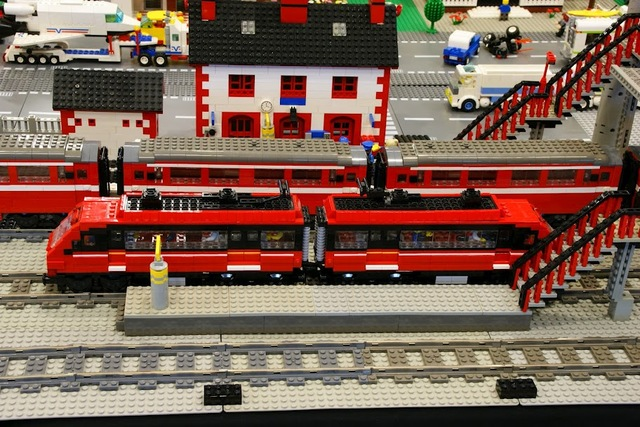](https://www.freelug.org/IMG/jpg/DSC00226_20-05_.jpg)

Un hommage au passage (... à niveau) à Timothy Gould et James Mathis, deux MOCeurs remarquables de trains dont la rame Capitole (Tim) et l’intercité rouge (James) sont présents sur cette photo.

J’espère que la prochaine édition permettra encore de nous retrouver pour jouer au LEGO® ensemble à Parigné l’Évêque. J’ai évidemment plus échangé avec mes voisins de diorama grâce à la proximité (coucou à Stéphane, Sylvain, Damien, Emanuel, Erik, Pierre et Eric) mais je garde de très bons souvenirs des repas et des pauses montage et démontage avec moult discussions entre tous.

## Petit mot de SystemDbrick :

C’est sous l’impulsion de Jéremy, la gentillesse de Erik mon chauffeur et l’accueil de Jean-Claude que j’ai participé à Briqu’expo Parigné l’Évêque pour la première fois ! J’ai donc dû accélérer les constructions et adapter au plus vite le module "mine" pour qu’il soit prêt !  
Animer un réseau de train commandé sous DCC : c’est un vrai plaisir et cela faisait longtemps que je ne l’avais fait avec le concours de Philippe !

J’ai trouvé le public assez timide par rapport à d’autres expositions auquel j’ai participé ! Car peu de question sur le système de commande des trains qui n’est pourtant pas conventionnel !  
Je remercie aussi toutes les petites mains pour les repas de groupe !

## Petit mot de Pierre C / Tribolego

Ne pouvant venir, au départ, pour l’exposition, le projet était de mettre à disposition ma rotonde et mon immeuble pour l’exposition.  
Et puis finalement, je les ai apportés moi-même !

Ce fût un plaisir de venir ces deux jours, vendredi et samedi, pour l’installation, une bonne tranche de rigolade et bien-sûr le plaisir d’accueillir un public toujours aussi émerveillé et venu encore plus nombreux et nombreuses pour admirer toutes les belles créations de nos exposants (je vous laisse voir les photos pour le détail, je ne voudrais rien oublier en faisant ma "liste des merveilles").

Quel déchirement cela a été de vous laisser tous le dimanche matin ! Faudrait presque faire ça plus souvent, pas vrai JC ?

Pour finir, je me joins à tout le monde pour remercier notre hôte du week-end, Jean-Claude, et sa femme Edwige, et les petits Petit, Julie et Xavier, pour leur accueil à Parigné-L’Évêque, pour le lit et le couvert (quel succulent roast-beef !).

## Petit mot de Pierre L / Pierrolego

Déjà présent pour la première édition, je ne pouvais pas louper la seconde ! Et j’ai bien eu raison ! Encore de belles choses à voir et surtout les rencontres et discussions qui pimentent le week-end bien trop court...

Pour ma part, au début, je n’avais pas prévu de ramener des LEGO, mais le temps et les demandes de Jean-Claude ont fait que j’ai ramené du Star Wars. J’ai donc présenté un diorama de Endor avec les Ewoks courant après les Stormtroopers. Je fus aidé dans cette tâche par Xavier ainsi que quelques scènes d’Erik...

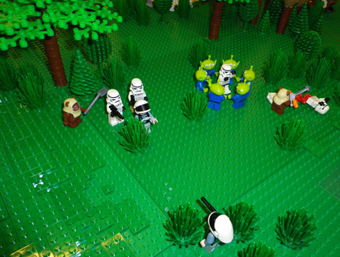

A côté de cela, je présentais le Millenium Falcon 10179 ainsi que le Super Star Destroyer 10221. Mais je n’avais pas pu monter le Millenium Falcon avant de venir, il est donc arrivé dans sa boite... et j’ai commencer à le monter durant le week-end. Et effectivement, je ne l’ai pas fini ! ;-D

J’ai participé aussi durant le week end au montage de la mosaique, ou il fallait encadrer le public et vérifier le montage de leur module. Une belle expérience.

Un grand merci à Jean-Claude pour nous proposer cette belle occasion de se voir, et merci aussi à toutes les petites mains pour faire tourner cette expo !

A l’année prochaine !

## Petit mot de la fin de Jean-Claude, le "grand argentier" de cette exposition.

Je voudrai remercier ici encore une fois toutes celles et tous ceux qui ont fait de cet évènement une belle réussite.  
Le public a aimé et ses encouragements prouvent que vous avez fait un travail formidable.  
Un beau week-end (bien arrosé par une météo capricieuse), le plaisir de voir ou revoir des adhérents en de trop rares occasions, mais également de faire la connaissance d’un legoteur par delà nos frontières, je parle ici de notre ami Michel de Belgique, d’un "visiteur" qui s’est transformé en bénévole (Jérôme merci pour le coup de main), de Clarence, une collègue de travail (que je ne connaissait pas et qui ne connaissait pas les LEGO sous cette forme), venue uniquement en tant que bénévole de Paris, Damien et Manu qui ont réquisitionné le perchoir (l’estrade) pour faire les animations, Rémi et Anne-Laure aux jeux de société, Dominick qui attendait (et attend encore) l’arrivée de L’ultimum imperial Faucon millénium (un truc comme ça) que Pierre a commencé à construire à PL objectif un atterrissage le dimanche vers 17h00 le dimanche (il y a du y avoir une grève :) cela sera pour la prochaine), il y avait tout ce formidable réseau CITY, il y avait encore tant tant et tant de choses..., ces rencontres avec les enfants, les visiteurs qui posaient des questions sur notre passion, des collègues, de la famille ou amis, il y avait encore...  
Mais le temps passe très vite trop vite et nous voici déjà à l’heure du rangement toujours sous la pluie. Encore un moment fort, ces multiples voyages (voitures et remorque) pour stocker provisoirement ce matériel en attendant de le rapporter à son propriétaire.  
Je terminerai par un remerciement (c’est un minimum) pour toutes les personnes qui sont restées derrière le comptoir à l’intendance et avec peut-être une pensée toute particulière pour celle qui nous a fait de si bonnes crêpes (certes pas Bretonne) mais on s’est tout de même bien régalé.

Pour conclure je dirai juste :  
**C’était SUPER ! ! !**

## Galeries photos et vidéo

**–** [Galerie photos d’Erik](http://photos.freelug.org/main.php/v/brickerik/expositions/2012/BE_PL/)  
**–** [Galerie photos de Damien](http://photos.freelug.org/main.php/v/meda1979/Expositions/)  
**–** [Vidéo du GBB](http://www.youtube.com/watch?v=5SZtys8RLag)  
**–** [Galerie photos de Stéphane](https://picasaweb.google.com/stebenard/19052012LEGOBriquExpo2012DeParigneLEveque?authuser=0&authkey=Gv1sRgCK-s9d2I3tiVGA&feat=directlink)  
**–** [Galerie photos de Stéphane (Mosaïque)](https://picasaweb.google.com/stebenard/19052012LEGOBriquExpo2012LaMosaique?authuser=0&authkey=Gv1sRgCPTv2ZC57umw9gE&feat=directlink)  
**–** [Galerie photos de SystemDbrick](http://photos.freelug.org/main.php/v/f1tvf/expositions/parigne2012/)  
**–** [Galerie photos de Pierrolego](http://photos.freelug.org/main.php/v/pierrel/exposition/2012/beparigne12/)
