Après deux ans d’absence dans la région, Briqu’Expo est revenu avec la première édition de BERA : Briqu’Expo Rhône-Alpes 2017.  
La LGV qui ne pouvait pas manquer ce rendez-vous en a profité pour accueillir 2 ensembles collaboratifs : la rue FreeLUG et le quartier des affaires.

À cela s’ajoute plusieurs autres villes ou campagne qui ont brillamment habillé les 35 mètres de la LGV

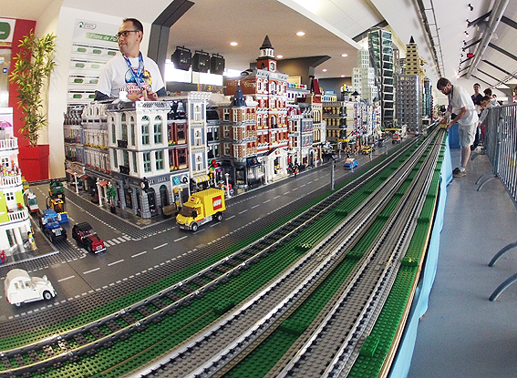

**La rue FReeLUG**

La rue FReeLUG

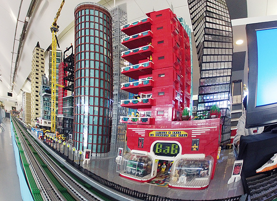

**Le quartier des affaires FReeLUG.**

Le quartier des affaires FReeLUG.

**Le quartier des affaires** (par cdhd)

Sûrement le plus grand et le plus beau quartier des affaires que nous ayons construit.

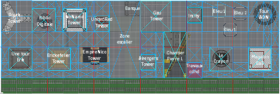

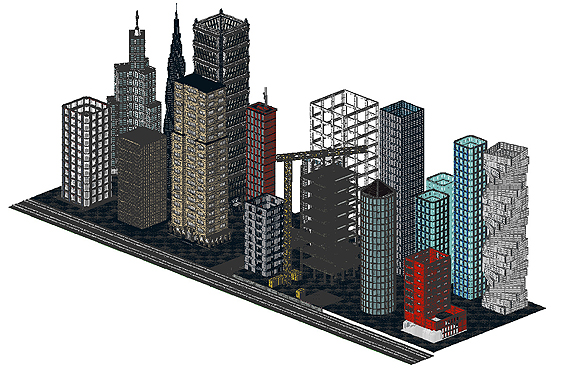

Quelques chiffres :

-   9 constructeurs adhérents FreeLUG
-   18 tours
-   plus de 130 000 pièces

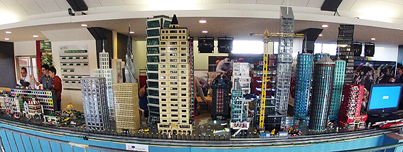

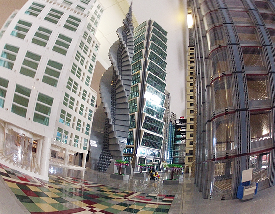

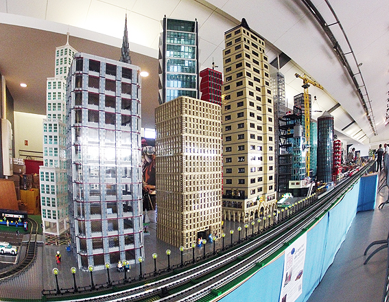

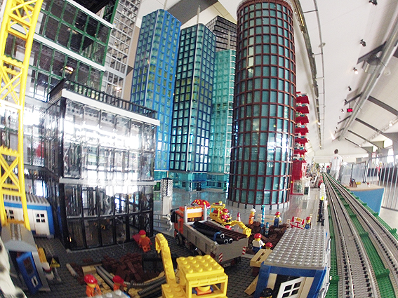

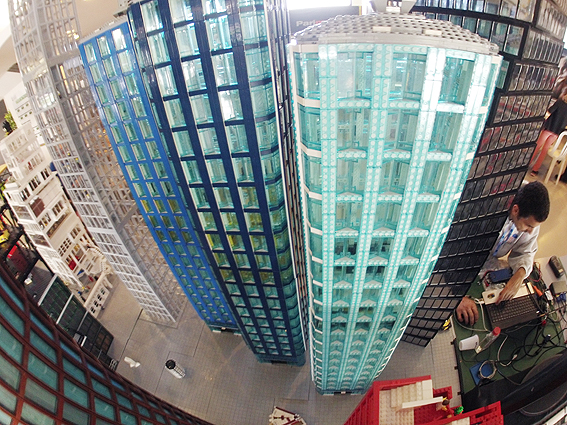

* * *

**30,67 km/h** (par DanSto)

C’est avec un grand plaisir que j’ai passé ce weekend en compagnie d’autres FreeLUGiens (ou non) passionnés de créations lors de cette exposition organisée de main de maître par Antoine et son équipe. Ma contribution à l’exposition étant finalement modeste (une tour et une grande sculpture), mon objectif était surtout de pouvoir faire circuler mes trains sur la LGV en espérant y mettre de l’animation. Pour l’occasion, j’ai ressorti le Shinkansen de 2008 et le Thalys de 2010, j’ai amélioré l’AGV Italo et le nouvel AGV blanc de 2015. Je considère que j’ai contribué au spectacle sur la LGV avec plus de 20 runs à plus de 25 km/h avec le soutien de l’homme-micro, avec un crash mémorable au bout de la ligne droite et un nouveau record absolu de 30,67 km/h.

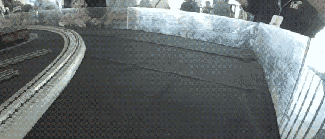

**Crash de l’AGV blanc**

Petit GIF montrant au ralenti le crash de l’AGV blanc au bout de la ligne droite.

“Petit GIF montrant au ralenti le crash de l’AGV blanc au bout de la ligne droite (l’image est à cliquer).”

C’était ma première participation à une Briqu’Expo et ce ne sera certainement pas la dernière.

* * *

**Dans le virage...**

Étonnamment c’est sans stress que j’ai choisi d’occuper la boucle droite de la LGV. C’est pourtant celle où il y a le plus de crash de train. Mais j’avais un robot protecteur comme barrière de défense de mon astrocochon et d’une version compacte de ma base spatiale "Classic Space". Alors même pas peur !

[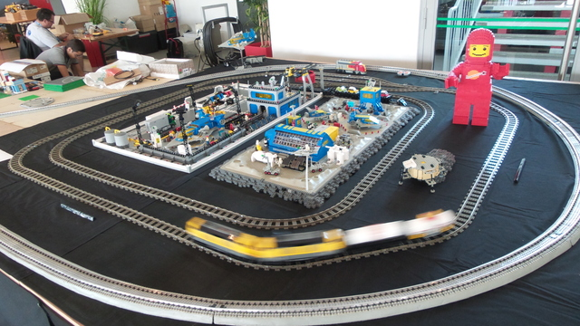](https://www.freelug.org/IMG/jpg/20170901_182043.jpg)

Je ne garde que de bons souvenirs de cette exposition, appelée à se développer et s’améliorer lors des prochaines éditions. Que ce soit au niveau de la qualité des créations présentées, de l’implication et de l’efficacité de l’équipe organisatrice et des fabuleux bénévoles, ainsi que de la possibilité de rencontrer d’autres AFOL, certains venant de loin, ce fut une belle réussite. J’ai passé un excellent week-end.

_Jérôme (jivé69)_
