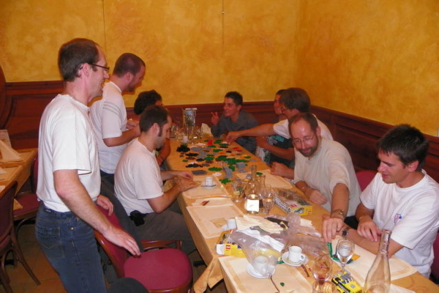

Rendez-vous était pris à la brasserie "Le 5", pour passer un moment entre passionnés LEGO, ce samedi 12 septembre.

Il était entendu que la prochaine soirée au restaurant entre fans de LEGO en Rhône-Alpes se ferait dans la région stéphanoise.

C’est pour cela que, ce samedi 12 septembre, nous avions rendez-vous à La Fouillouse (42) pour une nouvelle soirée mouvementée.

Arrivé sur place vers 18h50, avant Pierre L, je fais la rencontre de David, pour qui c’est la première vraie soirée AFOL. Nous nous étions déjà rencontrés à d’autres expositions. Puis, ce fut le tour de Didier, jusqu’à attendre Xavier et sa famille, vers 21h00. Mais, vous verrez plus bas, que notre patience ne fut pas trop éprouvée.

Nous rentrons sans problème dans le restaurant. Merci aux organisateurs, tout était très bien prévu, et nous étions attendus. Une table était prête au fond d’une grande salle. Nous n’étions pas les seuls à y manger en groupe.

Il nous a fallu quelques temps pour nous installer, discuter, se retrouver, et puis nous apprenons que Xavier et sa famille ne pourront arriver avant 21h00. L’attente semble longue, car les estomacs crient un peu famine, et pourtant... Didier nous sort son stock de minifigs à vendre, plus de 400 pièces, chacune neuve et bien rangée dans son sachet. Et là, nous n’avons pas vu le temps passer. Sans nous ruer sur le choix disponible, nous nous sommes amusés à chercher certaines spécialités. A un moment, j’ai entendu dire "Faudrait que les autres clients se taisent, on s’entend plus discuter !". C’était le mot de Pierrick. Et c’est vrai que finalement, nous ne faisions pas tant de bruit que ça !

Il restait quand même quelques sachets lorsque Xavier est arrivé. Et nous avons enfin pu commencer le repas...

**C’est où qu’on mange ???**

Le repas s’est déroulé sans encombre, c’était poissons et poissons, et très bon. Jusqu’au gâteau que nous avons dégusté avec plaisir.

La soirée s’est poursuivie avec un draft du set 6743. C’est toujours très amusant d’avoir plusieurs pièces identiques d’un même set. Et surtout très sympa d’avoir un constructeur Technic pour qui certaines pièces sont beaucoup plus importantes, que lorsqu’on fait du city !

Nous avons réussi à nous quitter vers 1h du mat, non sans mal... Heureusement qu’il ne faisait pas trop froid sur le parking.

Une soirée très sympathique à renouveler. Même si c’est très dur à caser dans le calendrier des expositions.

Jérôme / Jac

* * *

Et bien Jac a tout dit !

J’ai passé une agréable soirée, bien animée par nos bancs, les jetés de minifigs et un draft à neuf.

On a tous envie de recommencer des repas pareils tous les soirs.

Merci aux présents d’être venus.

Et vivement le prochain resto !

Pierre L. / Pierrolego

* * *

Effectivement Jac a tout dit !

Sacrée soirée (sans jean pierre) et j’ai même recruté un maçon pour le samedi suivant ;-)

A refaire !

Xavier / Brikolego

* * *

Merci aux organisateurs pour cette super soirée et aux participants pour leur bonne humeur. Même au resto, nos chères briques ne sont pas loin (mocs bancs, draft, minifigs volantes). Et toujours les regards amusés ou étonnés des personnes qui nous entourent...

Et comme dit Pierre L, vivement le prochain resto !

Laurent

* * *

Ces moments ont une particularité, en plus de se passer entre amis et avec des briques, c’est de passer trop vite. Et ce fut encore plus vrai ce samedi soir. Je ne répèterais pas que les gens sont géniaux, ce serait un pléonasme avec AFOLs. Le restaurant qu’avait choisi pierre était très bien malgré un nombre impressionnant de gens incultes en LEGO.

Avec toutes ces raisons, on va organiser un autre évènement de ce type très rapidement, allez soyons fous, disons en janvier.

Pierrick / PZ

* * *

Super soirée ! Merci à tous les participants et aux organisateurs pour être tous venus partager ce bon moment !

Jac a oublié de dire que j’avais apporté quelques catalogues 2009 en Japonais, que lui et d’autres intéressés ont pu ajouter à leur collection !

A refaire au plus vite !

Pierre C. / Tribolego

* * *

**–** [Galerie de JAC](http://photos.freelug.org/main.php/v/JAC/Exposition/Expositions2009/Sainte-2009-09-12/)  
**–** [Galerie de Sixtuds](http://photos.freelug.org/main.php/v/6studs/Expos/StEtienne/)
