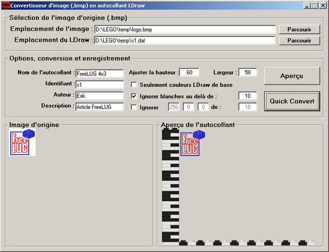
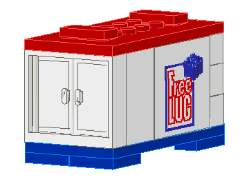

A partir d’une image bitmap, Sticker Generator permet la génération d’un fichier au format LDraw que vous pouvez insérer dans vos différents modèles. Voilà enfin une façon facile d’appliquer des autocollants dans vos modèles 3D !

[Sticker Generator](http://www.scottwardlaw.com/sticker_generator/) est un petit outil développé par Scott Wardlaw pour Windows, disponible en version française (Philo à la traduction ;) ).

L’interface graphique est relativement simple d’usage : sélection de l’image à convertir, chemin de destination et c’est à peu près tout si on est pressé.

Toutefois, voici quelques conseils.

Le premier est tout d’abord le format de l’image. Ce doit être une image au format BMP 8 bits (256 couleurs). Sticker Generator semble assez sensible sur la nature du BMP. Il n’est pas garanti que tous soient correctement acceptés ou convertis.

Le nom de fichier en sortie est limité à 8 caractères.

L’échelle de conversion par défaut est à peu près la suivante :  
**–** 18px pour une largeur d’un tenon  
**–** 21px pour une hauteur de brique  
Mais le logiciel permet d’ajuster la taille de l’image (hauteur uniquement, la largeur restant proportionnelle à la hauteur).

Sticker Generator permet également de gérer la transparence avec une tolérance sur la couleur souhaitée (le blanc par défaut).

Prenons pour exemple le logo FreeLUG que nous souhaitons appliquer sur un container LEGO (on choisit la pièce [4215b, Panel 1x4x3](http://www.peeron.com/inv/parts/4215b) pour cela). Notre logo ne devra donc pas dépasser 72 x 63 px.

Après avoir défini l’emplacement de l’image et le chemin vers le fichier de sortie, nous pouvons préciser quelques options. Comme mon image possède un fond un blanc, je décide ici d’ignorer les couleurs blanches.

Il suffit de lancer l’aperçu, et si le résultat est satisfaisant, il suffit de cliquer sur "Quick Convert".

Il faut ensuite importer le .dat généré dans son modèle, et voici ce que nous pouvons obtenir :

Maintenant, il n’y a plus d’excuse pour ne plus customiser vos modèles LDraw !
