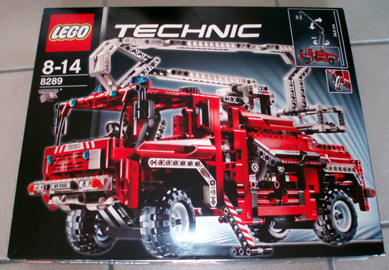
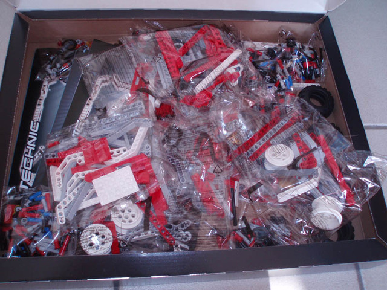
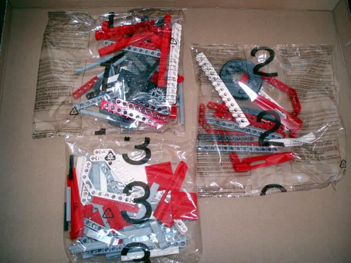
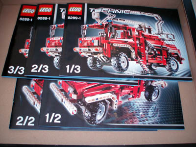
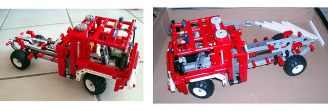
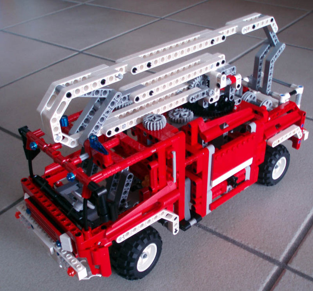
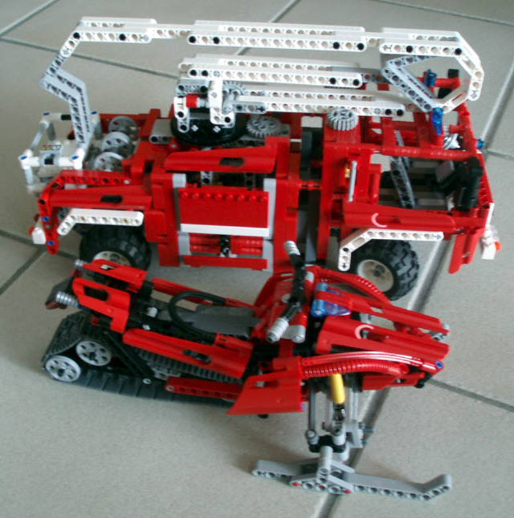

Contrairement à la [motoneige présentée dans la revue précédente](/articles/8272-motoneige-et-nouvelles-chenilles/), le look global du camion de pompier n’était pas pour me plaire. C’est pourquoi à un [prix de 65 euros](http://shop.lego.com/product/?p=8289&LangId=1036&ShipTo=FR) je n’en avais pas fait l’acquisition lors de sa [sortie en 2006](http://guide.lugnet.com/set/8289).

Surtout que [l’inventaire](http://www.bricklink.com/catalogItemInv.asp?S=8289-1&v=1&b=0) des pièces (1036 en tout) n’est pas attractif non plus ! Aucune pièce nouvelle, des couleurs plus que courantes (rouge, gris, noir et blanc).

Pourquoi donc en parler aujourd’hui ? Parce qu’un élément nouveau est apparu (et apparaît souvent en cette saison) : les soldes. En effet j’ai trouvé, et vous aurez peut être cette chance aussi, ce modèle à moitié prix dans une grande surface de distribution - dont le nom évoque plus les routes de nos villes que la campagne :-). A ce prix, il est certain que l’intérêt est relancé. Reste à voir ce que la boîte a réellement dans le ventre.

Encore une fois la boîte n’amène aucun commentaire particulier, forme, taille, design : tout est habituel. Une chose cependant, au jugé, le poids semble conséquent et les 1000 pièces se font sentir. Pour une fois la société LEGO n’a pas surdimensionné la taille du contenant pour valoriser le contenu.

On ouvre fébrilement (eh oui ! c’est l’hiver, on a attrapé une petite grippe) la boîte pour découvrir les sachets habituels auxquels on ne prête même plus attention avant de les ouvrir rageusement... et c’est à tort car ils sont numérotés suivant les trois étapes majeures du montage. Il faut donc les ouvrir les uns après les autres, au fur et à mesure de la construction.

On retrouve la planche d’autocollants [^1] dans une des notices et non pas en vrac au milieu des sachets. Les notices, on le notera, ont été scindées en plusieurs livrets, rompant avec ces documents épais et lourds, s’abîmant facilement, que nous trouvions auparavant dans les gros sets.

Concernant les pièces, pas de surprise. Un petit bémol à mon commentaire initial au sujet des pièces de ce set que je trouve banales : des barres Technic blanches pas aussi courantes qu’on peut le penser. Prenez par exemple la brique Technic blanche 1x14 qui n’est apparue que dans 6 sets, tous relativement récents, et qui vient pour la première fois dans un set Technic.

Le montage se déroule sans anicroches, sans difficultés insurmontables. Les étapes sont parfois détaillées jusqu’au ridicule (une seule pièce par étape !!) Seul le temps devrait départager les débutants des connaisseurs.

La première partie du montage vous emmène ainsi jusqu’à l’étape 73 (113 étapes au total pour le modèle), et il faudra 1h15 aux plus avertis pour y arriver. A la fin de cette partie, vous aurez déjà obtenu le châssis avec sa cabine. Ceux qui voudraient customiser le modèle peuvent s’en servir de base pour une camion citerne ou un porte échelle.

La direction avec crémaillère s’actionne pour une fois non pas par le dessus mais à l’arrière.

Video Player

[Vidéo de la publication d’origine](https://www.freelug.org/IMG/mov/direction.mov)

**Direction**

Les commandes des bêches ont pris sa place sur le toit de la cabine et s’actionnent indépendamment l’une de l’autre - rendant le montage plus aisé - à travers des engrenages particuliers : les [Technic wheel knob](http://www.bricklink.com/catalogItemPic.asp?P=32072).

Video Player

[Vidéo de la publication d’origine](https://www.freelug.org/IMG/mov/beche.mov)

**Bêche**

Les sièges dans la cabine sont très sympas (ils s’inclinent).

Les montants avant de la cabine sont réalisés à l’aide de tubes flexibles noirs. Cela rompt totalement avec les lignes rouges plus fortes de la cabine. On aime... ou pas. La calandre avant est réalisée à l’aide de pièces System (plaques lisses, plaques 1x1 rondes), là encore c’est une rupture par rapport au reste du modèle en pièces Technic.

La deuxième étape prendra 35 minutes aux plus rapides : montage des dévidoirs arrières et de la tourelle de la nacelle.

Video Player

[Vidéo de la publication d’origine](https://www.freelug.org/IMG/mov/tourelle.mov)

**Tourelle**

Enfin la troisième et dernière étape est la plus courte (25 minutes pour construire le bras et la nacelle) et fort heureusement car le plaisir du montage commençait à laisser place à l’impatience de pouvoir jouer avec les fonctions mécaniques.

Video Player

[Vidéo de la publication d’origine](https://www.freelug.org/IMG/mov/bras.mov)

**Bras**

**Les fonctions mécaniques.**

Je ne suis pas déçu par leur nombre : direction, bêches d’ancrages, rotation et déploiement du bras de nacelle [^2]. De nombreuses fonctions d’accord mais rien qui ne sorte de l’ordinaire : tout est basé sur des principes surexploités et déjà vus et revus en LEGO Technic : engrenages, parallélogramme déformable, tourelle. On ne s’offusquera même pas du manque d’un différentiel qui aurait été, pour le coup, superflu.

Conclusion : Un set très sympathique pour un débutant [^3] si l’on tient compte du prix soldé. D’ailleurs les plus jeunes apprécieront tout autant le camion de pompier que la voiture qui constitue le modèle alternatif. Par contre les fans adultes de Technic se passeront de cet achat sauf si ils souhaitent compléter leur collection de pièces détachées à moindre frais.

PS : Une petite comparaison de taille avec la motoneige.

[^1]: En anglais (Fire & rescue) et allemand (Feuerwehr) mais pas en français :-(

[^2]: Sauf pour la direction, toutes les commandes sont en double

[^3]: Le modèle est particulièrement robuste
