Déjà disponible dans un magasin à la girafe, le camion 7733 prévu pour janvier 2008 enrichit la catégorie Transport de la gamme City.

## La boîte

Résumé :  
**–** prix : 25 euro  
**–** Nombre de pièces : 343  
**–** Année : 2008

La première surprise est le poids : pour sa taille, la boîte pèse plutôt lourd, c’est une bonne nouvelle.

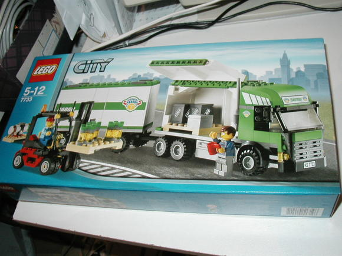

Comme c’est le cas depuis peu, l’arrière de la boîte ne propose plus de modèle alternatif mais met en scène le modèle. Le jeu a pris le dessus sur la créativité.

Après la juniorisation des pièces, la simplification des notices, le découpage des modèles en sous ensembles, les conseils en début de notice, voici l’apparition d’un petit pictogramme indiquant comment ouvrir la boîte. Les enfants d’aujourd’hui seraient-ils moins débrouillards qu’il y a 20 ans ?

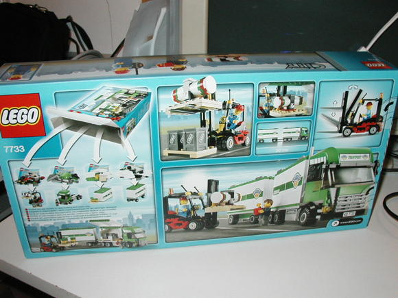

## Le contenu

Le contenu est réparti en quatre sachets, deux notices et une grande planche d’autocollants.

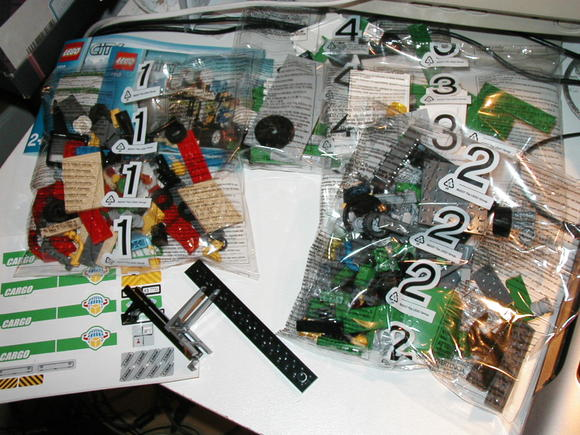

Première déception : la planche n’est pas très propre, sans doute du à la présence de traces de colle. Une plate lisse ronde 2x2 blanche viendra compléter cette impression un peu plus tard.

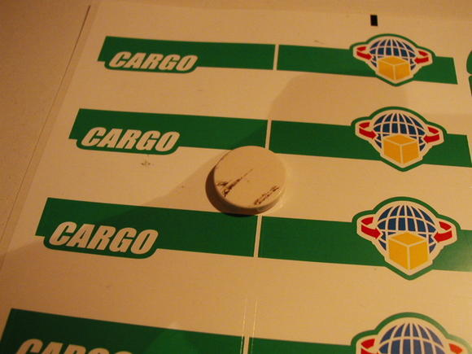

Les quatre sachets permettent le montage successif du chariot élévateur, de la caisse du camion, sa plate-forme et la remorque.

Impatient de découvrir les nouvelles pièces, je parcours rapidement les sachets.

On y découvre :  
**–** des briques pentues 4x1 18° ;  
**–** des plates 1x2 avec deux clips horizontaux (en noir et vert) ;  
**–** un toit de cabine ;  
**–** une plate ronde 4x4 ;  
**–** un nouveau cadre de fenêtre 4x3 ;  
**–** une nouvelle échelle ;  
**–** les nouvelles caisses.

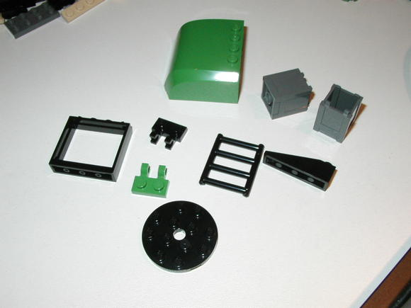

Ne pouvant pas m’empêcher de jouer avec ces nouveaux éléments, j’essaye des combinaisons qui titillent ma curiosité : les caisses s’empilent (ça pourra faire de beaux poteaux) et l’échelle peut venir se loger dans le nouveau cadre (combinaison déjà existante avec les anciennes versions).

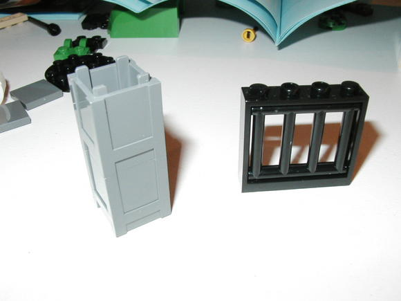

## Le chariot élévateur

Le premier sachet permet de construire le chariot élévateur ainsi que deux palettes de marchandises.

Le design est particulièrement réussi, même si on regrettera deux choses : l’absence d’une fixation pour le talkie-walkie, imposant au manutentionneur de manoeuvrer avec une seule main et un petit défaut de conception dû à l’usage de la nouvelle échelle.

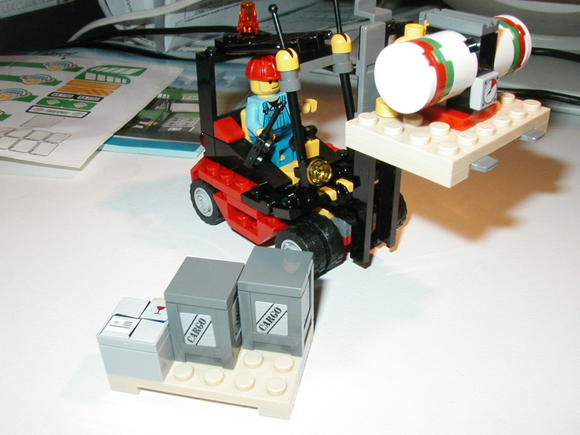

En effet, la notice utilise l’ancienne pièce [6016](http://peeron.com/inv/parts/6016) et les designers ont sans doute travaillé avec cette pièce. Or dans le montage, l’assemblage des petites antennes jaunes est empêché par la présence des nouvelles extrémités de la pièce [62113](http://peeron.com/inv/parts/62113). Le résultat est plutôt bancal. Dommage pour ce raté.

## Le camion

Deuxième surprise, le montage du camion se fait en deux temps, la partie dédiée au chargement pouvant être enlevée facilement.

Le nez du camion abandonne le design des camions de la gamme City 2006 et 2007 et en propose un nouveau, partagé avec le [nouveau camion de police 7743](http://www.brickset.com/detail.aspx?Set=7743-1).

Tout comme [le camion benne 7998](/articles/montage-commente-du-camion-benne-7998/), le routier dispose de sa tasse de café, mais la cabine ne propose pas de couchette. On regrette également l’absence de casiers de rangement, remplacé ici par de la brique et des autocollants.

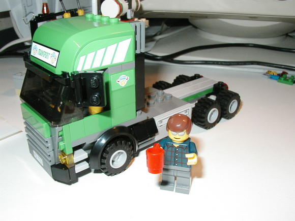

Le toit de la cabine avec ses autocollants latéraux nous rappellent une certaine pièce :  
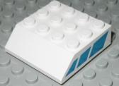

L’autocollant frontal nous laisse rêver à un rétro-éclairage.

Le montage se poursuit avec le second sachet et la plate forme du camion.

Si l’usage des panels semble un peu léger, cela confère toutefois une sensation de volume. Le sol lisse permet un chargement et déchargement aisé des marchandises avec le chariot, même si la fourche n’est pas suffisamment longue pour déposer correctement la palette au fond.

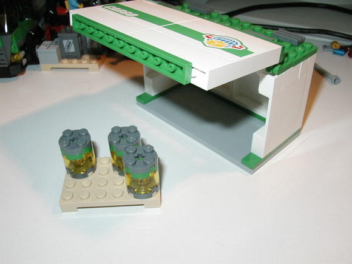

Allez, on supposera que la marchandise représente des fûts de bière d’une certaine marque.

Petit conseil : attendre le montage de la remorque avant de poser les autocollants pour les aligner correctement avec la brique verte.

## La remorque

La remorque se base sur le même montage astucieux d’ouverture que le camion, mais est un peu plus longue permettant l’accueil de deux palettes.

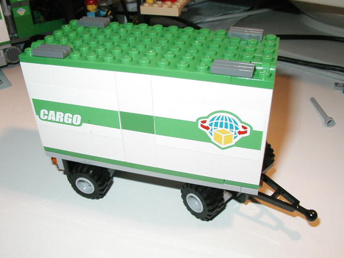

## Résultat

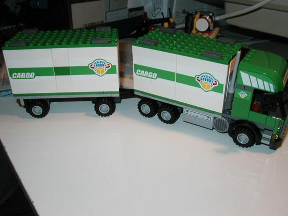

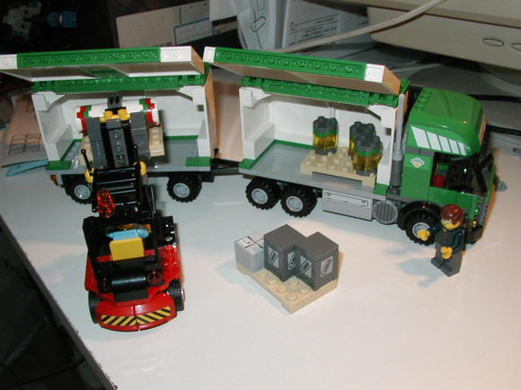

## Proposition alternative

Je n’ai pas pu m’empêcher... à peine fini, voila que je regarde ce qui peut en être fait. L’idée d’un semi-remorque me vient naturellement à l’esprit. En n’utilisant que les pièces de la boîte, cela ne demande finalement que peu de modifications pour obtenir un tracteur avec une belle remorque.

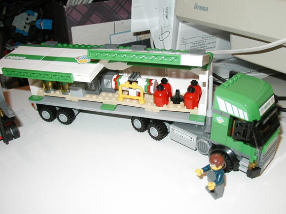

On gagne même du volume ce qui nous permet d’ajouter la palette de bombonnes issue de [la grue à containers 7992](http://www.brickset.com/detail.aspx?Set=7992-1).

## Conclusion

Au final, c’est un très bel ensemble que nous propose LEGO avec cette boîte, qui apportera de nombreuses heures de jeu aux plus jeunes d’entre nous.

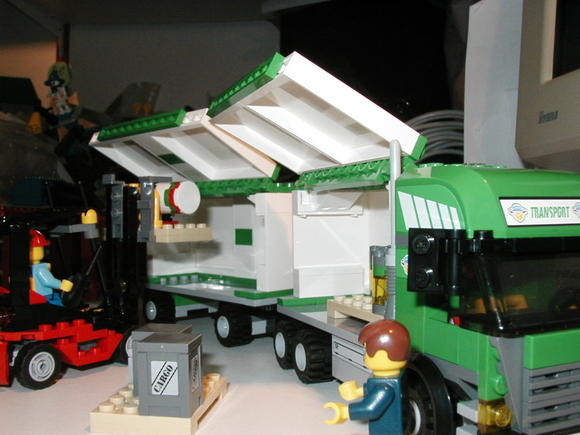

La conservation du logo transport (la caisse sur fond de globe terrestre avec les flèches) permet une intégration réussie avec le reste de la gamme et [l’avion 7734](http://www.brickset.com/detail.aspx?Set=7734-1) à venir complètera l’ensemble.
