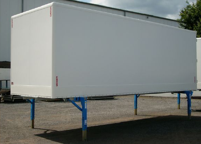
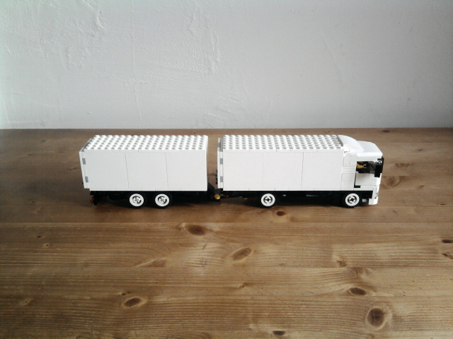
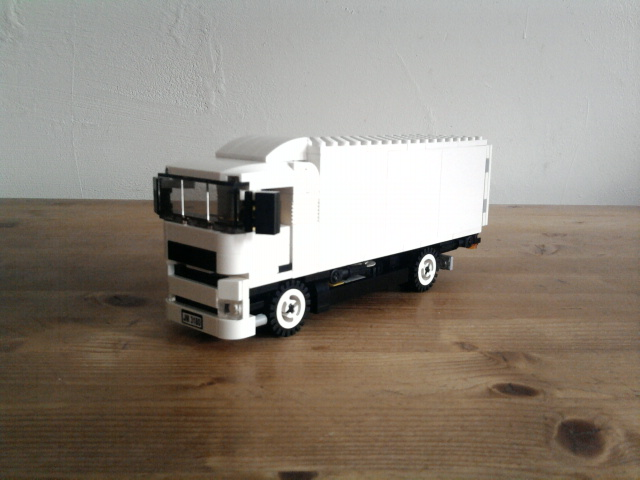
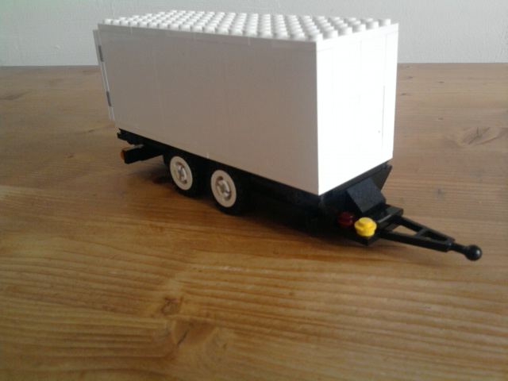
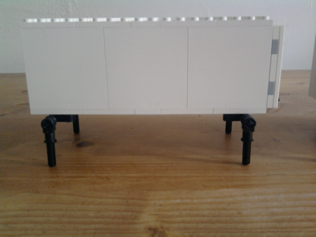

Suite à ma rechute dans le monde de la petite brique (merci les enfants), et après quelques constructions de set avec les filles, me voilà parti sur la réalisation de mon premier MOC, à savoir un camion remorque équipé de caisses mobiles.

Ayant roulé quelques années sur ce type de véhicule, et ayant comme projet la réalisation d’un diorama orienté transport de marchandises par camion, l’idée m’est venue naturellement.

## Le modèle à l’échelle 1

Le modèle qui a servi de base est un MAN TGA. Je n’avais pas pensé à le prendre en photo à l’époque, mais Internet m’a bien aidé. Vous trouverez sur ce [lien une photo permettant de bien visualiser l’ensemble routier](http://4.bp.blogspot.com/_H8umqFy9pdA/TE_1DwN3V1I/AAAAAAAAJ-8/Hd7ZEhRXyWU/s1600/IMG_1986.JPG).

Concernant les caisses mobiles, voici à quoi elles ressemblent :

## Utilité des caisses mobiles (d’après mon expérience) ?

Vous devez vous demander mais quel est l’intérêt des caisses mobiles (à ne pas confondre avec des conteneurs qui eux sont gerbables/superposables). Et bien, c’est avant tout pour optimiser certains transports.

Exemple, durant quelques mois je me suis retrouvé à charger de l’électroménager en région parisienne (désolé si je raconte un peu ma vie). Lors du chargement, les produits étaient chargés en fonction de la tournée de livraison. On charge donc en premier le dernier magasin à livrer, et en dernier le premier magasin à livrer. Ensuite le camion revenait en Bretagne, au dépôt, pour y déposer les deux caisses pleines sur une aire spéciale, et reprendre à la place deux autres caisses vides. Ce changement de caisse s’effectue en 20/25 minutes environ, et ne nécessite qu’une personne, en l’occurrence le chauffeur. Les caisses sont déposées et reposent sur des béquilles.

Au petit matin, le livreur (un autre chauffeur) fixait une caisse pleine sur son petit porteur et partait en tournée, afin de livrer les magasins. La tournée s’effectuant en fonction de l’ordre de chargement. La marchandise a donc changer de camion sans intervention direct sur le chargement.

Ce système bien rodé permettait de gagner du temps au niveau de la manutention, d’éviter de la casse (plus il y a de manutention plus il y a de risque de casse), de s’adapter aux lieux de livraison (centre ville...).

On peut aussi déposer une caisse vide à quai pour un chargement, effectuer un changement de caisse d’un camion à un autre pour regrouper un transport vers une même destination, charger des caisses sur un wagon ou un navire...

## Les dimensions

En réalité un tel ensemble ne doit pas dépasser 18,75 m. Je suis donc parti sur une base d’un modèle de 46 tenons (un tenon équivaut à 0,40 mètre), ce qui permet aussi d’être pas trop mal au niveau de la largeur avec 6 tenons, soit 2,40 m. Pour les caisses, avec 18 tenons on arrive à 7,20 m, donc possibilité de charger 18 palettes par caisse, soit 36 palettes sur l’ensemble.

## Le porteur

On y trouve notamment les barres anti-encastrement (dont une rabattable), la roue de secours, le réservoir, les branchements pour les flexibles, les feux, rétroviseurs... A noter que les portières de la cabine ne s’ouvrent pas. Par contre y a la glacière dans la cabine (non je plaisante).

## La remorque

Là aussi pas mal de détails, barres anti-encastrement, roue de secours, cale... Compte tenu des béquilles de la caisse et des roues utilisées, 3 essieux ne passaient pas, du coup c’est une remorque 2 essieux (on trouve des 2 et 3 essieux en réalité).

## La caisse mobile

La caisse est assez basique. On y trouve les béquilles, ainsi que les portes, réalisées d’un seul bloc, et qui ne s’ouvrent pas !

## Conclusion

Pour ce premier MOC, qui m’a prit quelques heures, le camion a connu différentes versions et évolutions. J’ai souvent démonté et remonté, bloqué sur un élément... ceci certainement dû à mon manque d’expérience (mais ça devrait revenir et s’améliorer). Par exemple la hauteur des chassis, qui doit être identique, pour que la caisse puisse aller sur l’un ou l’autre sans problème, ou le système d’attelage qui placé assez bas doit permettre à la remorque de tourner, le tout sans toucher les feux. Tous ces petits détails m’ont bien fait cogiter !

Mais le principal, et c’est ça le plus important, c’est que je me suis amusé comme un gosse (et avec les gosses).

[Galerie photos](http://photos.freelug.org/main.php/v/Timivox/)
