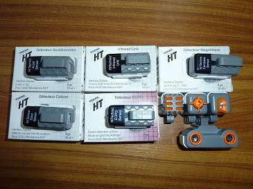
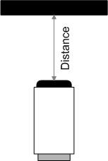
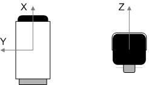
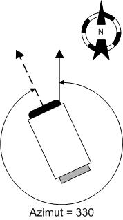
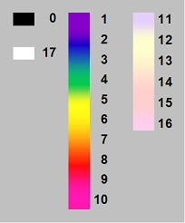

Revue du capteur de proximité à infrarouge, d’un capteur accéléromètre +/- 2g, d’un compas magnétique, et d’un capteur de couleur.

## HiTechnic

[HiTechnic](http://www.hitechnic.com/) fabrique une gamme de capteurs compatibles avec la gamme LEGO de robotique MINDSTORMS NXT. La majorité des capteurs HiTechnic sont certifiés par LEGO, ce qui assure les standards de qualité et de sécurité.

LEGO garantie en les certifiant que les capteurs fabriqués par HiTechnic sont :

-   100% compatibles avec les Mindstorms NXT,
-   conformes aux normes qualité LEGO,
-   conformes aux normes de sécurité en vigueur,
-   conformes au standard RoHS (sans plomb).

Les procédures pour accéder aux données de ces capteurs sont directement incluses dans la dernière version de Bricxcc. Pour les utiliser, il vous faudra un PC avec [Brixcc](http://bricxcc.sourceforge.net/), [NBC/NXC](http://bricxcc.sourceforge.net/nbc/), et un NXT avec le « [enhanced firmware by John Hansen](http://bricxcc.sourceforge.net/lms_arm_jch.zip) »

**Capteurs Mindstorms**

Capteurs hitechnic et LEGO NXT1.0

## NXT EOPD

Ce capteur détecte précisément la proximité d’objets. L’EOPD (ou Electro Optical Proximity Detector) utilise une source lumineuse interne pour détecter la présence d’un objet, et déterminer la distance entre l’objet et le capteur. En générant sa propre source de lumière (et en la modulant), le capteur est capable de filtrer les intensités lumineuses externes. En passant ainsi d’un environnement lumineux à un environnement sombre, ou au travers d’ombres, le capteur EOPD compense automatiquement et ne retourne que la valeur issue de la mesure de sa source propre. Les cibles peuvent être détectées précisément de 2 cm jusqu’à 20cm, et les mesures dépendent essentiellement de la taille et de la forme de l’objet détecté, ainsi que de son état de surface (plus ou moins réfléchissant).

Ce capteur peut être utilisé comme un capteur de lumière standard, dont on peut activer ou désactiver la source de lumière, selon les besoins. Comme pour ce dernier, désactiver la source de lumière interne influe directement sur la distance mesurable. Cela n’a vraiment de sens que lors de mesure de type pourcentage, car même lors de mesures "long range", la résolution est bonne à courte distance.

L’utilisation de ce capteur peut passer par l’utilisation des procédures standard **SetSensorType()**, **SetSensorMode()**, **SensorRaw()** et **Sensor()**. Un exemple pour en illustrer l’utilisation, fourni par le SAV de HiTechnic (Merci Gus).

// EOPD Demo - Testing Long/Short Range // HiTechnic // task main() { int eopdRaw, eopdPercent; SetSensorType(S1, SENSOR\_TYPE\_LIGHT\_ACTIVE); //Long Range //SetSensorType(S1, SENSOR\_TYPE\_LIGHT\_INACTIVE); //Short Range SetSensorMode(S1, SENSOR\_MODE\_PERCENT); TextOut(0, LCD\_LINE1, "EOPD-Test"); while(true) { eopdRaw = SensorRaw(S1); eopdPercent = Sensor(S1); TextOut(0, LCD\_LINE2, "EOPD Raw: "); NumOut(9\*6, LCD\_LINE2, eopdRaw); TextOut(0, LCD\_LINE3, "EOPD %: "); NumOut(9\*6, LCD\_LINE3, eopdPercent); Wait(100); } }

Des procédures sont déjà disponibles dans Bricxcc pour utiliser le capteur :

-   **SetSensorHTEOPD()** initialise le capteur, le choix du type de source lumineuse étant laissé par IN\_TYPE\_LIGHT\_ACTIVE ou IN\_TYPE\_LIGHT\_INACTIVE.
-   **SensorHTEOPD()** renvoie la valeur mesurée, brute. Voir le code exemple à la fin de l’article...

## NXT Acceleration / Tilt Sensor

Le capteur accéléromètre contient un composant capable de mesurer l’accélération selon les trois axes x, y, z.

La gamme de mesure de l’accélération est de -2g à +2g, avec une résolution de 200 incréments par g, et un rafraichissement de la mesure de 100 Hz (soit 100 mesures par seconde).

Ce capteur peut aussi être utilisé comme capteur de position, en statique, car alors il mesure l’accélération de la gravité, et donc par déduction, la position du mobile.

Ce capteur utilise l’interface I2C du NXT. Pour le tester, Il faut un firmware minimum 1.03, et connectez le capteur sur l’entrée 2, puis sélectionnez dans le menu "View > Ultrasonic cm > Port 2". Tenez le capteur debout dans votre main, l’axe des x vers le haut, et faites pivoter votre poignet de gauche à droite, doucement. La valeur devrait passer de 0 à 254. Notez que seule la valeur de x (enfin les 8 bits de poids fort de x) est disponible dans ce mode de démonstration.

**Registres du capteur**

Le mot binaire contenant la valeur de mesure étant codé sur 10 bits, la mesure nécessite 2 registres de 8 bits.

| Adresse | Type | Signification |
| --- | --- | --- |
| 42H | byte | 8 bits forts axe X |
| 43H | byte | 8 bits forts axe Y |
| 44H | byte | 8 bits forts axe Z |
| 45H | byte | 2 bits faibles axe X |
| 46H | byte | 2 bits faibles axe Y |
| 47H | byte | 2 bits faibles axe Z |

L’utilisation de ce capteur peut passer par l’utilisation des procédures standard **SetSensorLowSpeed()** et **I2CBytes()**. Un exemple pour en illustrer l’utilisation, fourni par HiTechnic sur son site.

#include "NXCDefs.h" task main() { SetSensorLowspeed(IN\_1); int count; int xval; int yval; int zval; byte inI2Ccmd\[\]; byte outbuf\[\]; while (TRUE) { ArrayInit(inI2Ccmd, 0, 2); // set the buffer to hold 10 values (initially all are zero) inI2Ccmd\[0\] = 0x02; // set values in the array inI2Ccmd\[1\] = 0x42; count=8; //read count set to 8 bytes I2CBytes(IN\_1, inI2Ccmd, count, outbuf); //read the acceleration sensor on port 1 xval=outbuf\[0\]; //load x axis upper 8 bits yval=outbuf\[1\]; //load Y axis upper 8 bits zval=outbuf\[2\]; //load z axis upper 8 bits if (xval > 127) xval-=256; //convert x to 10 bit value xval=xval\*4 + outbuf\[3\]; if (yval > 127) yval-=256; //convert y to 10 bit value yval=yval\*4 + outbuf\[4\]; if (zval > 127) zval-=256; //convert z to 10 bit value zval=zval\*4 + outbuf\[5\]; } }

Des procédures sont déjà disponibles dans Bricxcc pour utiliser le capteur.

-   **SetSensorLowspeed()** initialise la communication I2C avec le capteur.
-   **ReadSensorHTAccel(port, x, y, z)** renvoie un booléen de bonne réussite, et les trois valeurs d’accélération. Voir le code exemple à la fin de l’article...

## NXT Compass Sensor

Le capteur Magnétomètre contient un composant capable de mesurer la composante du champ magnétique terrestre, et de calculer l’azimut, où angle entre la direction du capteur, et celle du nord magnétique. Cette mesure est effectuée 100 fois par seconde, et arrondie au degré près.

Ce capteur utilise l’interface I2C du NXT. Pour le tester, Il faut un firmware minimum 1.03, et connectez le capteur sur l’entrée 2, puis sélectionnez dans le menu "View > Ultrasonic cm > Port 2". Tenez le capteur dans votre main, comme un pistolet, puis faites pivoter votre main de gauche à droite, doucement. La valeur devrait passer de 0 à 179, c’est azimut2. Doublez cette valeur, et vous aurez une bonne idée de l’azimut (à + ou - 1, cf infra).

**Registres du capteur**

| Adresse | Type | Signification |
| --- | --- | --- |
| 42H | byte | azimut2, moitié de l’azimut |
| 43H | byte | azimut1, reste de l’azimut |
| 44, 45H | word | azimut16,(lowbyte, highbyte) |

Deux méthodes pour calculer l’azimut :  
**azimut = azimut2\*2+azimut1**, nécessite 2 cycles de lecture, azimut non signé, ou **azimut=hightbyte\*8+lowbyte**, azimut signé, mais occupation mémoire sur 16 bits.

Le compas doit être utilisé horizontalement pour bien fonctionner. Souvenez-vous en lors de la construction de votre robot, et du placement du capteur. Celui-ci doit être fermement accroché, sinon les mesures seront erratiques. HiTechnic recommande que le compas doit se trouver à au moins 15 cm d’un moteur, et 10 cm de la brique NXT.

Des procédures sont déjà disponibles dans Bricxcc pour utiliser le capteur.

-   **SetSensorLowspeed()** initialise la communication I2C avec le capteur.
-   **SensorHTCompass()** renvoie la valeur de l’azimut. Voir le code exemple à la fin de l’article...

## NXT Color Sensor V2

Le capteur de couleur utilise une led blanche pour illuminer la cible, et analyser les composantes de la lumière reflétée à l’aide d’un phototransistor. Cela lui permet ensuite de calculer l’index de la couleur, selon le diagramme suivant :

Ce capteur utilise l’interface I2C du NXT. Les composantes de la couleur sont calculées 100 fois par secondes.

**Registres du capteur**

| Adresse | Type | Signification |
| --- | --- | --- |
| 42H | byte | Index de la couleur |
| 43H | byte | Composante Rouge |
| 44H | byte | Composante Verte |
| 45H | byte | Composante Bleue |

Le capteur de couleur fonctionne bien mieux si le capteur est très prés, et perpendiculairement à la cible, afin que la lumière ambiante ne vienne pas parasiter la mesure.

Des procédures sont déjà disponibles dans Bricxcc pour utiliser le capteur.

-   **SetSensorLowspeed()** initialise la communication I2C avec le capteur.
-   **SensorHTColorNum(port)** renvoie la valeur de l’index.
-   **ReadSensorHTRawColor(port, rouge, vert, bleu)** renvoie les composantes RGB.
-   **ReadSensorHTColor(port, index, rouge, vert, bleu)** renvoie la valeur de l’index et des composantes RGB.  
    Voir le code exemple à la fin de l’article...

## Code de test

//Code pour la connexion via I2C, de capteurs fournis par HiTechnic //Aucune espèce de garantie ou de copyright sur le code, faites //en ce que vous voulez. #include "NXCDefs.h" //EOPD en 1, Accel en 2, Compass en 3 and Color en 4 task main() { // Initialisation du capteur de distance infrarouge (en 1) SetSensorHTEOPD(IN\_1,IN\_TYPE\_LIGHT\_ACTIVE); // Initialisation de la communication I2C avec les autres capteurs SetSensorLowspeed(IN\_2); SetSensorLowspeed(IN\_3); SetSensorLowspeed(IN\_4); int x,y,z; // données de l'accelerométre (en 2) byte ColorNum, Red, Green, Blue; // composantes de la couleur (en 4) while (true) { NumOut(50, LCD\_LINE3, SensorHTEOPD(IN\_1),true); ReadSensorHTAccel(IN\_2, x, y, z); NumOut(0, LCD\_LINE4, x); NumOut(35, LCD\_LINE4, y); NumOut(70, LCD\_LINE4, z); NumOut(50, LCD\_LINE5, SensorHTCompass(IN\_3)); ReadSensorHTColor(IN\_4, ColorNum, Red, Green, Blue); NumOut(0, LCD\_LINE6, Red); NumOut(35, LCD\_LINE6, Green); NumOut(70, LCD\_LINE6, Blue); NumOut(0, LCD\_LINE7, ColorNum); Wait(100); } }

La deuxième partie de l’article sera sur l’utilisation concrète et les performances des capteurs, avec comparaison de mes capteurs "home-made".

Un grand merci à Gus, du support technique de HiTechnic, qui a répondu dans la journée à toutes mes questions.
