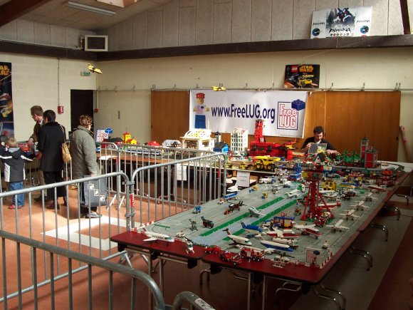
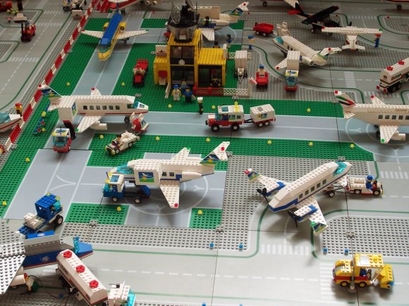
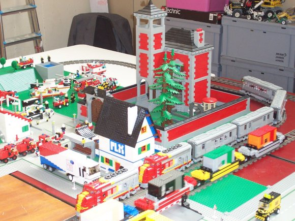
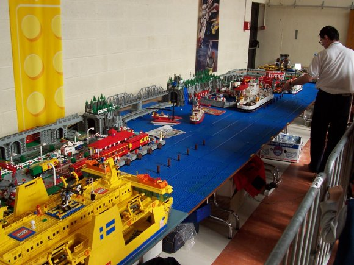
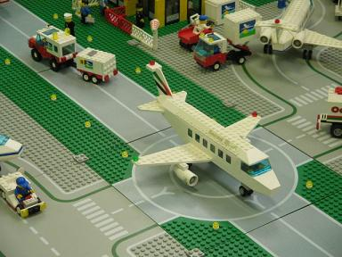
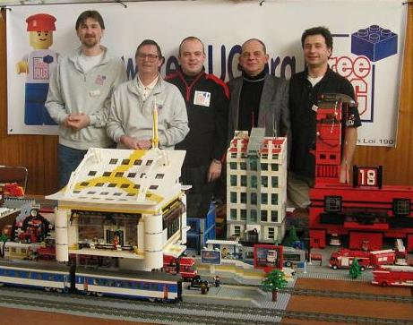
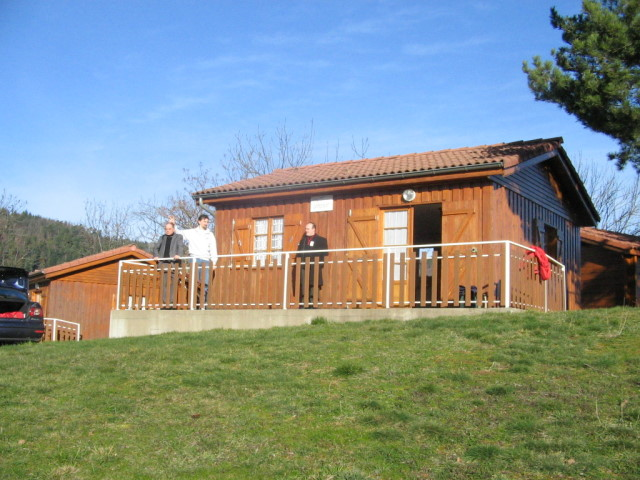

Les 3 & 4 mars, FreeLUG était présent à la biennale du modélisme, organisée par l’association humanitaire Ceyrat Partage.

Cette exposition dans la banlieue clermontoise s’annonçait bien, et ce fut un week-end finalement parfait !!

Cela commence le vendredi soir par l’accueil des organisateurs qui nous proposaient une pièce de 100 m² pour nous tout seuls ; et un hébergement offert dans un mobilhome à cinq minutes du lieu de l’exposition. Ensuite, le samedi, nous avions la matinée pour finir tranquillement notre installation avant l’inauguration de l’exposition par M. le Maire. Et là, grand succès ! Je cite : "Ah ! des LEGO ! toute ma jeunesse !". Et au discours inaugural, il évoque ses souvenirs de douleurs aux doigts lors de séances mémorables de LEGO. On ne pouvait pas le laisser repartir sans lui offrir un démonte-brique !!

**la salle**

Enfin, le dimanche matin, un bel article de presse dans "La Montagne" est venu couronner ce grand succès. Ils ont tout compris ces journalistes !! :)

**Article de presse**

en haut a gauche

Notre table présentait trois facettes : tout de suite en entrant, il y avait le grand aéroport de Jean-Gérald, notre collectionneur de Tradilug, avec entre autres quelques modèles promotionnels assez rares.

**L’aéroport**

Sur la partie centrale, il y avait un réseau ville/train, avec un village, une zone artisanale, la gare, les pompiers et une superbe maison de maître. Au niveau des trains, Jac et moi présentions nos locomotives "Made in France". J’avais aussi installé mon système de cantonnement automatisé ; permettant l’alternance des trains conditionnés par des feux rouges ou verts. En ayant eu le temps de bien le régler le samedi matin, le système à très bien fonctionné (vidéo à la fin de l’article).

**Maison de maitre**

Enfin, sur la gauche, il y avait le réseau des ferry de Jean-Marc. Il n’a pas arrêté de faire des démonstrations de son réseau durant tout le week-end, captivant l’attention des grands mais surtout des petits...

**Jean Marc et son ferry**

Voila, ce fut une petite exposition simple, mais très bien réussie. Au démontage, j’ai délégué la responsabilité de détruire ma caserne de pompier à Jac !! :)

Je voudrais remercier d’abord M. Jacques Dautraix, président de Ceyrat Partage, et toute son équipe pour leur chaleureux accueil ; remercier aussi Franck Loiseau, un AFOL qui a pensé à nous pour faire cette exposition ; remercier aussi les adhérents qui sont venus nous voir, et jouer au petit train (n’est-ce pas Daniel ?). Enfin, grand merci à Jérôme "Jac" Tessier pour avoir tout organisé de façon magistrale.

A refaire et à bientôt, Loys.

* * *

Le salon de modélisme de Ceyrat est terminé, et déjà, les bilans sont largement positifs pour les organisateurs (3000 dont 1200 entrées payantes). Pour FreeLUG, un article avec photo couleur de notre salle dédiée aux LEGO. Ce fut deux jours pleins pour les quatre sections (non mousquetaires) de FreeLUG : Bourgogne, Rhône-Alpes, Auvergne et Bretagne, tous les thèmes proposés ont plu aux officiels, visiteurs, et on en a vu certains revenir plusieurs fois. Pour ma part, mon réseau a bien fonctionné sauf le ferry blanc qui m’a laché à 90 minutes de la clôture du salon. Je remercie Jac pour son organisation, Jean-Gérald et son petit papa, Loys pour leur présence très sympathique, conviviale. Dans deux ans, peut-être ... Votre serviteur finistérien.

Jean-Marc

* * *

Ce petit week-end entre AFOLs fut pour nous rempli d’excitation, de fierté et de sourire.  
Et c’est avec une grande joie de voir le Tradilug (Traditionnal LEGO Users Group) c’est-à-dire l’exposition (de beaucoup) de sets officiels LEGO se réaliser pleinement en vrai. Pour cette exposition j’ai amené plus de 80 sets officiels de la ville. Les effets ne se sont pas fait attendre puisque que l’on pouvait, entre autres, entendre : « waaaaa cette avion là-bas je l’ai encore chez mes parents » (set 6368)... « Tu vois le camion de pompier à coté de la tour de contrôle et bien les gyrophares s’allument et il y a 2 sirènes dessus... » (set 6480) bref que de souvenirs évoqués mais aussi la démonstration de sets inédits en France comme les sets principalement américains dont notamment les sets 1475, 1687, 1702 6377 et 6391 ou les sets promotionnels AIRLINE dont notamment le 1772-1773-1774-1775-1817-1818-1973.

**sets officiels Airline**

Je tiens à remercier les autres exposants d’avoir accepté le mouvement que je lance, d’avoir eu cette ouverture d’esprit et surtout de malgré tout être curieux de certains sets officiels. (Pour Loys un petit clin d’oeil au set 6614). Donc en conclusion pour moi le Tradilug est lancé au sein de FreeLUG. J’espère avoir le soutien voir l’aide d’autres pour faire vivre tous les sets officiels quelque soit le thème abordé ou l’année de sortie du set.

Je voudrais mettre en avant le public qui fut nombreux. J’ai été étonné de voir le nombre de dépliants FreeLUG partir sur 2 jours. Évidemment grâce à notre dynamisme face aux gens. J’ai été étonné de voir aussi beaucoup de personnes revenir plusieurs fois dans notre salle, signe d’une attraction irrésistible...

J’ai pu noter de façon remarquable un petit nombre de KFOL français s’intéresser à la brique, dont notamment un gentil garçon d’une dizaine d’année prénommé Johan avec qui j’ai pris le temps de discuter et j’ai pu constater avec admiration qu’il maîtrisait Bricklink aussi bien que moi ! Du coup nous avons gardé contact et il vient de m’envoyer un mail me disant qu’il venait de s’inscrire à FreeLUG. Je suis ravi que les enfants soient parmi nous et j’espère qu’ils seront aussi des exposants futurs.

Je voudrais remercier Jérôme, Loys, Jean-Marc et mon père pour la bonne humeur que l’on a eu tout le long... les expositions renforcent les liens existants et en créent d’autres... et je suis ravi de la complicité que l’on a eu à 5, et même si tout n’a pas été parfait, ces petites imperfections ont été sources de bonnes rigolades.  
Je voudrais aussi remercier le président de « Ceyrat Partage » pour son dévouement à faire de cette exposition une réussite mais aussi de nous avoir trouvé un beau logement gratuit. Je remercie par la même occasion son équipe ainsi que tous les exposants dont certains sont souvent venus nous voir (comme l’exposant du seigneur des anneaux).

Un remerciement spécial à mon ami Jac (Jérôme) sans qui je n’aurai jamais fait tout ce que j’ai fait en MOCs aujourd’hui et aussi en exposition... un grand merci à toi Jac !!!

Voilà nous sommes, mon père et moi, heureux de cette exposition et nous sommes déjà en train de préparer la suivante qui est en principe prévue pour octobre 2007 à Lyon mais si une autre pouvait se faire en mai nous sommes partant !

JeanG et son Père Jean

* * *

Contacté par Franck Loiseau (informaticien à "La Montagne") et Jacques Dautraix (Président de "l’Association Ceyrat Partage"), je me suis retrouvé coordinateur de cette exposition que j’ai qualifiée de "Marsienne" !! Il faut prendre les contacts avec les FreeLUGiens intéressés, puis, s’entendre pour placer nos différents éléments, et mettre au point tous le WE avec l’hébergement, les repas, et l’espace disponible, et le temps de préparation. C’est beaucoup de travail, mais le résultat est convaincant. De même que les réactions écrites plus haut, qui font vraiment plaisir.

L’entente pour le placement des modules s’est faite grâce à internet, comme à l’accoutumée. Par contre, les différences qui sont apparues lors du vrai montage, bin, on en parlera pas, non, non, c’est pas la peine d’insister. Surtout que, avec l’habitude de l’installation de nos module, on a pu s’arranger...

Pour l’hébergement, nos avons eu gracieusement, à notre disposition un sympathique petit châlet, avec une belle vue sur le Puy-de-Dôme. Ce n’était pas le but du voyage, mais, c’est quand même à signaler ! Du coup le repos de nos journées bien remplies a été plus agréable.

**Le petit Chalet**

Je ne reviendrai pas sur les repas, il y a encore des choses à améliorer, vous ne m’en voudrez pas !! Je ferais mieux le prochain coup !!

Nous avions un espace de 100m² à remplir, et il nous a fallu 7 heures pour tout préparer. Mais nous ne les avons pas vu passer. Elles se sont passées entre la soirée du vendredi, et la matinée du Samedi, jusqu’à environ 10h30, heure prévue pour l’inauguration.

Enfin, la phrase de Monsieur le Maire de Ceyrat restera dans nos mémoire, ainsi que son étonnement lors du cadeau remis par la délégation FreeLUGienne !!

En conclusion, c’est un excellent WE que j’ai passé en votre compagnie. La marche des trains a été impeccable. Celle des bateaux aussi. Nous avons juste regretté de ne pas avoir fait voler un avion... Alors, un grand merci à tous les participants, et visiteurs, JAC.

Galeries de photos :  
**–** [Photos de Loys](http://www.brickshelf.com/cgi-bin/gallery.cgi?f=238493)  
**–** [Photos de JAC](http://www.brickshelf.com/cgi-bin/gallery.cgi?f=238736)  
**–** [Photos de JeanG](http://www.brickshelf.com/cgi-bin/gallery.cgi?f=238288)  
**–** [Photos de Jean Marc](http://gallery2.freelug.org/main.php/v/barr__/ceyrat/)  
**–** [Vidéo du système de cantonnement](http://gallery2.freelug.org/main.php/v/Chimere/Cantonnement.MOV.html)
