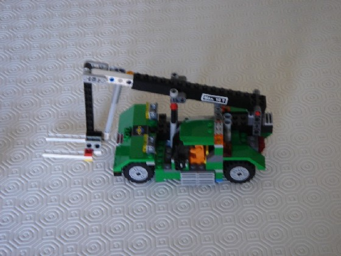
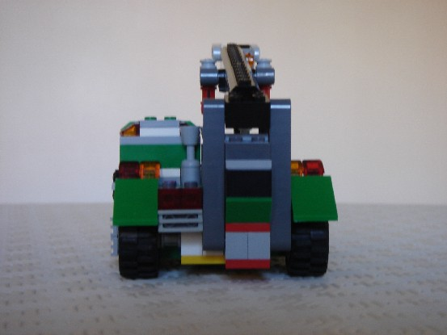
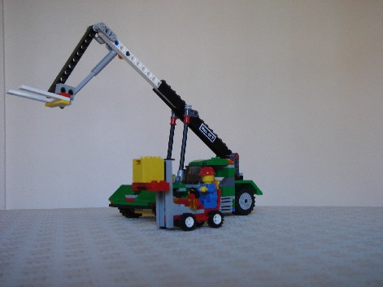
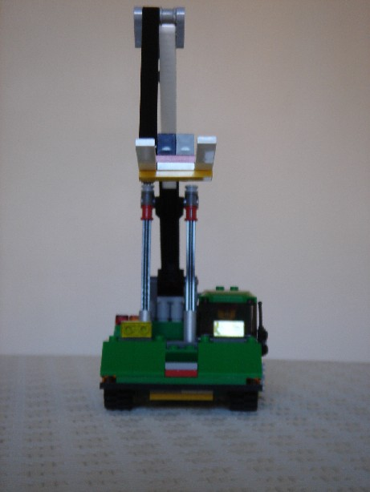

Il y a déjà un petit bout de temps, [Alban Nanty (Banban) nous présentait son chariot élévateur](/articles/un-chariot-elevateur-version-2/) qui utilise une fourche spéciale assez rare. Aujourd’hui je vous présente une nouvelle forme de chariot élévateur : un chariot élévateur à bras télescopique.

Le chariot élévateur est tiré en parti du set 7992.

**Le nouveau chariot**

## Dimensions

Ce nouveau chariot élévateur fait :  
**–** 10 tenons de large ;  
**–** 19 tenons de longueur ;  
**–** 10 briques de haut quand le bras télescopique est en position à raz-de-terre.

## Le début d’une construction rapide

Comme je le disais au départ de cet article, l’idée est venue du set [7992 : le chargeur de containers](http://guide.lugnet.com/set/7992). J’ai gardé le châssis, c’est-à-dire les 2 briques Technic de 15 trous et les 2 plates 2x2 rouges, après le montage est venu tout seul.

**Vue arrière**

## Comparaison avec le set d’origine

Le chariot du set 7992 est constitué d’un crochet au bout du bras télescopique, de 2 vérins, et de 6 roues.  
Le nouveau chariot élévateur est lui constitué d’un vérin supplémentaire, de 4 roues et le bras est décalé d’un tenon vers la droite.

ATTENTION : certaines pièces ne viennent pas du set d’origine.

## Une comparaison avec le chariot élévateur du set 10159

Certains vont dire que les deux chargeurs n’ont pas la même fonction, mais le but de cette comparaison est de faire une comparaison avec le chariot de Banban.

**comparaison**

La première comparaison que je vais faire concerne la taille. Le chariot de Banban fait environ 4 tenons de large, le mien en fait 10 tenons de large.

La seconde : la hauteur maximale de la fourche de Banban est de 5 briques, le mien est de 12 briques.

**Vue avant**

Voila la dernière photo qui conclue cet article.  
Si quelqu’un a des commentaires ou des critiques faîtes les moi savoir.
