Après une présentation de l’environnement LEGO Mindstorms à la Gaîté Lyrique dans le cadre du [TMP/LAB](http://www.tmplab.org/), j’ai été contacté par tout un tas de personnes intéressées par l’approche LEGO, qui pour du prototypage rapide en vue de construire après en "dur", qui pour prospecter des solutions industrielles de substitution à la brique NXT, qui pour animer des ateliers pédagogiques de découverte de la programmation auprès d’enfants.

Comme vous vous en doutez, c’est cette dernière qui a donné lieu au "coding gouter", et fait donc l’objet de cet article.

## Qu’est ce qu’un coding gouter ?

Un coding gouter, c’est des papas et des mamans, geeks (ou pas !), qui amènent leurs enfants à découvrir les multiples aspects de la programmation au travers de jeux et d’expérimentations via des outils numériques (principalement des ordinateurs, mais aussi des smartphones et des tablettes). On y fait (entre autres) des animations évènementielles avec [Scratch](http://scratch.mit.edu/), du basic ou des applis [GameSalad](http://gamesalad.com/).

La philosophie est simple, on apprend en faisant, pas de cours, mais de la bidouille, le droit de laisser tomber une activité, d’y revenir, de faire et défaire, bref ce n’est pas l’école, c’est un goûter !!!

[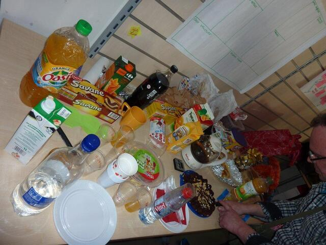](https://www.freelug.org/IMG/jpg/P1020758.jpg)

## Et les Mindstorms dans tout ça ?

Au début de l’histoire, je ne connaissais personne, et je n’ai pas pu rencontrer des organisateurs avant, pour échanger sur ce qu’ils attendaient de moi. J’ai cherché sur le net [coding gouter](http://ils.sont.la/post/premier-coding-gouter-paris-kids-code-et-cake), et finalement, vu le public visé, et comme je venais avec mes enfants et ma femme, j’ai tenté de faire simple et ludique (crédibilité de papa à sauvegarder, m’enfin !).

Le premier écueil était l’interface de programmation. Or Scratch a été déjà expérimenté durant les coding goûters précédents, et comme il est basé sur java, je me suis mis à rechercher une interface scratch <-> lejos. Bingo, ça existe, et ça s’appelle [Enchanting](http://enchanting.robotclub.ab.ca/).

Sitôt téléchargé, sitôt installé, sitôt planté -> Aïe, marche pas sous Win7, bon, WinXP alors, ça marche ! Ouf !

Configuration des capteurs standards LEGO facile, des moteurs NXT facile, mon alpharex2.0 marche en avant et en arrière, les blocs sont faciles à manipuler, j’ai trouvé le logiciel !

[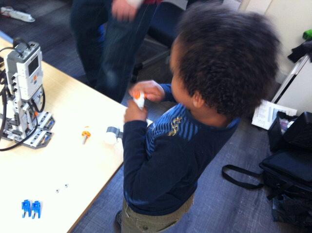](https://www.freelug.org/IMG/jpg/IMG_4986.jpg)

Le second écueil était le robot : construit, ou à construire ? Simple et robuste (c’est des enfants), ou plus sophistiqué, pour montrer plus de potentialités (c’est déjà des mini hackeurs !). J’ai donc refait un tour sur le net, et j’ai trouvé le [Robot fait en 5 minutes](http://www.nxtprograms.com/NXT2/five_minute_bot/index.html)

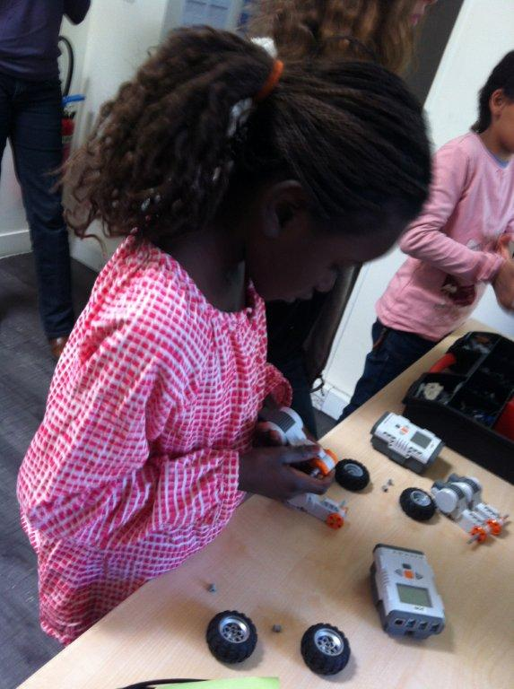

J’imprime, je lis, et je me dis que je vais projeter les instructions de montage sur un mur, pour que tout le petit monde profite du plan en même temps, en grand pour aider pour les étapes.

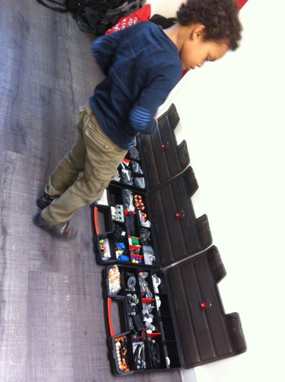

[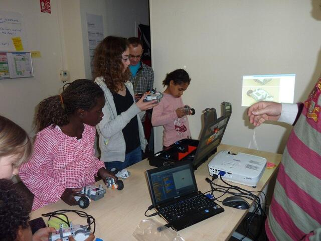](https://www.freelug.org/IMG/jpg/P1020757.jpg)

Voilà, j’ai construit l’atelier autour d’un vidéo projecteur, qui diffusait le plan du robot "5 minutes", de mes 4 boites de rangements (toutes dérangées après....), des 4 Kits NXT et de ma brique modifée JTAG qui finalement a servi aussi.

[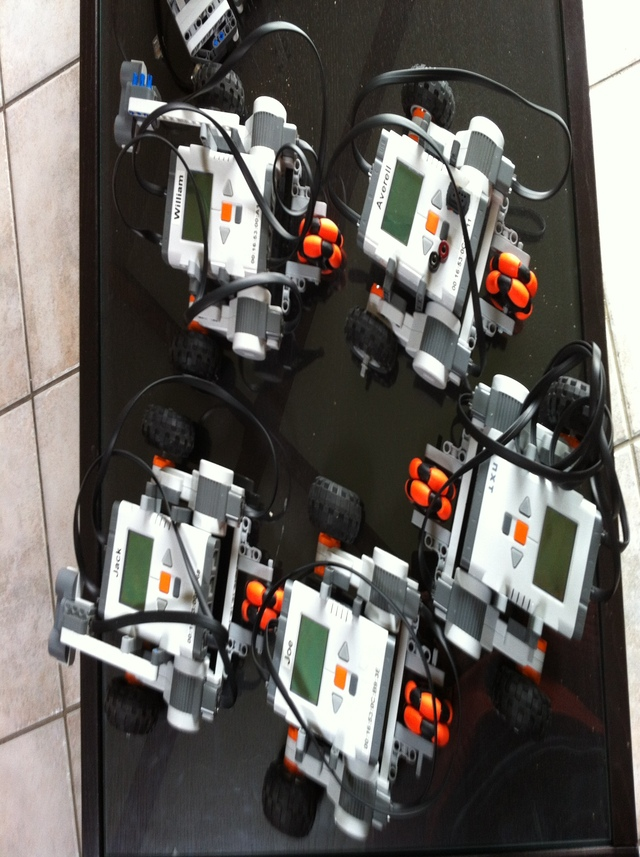](https://www.freelug.org/IMG/jpg/IMG_0655.jpg)

Les 5 robots construits, et la carcasse du marcheur, les enfants voulant construire leur propre robot !

[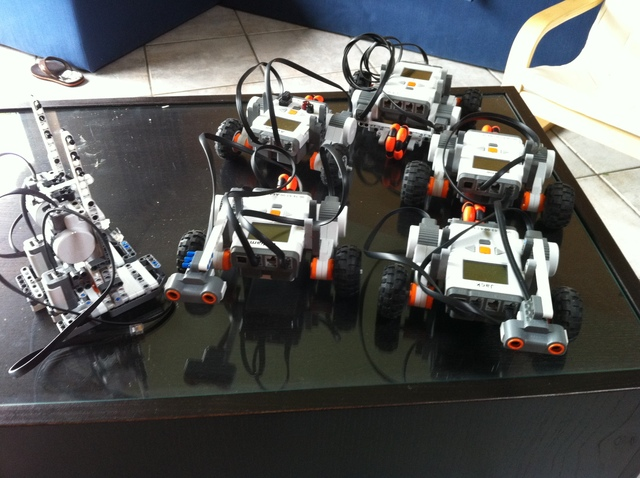](https://www.freelug.org/IMG/jpg/IMG_0654.jpg)

Vidéo d’une démonstration des deux sortes de robots qui ont émergé, un "danseur" sans capteurs, et un "éviteur" d’obstacle avec capteur à ultrasons.

Video Player

[Vidéo de la publication d’origine](https://www.freelug.org/IMG/mov/test1.mov)

## Comment ça c’est passé ?

Bien, rassurez-vous !

Les enfants ont d’abord fait le tour des activités, pendant que j’installais vidéo projecteurs, portables et boites de LEGO. Une fois les coding gouter lancés, j’ai récupéré trois grandes filles et mon fils, soit 4 robots, puis un peu plus tard, un garçon est venu pour construire lui aussi son robot (je lui ai vite trié les éléments de base, il a ainsi pu rattraper les autres...)

Deux grandes se sont vite détachées, les trois plus petits ont mis un peu plus de temps, mais tout le monde a fini son robot, et ils étaient fonctionnels.

[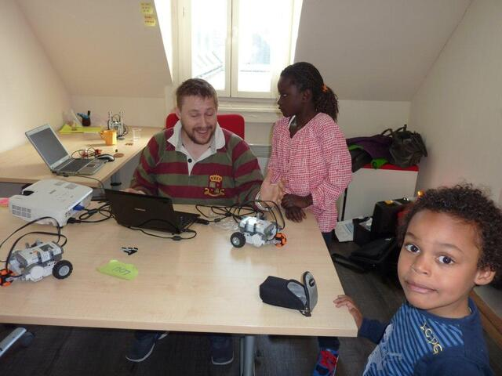](https://www.freelug.org/IMG/jpg/P1020761.jpg)

Premier programme, avec pour principe de "faire danser le robot", en avant, en arrière, tour sur le coté, et on recommence en variant les vitesses.

[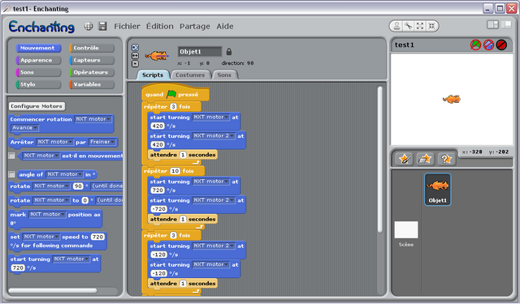](https://www.freelug.org/IMG/png/danseur1.png)

[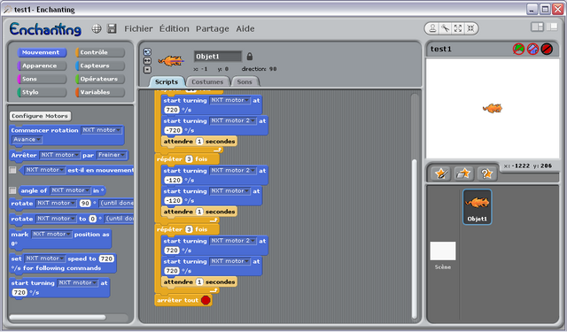](https://www.freelug.org/IMG/png/danseur2.png)

Les deux grandes en ont eu vite marre et ont voulu le faire éviter les gens. Ni une ni deux, ajout d’un bras et d’un capteur à ultrason, une consigne à 30cm, et hop le tour était joué !

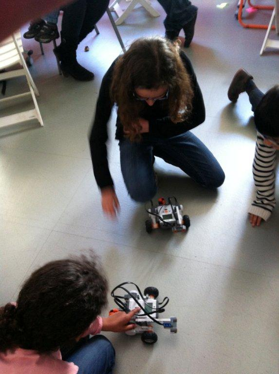

[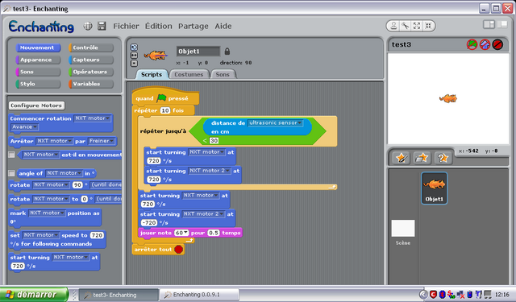](https://www.freelug.org/IMG/png/eviteur.png)

Mais elles en voulaient plus, un comportement aléatoire de ballade dans la pièce, et non pas du "tout droit". On n’est pas arrivé à faire quelque chose de bien ficelé, mais les idées fusent vite !

A noter que l’autre petite a cherché à installer sur son pc Enchanting directement, pour programmer son robot, mais a buté sur le [driver USB du NXT](http://mindstorms.lego.com/en-us/support/files/Driver.aspx#Driver). Je ne l’ai su qu’à la fin, dommage, j’avais le driver sur une clé USB.

* * *

Un très grand moment de partage avec les enfants, des parents ravis et amusés, (mais qui ne sont pas venus programmer), des enfants contents et certains même qui vont demander des boites de mindstorms au pére Noel en avance. Mes enfants ravis de pouvoir enfin toucher mes "LEGO de grand", car ils ont déjà mis la main sur mes "LEGO de quand j’étais petit", les gredins. Ma femme, qui venait sans grand enthousiasme, a vraiment apprécié ce moment, la créativité des enfants, la bonne humeur qui régnait. Je ne sais pas si j’arriverais bientôt à négocier le droit à un espace dédié LEGO dans la maison, mais j’ai assurément gagné quelques points... Bref carton plein !
