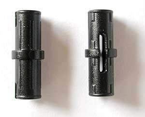
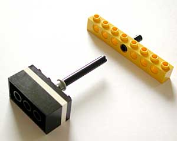
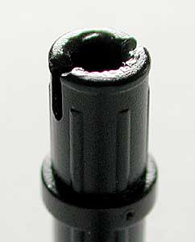
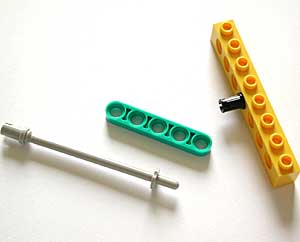
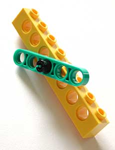
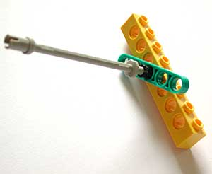
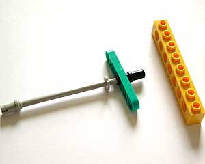
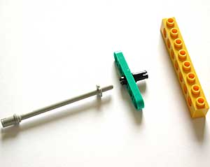

|  |  |
| --- | --- |
|  **Broches Technic à friction** L’ancien type à gauche, le nouveau à droite | Les broches Technic noires sont de deux type : l’ancien modèle, sans fente, et le nouveau type, apparu en 1990, qui comporte une fente permettant d’éviter le blocage de la broche dans le trou. |
|  **Méthode "classique"** | L’ancien modèle peut être particulièrement récalcitrant à extraire... la technique classique, préconisée par Lego®, consiste à chasser la broche à l’aide d’un axe emmanché. |
|  **Broche abimée** | Cette méthode a toutefois deux inconvenients, on peut abimer la broche (la poutre Technic peut l’être aussi si on dérape), et il faut pouvoir accéder à l’arrière de la broche. |

Voici donc en image une méthode, décrite par [Paul Krieg et David Arnon](http://news.lugnet.com/technic/?n=10909), qui évite ces deux problèmes.

Note :  
J’évite en général d’utiliser les anciennes broches dans mes constructions. Je les ai toutefois rangées soigneusement à part, car elle sont parfois utiles pour faire des montages particulièrement résistants.
