**C**a y est ! Le jour tant attendu (peut être redouté par certains :-)) est enfin arrivé. En ce jour du 27 janvier 2003 nous nous sommes donc retrouvés 5 sumos (je parle des robots pas des concepteurs de ceux-ci :-) ) prêts a faire mordre la ligne blanche aux autres. Voici donc pour vos yeux et oreilles impatientes l’histoire de ces combats épiques.

## Les forces en présence

[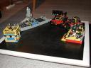](http://photos.freelug.org/photo.php?cat=12&num=180&expand=all)

**Les 5 SUMOS**

Nos sumos dans l’attente d’en decoudre ..

Voici le tableau qui résume les caractéristiques de nos combattants :

| Nom du robot | Nom de l’auteur | Poids | Photo | Strategie/technique |
| --- | --- | --- | --- | --- |
| Highlander | Gael | 965g | [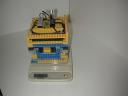](http://photos.freelug.org/photo.php?num=176&cat=12&expand=) | Technique dite du suicide .. Il fonce en avant jusqu’à "voir" la bande blanche, puis fonce en arrière jusqu’à voir l’autre bande blanche. La plupart du temps il ne fait qu’un aller-retour avant de tomber dans le vide :-)) 4 moteurs, vitesse maxi, mais peu de force. Pas de rotation, mais fou rire de série ! Un petit détail qui à son importance : Gaël à confondu 16 Cm, et 16 "Studs" de largeur. Il à donc le plus petit Sumo ce soir là ;o) |
| JLB1 (original non ?) | JLB | 1,015kg | [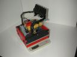](http://photos.freelug.org/photo.php?cat=12&num=177&expand=) | Avance droit devant lui en abaissant son rateau souleveur de sumo :-) Il dispose d’un détecteur de distance pour essayer de trouver son adversaire (marche mal), d’un détecteur de contact en face avant pour être sur qu’il pousse bien son adversaire et d’un capteur de lumière pour voir la bande blanche. La propulsion se fait par 2 moteurs qui utilisent des vis sans fin pour avoir un maximum de couple. |
| JLB2 (Encore mieux ..) | JLB | 905g | [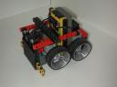](http://photos.freelug.org/photo.php?num=178&cat=12&expand=) | Robot rudimentaire propulse par 4 moteurs (un pour chaque roue). Il va droit devant lui jusqu’a tomber soit sur un adversaire (un capteur de contact en facade lui indique qu’il pousse), soit tomber sur une bande blanche. Dans ce dernier cas il tourne d’un angle aléatoire et repart droit devant lui. Le plus léger, et pourtant le plus efficace de ce tournoi ! |
| Juggernaut 1 | Philo | 960g | [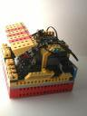](http://photos.freelug.org/photo.php?cat=12&num=162&expand=) | Belle gueule. L’idée astucieuse de placer des éléments de toit Fabuland en avant ! Il passe sous tout le monde ! (Si le système se déploie ? ;o) ). En plus de son allure, il joue "Pink Panther" pendant la phase de recherche, et grâce à un capteur "maison" de Philo, il détecte son adversaire, et passe en mode poussée, en jouant alors "StarWars" lol. Relativement puissant et rapide. Le juste milieu. |
| Orangina Rouge | Pascal | 1,435 Kg | [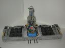](http://photos.freelug.org/photo.php?cat=12&num=170&expand=) | L’usine a gaz :-)) Compresseur, pour assurer le déploiement, et la sortie de griffes permettant d’éloigner les adversaires. Deux capteurs mécaniques en avant, et deux moteurs. Idem, dès qu’il apperçoit le bord, il recule et tourne aléatoirement. Très lent, mais les roues ne bloquent jamais, et la poussée est forte. Et le "sons et lumières" est assuré ;o)... et pourquoi Orangina Rouge ??? Parceque : "ça va saigner !" |

Pour ceux qui ne connaitraient pas encore les règles par coeur, vous pourrez les lire [ici](http://www.freelug.info/gen.php3/2002/03/11/3,0,1,0.php3)

## Les tournois

Les matchs ce sont passés sur le principe de poule (mais il n’y a eu qu’une poule unique pour cause du faible nombre de participants)

**Premiere Serie**

La

[

webcam

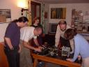

**Webcam**

Mise en place de la webcam mototisee pour l’enregistrement des combats.

](http://photos.freelug.org/photo.php?cat=12&num=13&expand=all)

et

[

l’arbitre

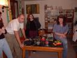

**L’arbitre**

l’arbitre est pret .. on peut lancer les hostilites :-)

](http://photos.freelug.org/photo.php?cat=12&num=19&expand=all)

sont pret .. on peut donc commencer les hostilites :

| Combattant 1 | Combattant 2 | Vainqueur | duree |
| --- | --- | --- | --- |
| Highlander | JLB2 | [JLB2](http://photos.freelug.org/photo.php?cat=12&num=16&expand=all) | 10" |
| Highlander | JLB1 | [JLB1](http://photos.freelug.org/photo.php?cat=12&num=18&expand=all) | 19" |
| Highlander | Juggernaut 1 | [Juggernaut 1](http://photos.freelug.org/photo.php?cat=12&num=21&expand=all) | 58" |
| Highlander | Orangina Rouge | Orangina Rouge | 10" |
| JLB2 | JLB1 | [JLB1](http://photos.freelug.org/photo.php?cat=12&num=25&expand=all) | 50" |
| JLB2 | Juggernaut 1 | [JLB2](http://photos.freelug.org/photo.php?cat=12&num=27&expand=all) | 9" |
| JLB2 | Orangina Rouge | [JLB2](http://photos.freelug.org/photo.php?cat=12&num=29&expand=all) | 22" |
| JLB1 | Juggernaut 1 | [Juggernaut 1](http://photos.freelug.org/photo.php?cat=12&num=33&expand=all) | 32" |
| JLB1 | Orangina Rouge | [JLB1](http://photos.freelug.org/photo.php?cat=12&num=35&expand=all) | 30" |
| Juggernaut 1 | Orangina Rouge | [Juggernaut 1 (par suicide de l’adversaire)](http://photos.freelug.org/photo.php?cat=12&num=38&expand=all) | 56" |

**Resultat de la premiere serie**

| Rang | Combattant | Victoires | Temps total |
| --- | --- | --- | --- |
| 1 | JLB2 | 3 | 41" |
| 2 | JLB1 | 3 | 99" |
| 3 | Juggernaut | 3 | 146" |
| 4 | Orangina Rouge | 1 | 58" |
| 5 | Highlander | 0 | na |

**Bagarre generale**

Cette premiere serie ne pouvait pas se finir sans une bonne [bagarre generale](http://photos.freelug.org/photo.php?cat=12&num=157&expand=all).

[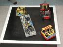](http://photos.freelug.org/photo.php?cat=12&num=202&expand=10,11)

**Entracte**

Pendant que certains revoyaient la

[

technique de leur robot

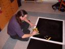

**ca bricole ..**

khan agrandit son sumo :-)

](http://photos.freelug.org/photo.php?cat=12&num=42&expand=all)

, d’autres se détendaient au volant de

[

voiture radio-commandée

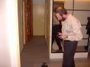

**Philo et la RC**

Philo se detend en jouant a la voiture RC.

](http://photos.freelug.org/photo.php?cat=12&num=40&expand=all)

 :-)

**Deuxieme serie**

On prend les mêmes dans l’ordre inverse et on recommence a se battre :-)

| Combattant 1 | Combattant 2 | Vainqueur | duree |
| --- | --- | --- | --- |
| Orangina Rouge | Juggernaut 1 | [Orangina Rouge](http://photos.freelug.org/photo.php?cat=12&num=69&expand=all) | 62" |
| Orangina Rouge | JLB1 | [JLB1](http://photos.freelug.org/photo.php?cat=12&num=73&expand=all) | 40" |
| Orangina Rouge | JLB2 | [JLB2](http://photos.freelug.org/photo.php?cat=12&num=75&expand=all) | 17" |
| Orangina Rouge | Highlander | [Orangina Rouge (apres un match nul)](http://photos.freelug.org/photo.php?cat=12&num=83&expand=all) | 120" |
| Juggernaut 1 | JLB1 | [Juggernaut](http://photos.freelug.org/photo.php?cat=12&num=88&expand=all) | 72" |
| Juggernaut 1 | JLB2 | [JLB2](http://photos.freelug.org/photo.php?cat=12&num=90&expand=all) | 15" |
| Juggernaut 1 | Highlander | [Highlander](http://photos.freelug.org/photo.php?cat=12&num=93&expand=all) | 10" |
| JLB1 | JLB2 | [JLB1](http://photos.freelug.org/photo.php?cat=12&num=95&expand=all) | 40" |
| JLB1 | Highlander | [JLB1](http://photos.freelug.org/photo.php?cat=12&num=97&expand=all) | 22" |
| JLB2 | Highlander | [JLB2 (apres 2 macths nuls)](http://photos.freelug.org/photo.php?cat=12&num=107&expand=all) | 40" |

NB : Highlander et Orangina Rouge ont légerement été modifiés avant la deuxieme série.  
Highlander est passé en puissance maxi sur les 4 moteurs, max de couple, mais aussi grande vitesse.

**Resultat de la deuxieme serie**

| Rang | Combattant | Victoires | Temps total |
| --- | --- | --- | --- |
| 1 | JLB2 | 3 | 72" |
| 2 | JLB1 | 3 | 95" |
| 3 | Orangina Rouge | 2 | 182" |
| 4 | Highlander | 1 | 10" |
| 5 | Juggernaut | 1 | 72" |

**Bagarre general (bis)**

Cette deuxième série n’echappe pas a la règle de la premiere : bagarre génerale.

[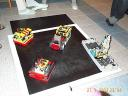](http://photos.freelug.org/photo.php?cat=12&num=149&expand=10,11)

## Resultats finaux

Voici les résultats finaux sur l’ensemble des 2 manches :

| Rang | Combattant | Victoires | Temps total |
| --- | --- | --- | --- |
| 1 | JLB2 | 6 | 113" |
| 2 | JLB1 | 6 | 194" |
| 3 | Juggernaut | 4 | 218" |
| 4 | Orangina Rouge | 3 | 240" |
| 5 | Highlander | 1 | 10" |

[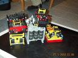](http://photos.freelug.org/photo.php?cat=12&num=157&expand=10,11)

**Podium Final**

Les perdants servent de podium aux vainqueurs :-)

**Bilan Strategique** : il etait inutile de chercher a faire un robot dans la finesse (qui cherche son adversaire ou bien qui utilise des verrins pneumatiques pour repousser le robot adverse). Le robot vainqueur a été fait en une soirée et a une stratégie des plus primaire : foncer droit devant jusqu’à heurter quelquechose ou voir la ligne blanche. Mais la stratégie n’a pas dit son dernier mot, car il y aura sûrement une revanche a ce premier concours :-))

Avis aux amateurs de concours SUMO pour la prochaine édition :-)

## Videos et images

Vous pouvez retrouver toutes les images ici : [Les photos](http://photos.freelug.org/diapo.php?cat=12&expand=10,11)

Les vidéos (faites avec une webcam, donc la qualité n’est pas excellente) sont téléchargeables ici : [Les videos](http://jlb.freelug.org/sumo_27012003/video/)

Les vidéos de Pascal (faites avec son appareil photo) sont [ici](http://perso.freelug.org/pbreard/) et sont de meilleure qualité que celles de la webcam.

## Epilogues

Nous avons tous passé une excellente soirée et nous nous sommes bien amusés. Merci a Philo et toute sa famille pour son acceuil. Peu importe le resultat final, l’essentiel était vraiment de participer et de bien se marrer. Bref vivement la prochaine édition :-)

[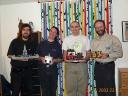](http://photos.freelug.org/photo.php?cat=12&num=159&expand=all)

**Nous ..**

Heureux d’avoir participe :-)

Une dernière petite photo pour le plaisir :-))

[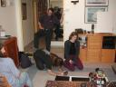](http://photos.freelug.org/photo.php?cat=12&num=209&expand=10,11)

**Insolite ..**

Mais que font ils donc ?
