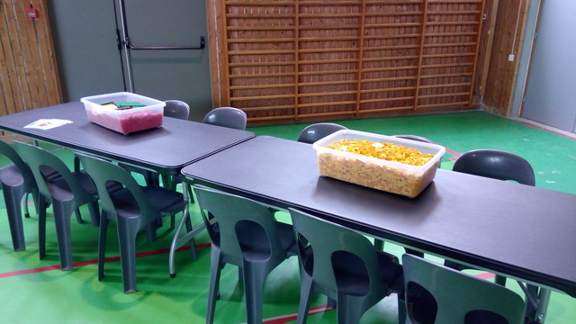
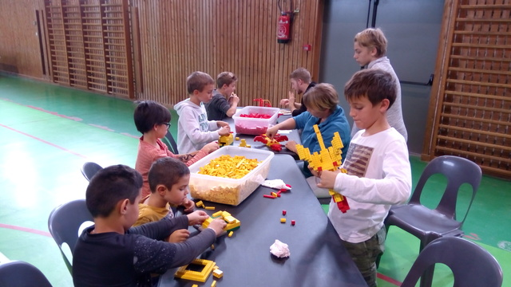
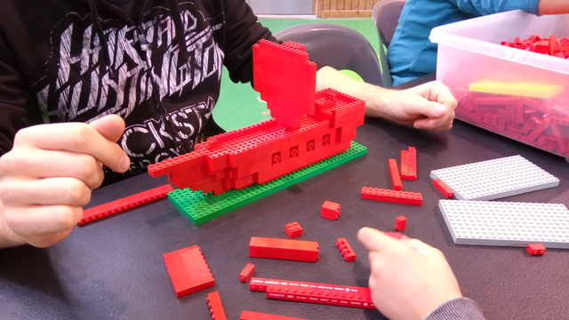
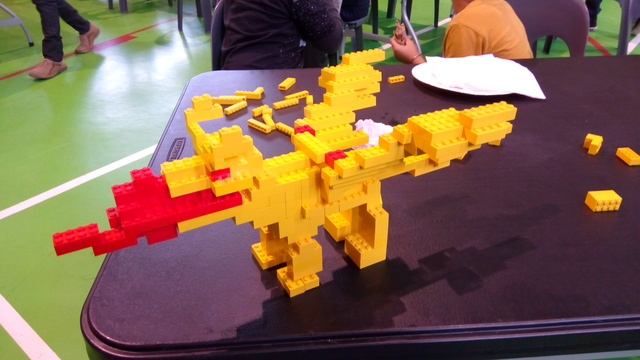
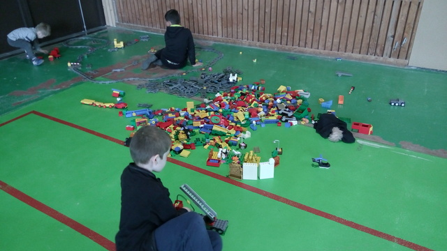
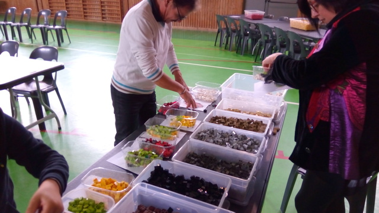
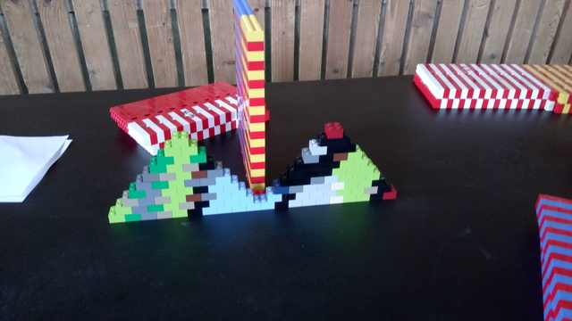
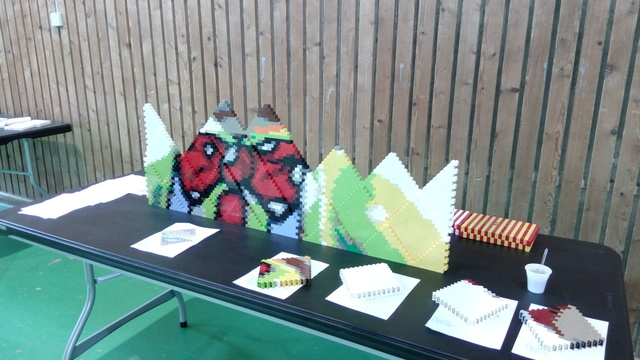
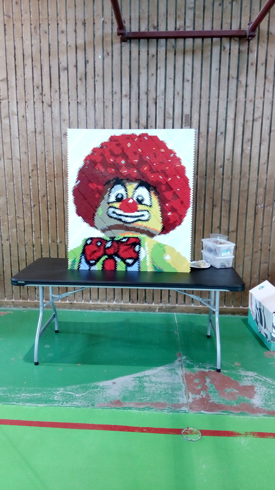
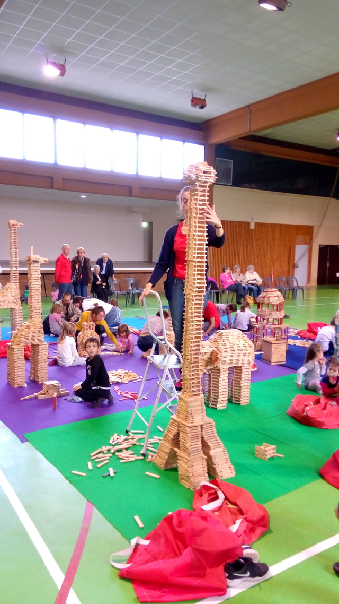

Dimanche 08 octobre 2017, nous étions conviés aux côtés de l’association [Une Frimousse pour Joshua](https://www.facebook.com/frimoussejoshua/) pour assurer une animation à l’aide de nos petites briques.

Nous avions mis à disposition les traditionnelles caisses de briques.

**Caisses de briques jaunes et rouges**

On est toujours surpris du succès rencontré par ces briques toutes simples et par l’imagination déployée par les enfants pour palier au manque de diversité des pièces mises à disposition :

**Stand de briques**

**Superbe bateau**

**Etrange créature**

Pour les plus petits, briques et trains Duplo occupaient un coin de la salle :

**Traditionnel coin Duplo**

Et bien sûr, la mosaïque, imaginée par Didier et Simon a rencontré un franc succès. Moins de deux heures auront suffit aux visiteurs pour venir à bout des 8000 pièces et voir apparaître le superbe clown coloré !

**Tout est prêt pour construire la mosaïque**

**Les premières briques que la mosaïque**

**La construction avance**

**La mosaïque terminée**

Ce fut une journée agréable, l’occasion de rencontrer de nouveaux adeptes du LEGO, de revoir des passionnés qui nous suivent sur nos diverses expositions et animations, et tout simplement de partager entre Afols.

D’autres activités étaient proposées également sur cette journée pour le bonheur des petits et des plus grands : Maquillage, tour de poney, Kapla.

Nous vous donnons rendez-vous certainement l’année à la même période pour une 3ème édition de la Frimoussette à St Just Chaleyssin, et le 1er Décembre à Diemoz pour une animation dans le cadre du Téléthon.
