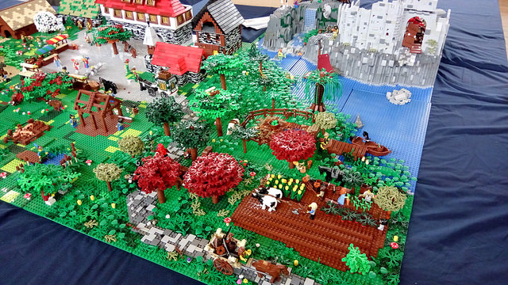
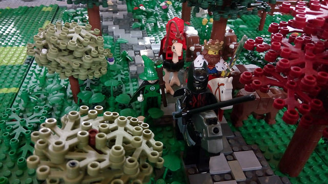
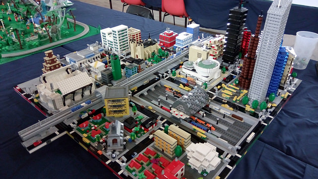
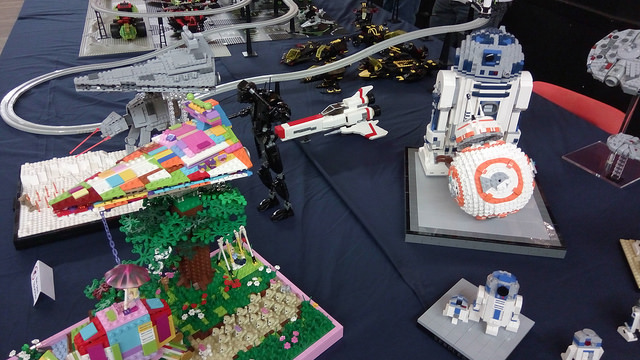
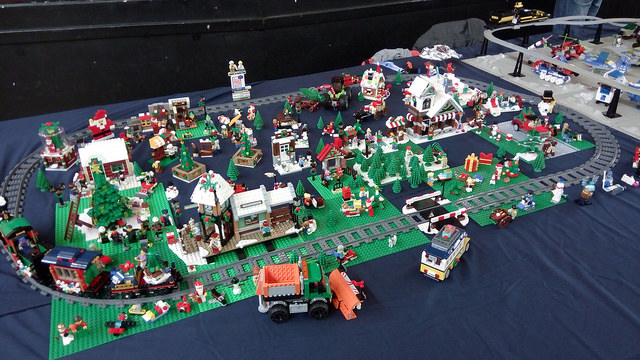
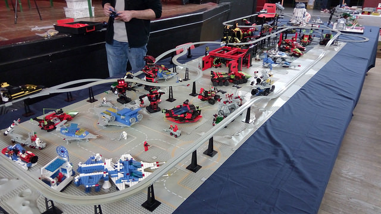
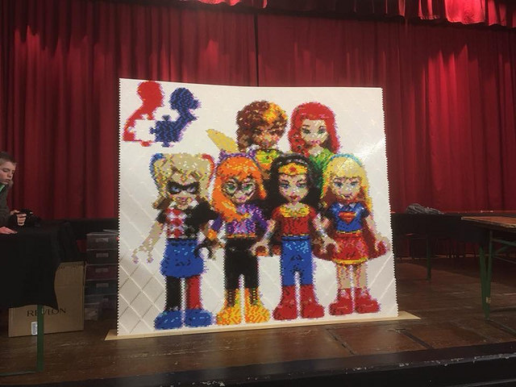

En 2016, les organisateurs de cette bourse aux jouets nous avaient sollicités pour venir exposer nos créations et collection sur une journée lors d’une bourse aux jouets. En 2018, nous avons ré-itéré l’opération sur un week-end.

En [2016](/articles/exposition-a-fontaines-sur-saone-le-7-fevrier-2016/), nous étions 17 à présenter diverses constructions aux habitants de Fontaines sur Saône. Cette année, 15 exposants ont une nouvelle fois répondu présents.

Cette année, avec Fabrice, nous présentions un diorama médiéval.

Même la Justice League s’était mise à jouer le jeu et revêtir sa tenue médiévale :)

A nos côtés, Loys a fait sensation avec sa ville à l’échelle micro.

La variété était une nouvelle fois au rendez-vous, avec du Star Wars, du Space, du City, etc.

Et bien sûr, la traditionnelle animation mosaïque permettait aux petits et grands de participer à une belle construction collaborative !

Rendez-vous dans 2 ans pour une prochaine !

Yannick/Yannoch06
